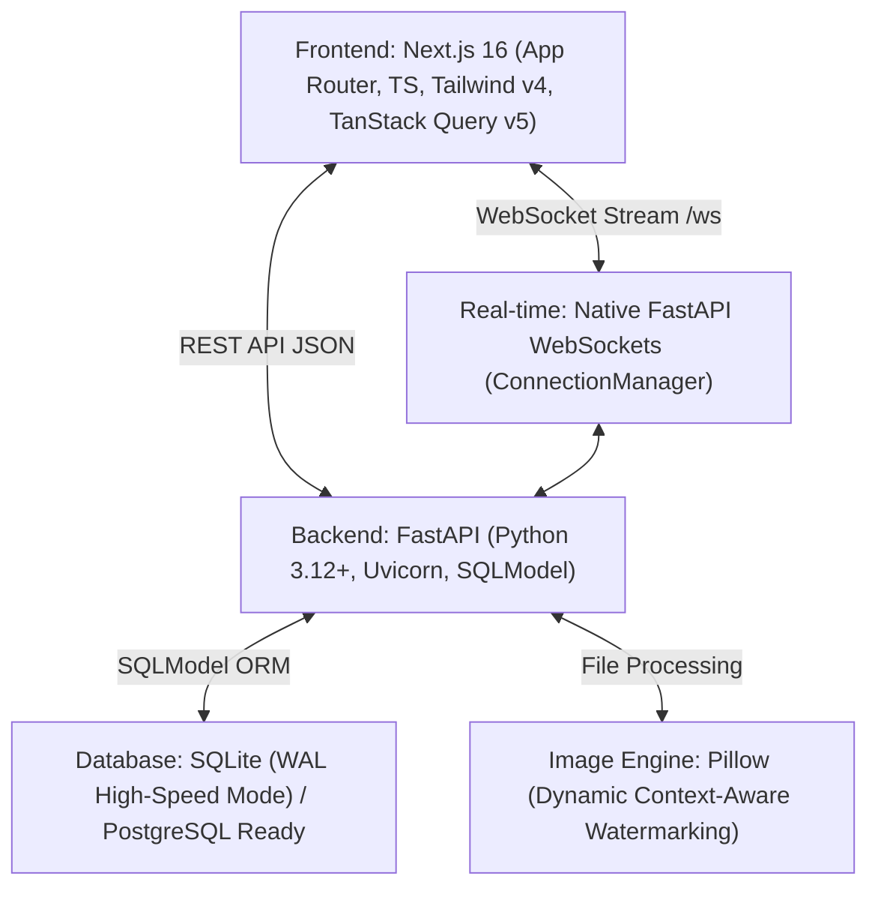
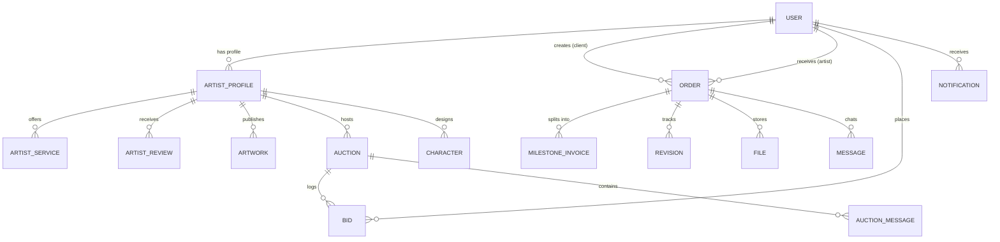
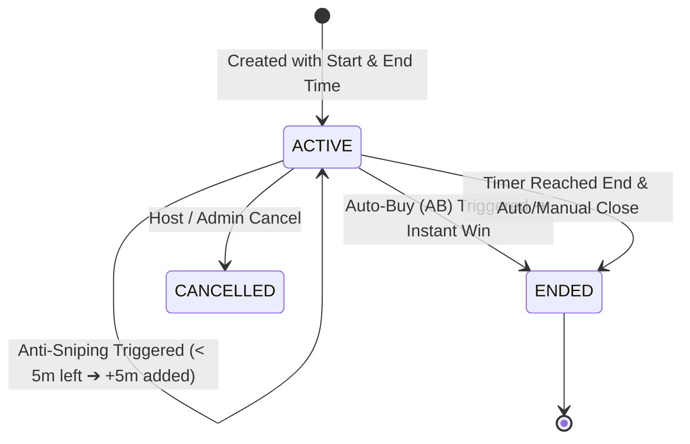
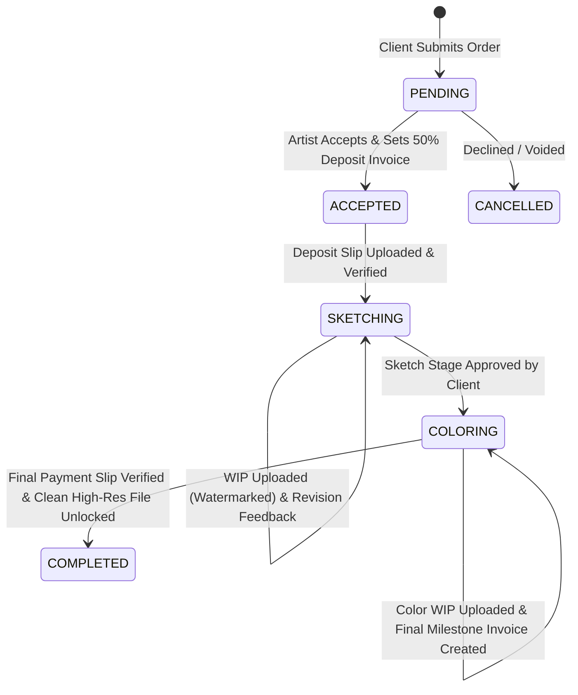

# 🎲 DICE PLATFORM — MASTER SPECIFICATION & SYSTEM PROMPT
> **Master Prompt Blueprint for Recreating or Spawning the DICE Platform Architecture**
> *Multi-Artist Commission Marketplace, Real-Time Live Auction, Milestone Billing & Character Ownership Registry*

---

## 📋 1. PROJECT IDENTITY & SYSTEM GOALS

### 1.1 Overview
**DICE** is a high-performance, multi-artist freelance platform engineered for digital illustrators, 2D character designers, VTuber riggers, and their clients (collectors, game studios, content creators). The platform integrates real-time live auctions with anti-sniping protection, milestone-based commission queue management, automated anti-theft watermarking, character adoptable genesis & ownership transfer tracking, and comprehensive revenue analytics.

### 1.2 Target User Roles
1. **Client (Buyer / Collector):**
   - Discovers artists and browse categorized portfolios.
   - Places real-time bids on live auctions (with Auto-Buy / AB capability).
   - Submits commission requests, tracks 5-stage progress via public queue boards.
   - Uploads bank transfer payment slips per milestone invoice.
   - Requests revisions within agreed quotas and leaves artist reviews.
   - Manages owned adoptable characters and transfers ownership.
2. **Artist (Creator / Studio Admin):**
   - Owns a dedicated studio profile (`/artists/[handle]`) with custom services and pricing.
   - Hosts real-time live auctions for adoptables or commission slots with anti-sniping timers.
   - Manages commission workflows (Pending ➔ Sketching ➔ Lining ➔ Coloring ➔ Completed).
   - Verifies milestone payment slips and automatically delivers watermarked WIPs vs clean final deliverables.
   - Monitors financial analytics (commission vs auction revenue, monthly charts).
3. **System Admin:**
   - Platform-wide user management, artist verification badges, dispute resolution, and global watermark presets.

---

## 📐 2. TECH STACK & ARCHITECTURAL FOUNDATION



| Layer | Technology | Key Highlights & Configuration |
| :--- | :--- | :--- |
| **Frontend Framework** | **Next.js 16 (App Router)** | TypeScript, React 19, Server & Client Components (`use client`) |
| **Styling & Design** | **Tailwind CSS v4 & CSS Variables** | Editorial Studio Dark/Light Theme, WCAG 2.2 AAA/AA Accessibility |
| **State & Data Fetching**| **TanStack React Query v5 + Axios** | Automatic cache invalidation, optimistic updates |
| **Internationalization** | **next-intl** | Bi-lingual support (`th` Thai & `en` English) via `/[locale]/...` |
| **Icons & Charts** | **Lucide React & Recharts** | Modern tactile icons, interactive revenue & order graphs |
| **Backend Framework** | **FastAPI (Python 3.12+)** | High-concurrency async endpoints, automatic OpenAPI docs |
| **ORM & Validation** | **SQLModel** | Unifies Pydantic v2 schemas and SQLAlchemy 2.0 ORM models |
| **Database Engine** | **SQLite with WAL Mode / PostgreSQL**| `PRAGMA journal_mode=WAL`, `synchronous=NORMAL`, `cache_size=-64000` |
| **Real-time Protocol** | **FastAPI WebSockets** | Event broadcasting for live auction bids, in-app notifications, and chat |
| **Image Processing** | **Pillow (PIL)** | Dynamic diagonal pattern & corner watermark generator with variable text replacement |
| **Security & Auth** | **OAuth2 Password Bearer + JWT** | `passlib[bcrypt]`, `python-jose`, role-based route guards |

---

## 🗄️ 3. DATABASE SCHEMA & DATA MODELS (SQLMODEL)



### 3.1 Base Enums & Shared Types
```python
from enum import Enum

class VisibilityStatus(str, Enum):
    PUBLIC = "PUBLIC"
    PRIVATE = "PRIVATE"
    CLIENT_ONLY = "CLIENT_ONLY"
    LINK_ONLY = "LINK_ONLY"

class OrderStatus(str, Enum):
    PENDING = "PENDING"
    ACCEPTED = "ACCEPTED"
    SKETCHING = "SKETCHING"
    COLORING = "COLORING"
    COMPLETED = "COMPLETED"
    CANCELLED = "CANCELLED"

class AuctionType(str, Enum):
    COMMISSION_SLOT = "COMMISSION_SLOT"
    ADOPTABLE = "ADOPTABLE"

class AuctionStatus(str, Enum):
    ACTIVE = "ACTIVE"
    ENDED = "ENDED"
    CANCELLED = "CANCELLED"

class WorkType(str, Enum):
    COMMISSION = "COMMISSION"
    FANART = "FANART"
    VTUBER_MODEL = "VTUBER_MODEL"
    ILLUSTRATION = "ILLUSTRATION"
    SKETCH = "SKETCH"
    COMIC = "COMIC"
    LIVE2D = "LIVE2D"
    CONCEPT_ART = "CONCEPT_ART"

class NotificationType(str, Enum):
    AUCTION = "AUCTION"
    ORDER = "ORDER"
    SYSTEM = "SYSTEM"
```

### 3.2 SQLModel Entities
```python
from typing import Optional, List
from datetime import datetime
from sqlmodel import SQLModel, Field, Relationship

# --- USER & ARTIST PROFILE ---
class User(SQLModel, table=True):
    id: Optional[int] = Field(default=None, primary_key=True)
    email: str = Field(unique=True, index=True)
    full_name: str
    hashed_password: Optional[str] = None
    is_admin: bool = Field(default=False)
    is_artist: bool = Field(default=False)
    avatar_url: Optional[str] = None
    created_at: datetime = Field(default_factory=datetime.utcnow)

    notifications: List["Notification"] = Relationship(back_populates="user")

class ArtistProfile(SQLModel, table=True):
    id: Optional[int] = Field(default=None, primary_key=True)
    user_id: Optional[int] = Field(default=None, foreign_key="user.id", index=True)
    handle: str = Field(unique=True, index=True)
    display_name: str
    tagline: str
    bio: str
    avatar_url: Optional[str] = None
    banner_url: Optional[str] = None
    styles: str = "Anime, Character Sheet, VTuber 2D"
    commission_status: str = "OPEN" # OPEN, CLOSED, WAITLIST
    rating: float = 5.0
    total_completed_orders: int = 0
    starting_price: float = 500.0
    social_twitter: Optional[str] = None
    social_pixiv: Optional[str] = None
    social_discord: Optional[str] = None
    is_verified: bool = True
    is_featured: bool = False
    created_at: datetime = Field(default_factory=datetime.utcnow)

class ArtistService(SQLModel, table=True):
    id: Optional[int] = Field(default=None, primary_key=True)
    artist_id: int = Field(foreign_key="artistprofile.id", index=True)
    title: str
    category: str
    description: str
    base_price: float
    estimated_days: int = 7
    includes_commercial: bool = True
    includes_psd: bool = True
    sample_image_url: Optional[str] = None
    created_at: datetime = Field(default_factory=datetime.utcnow)

class ArtistReview(SQLModel, table=True):
    id: Optional[int] = Field(default=None, primary_key=True)
    artist_id: int = Field(foreign_key="artistprofile.id", index=True)
    client_name: str
    rating: int = Field(default=5, ge=1, le=5)
    comment: str
    created_at: datetime = Field(default_factory=datetime.utcnow)

# --- PORTFOLIO & CHARACTERS ---
class Character(SQLModel, table=True):
    id: Optional[int] = Field(default=None, primary_key=True)
    name: str
    description: Optional[str] = None
    theme_color: Optional[str] = None
    image_url: Optional[str] = None
    artist_id: Optional[int] = Field(default=None, foreign_key="artistprofile.id", index=True)
    created_at: datetime = Field(default_factory=datetime.utcnow)

class Artwork(SQLModel, table=True):
    id: Optional[int] = Field(default=None, primary_key=True)
    artist_id: Optional[int] = Field(default=None, foreign_key="artistprofile.id", index=True)
    character_id: Optional[int] = Field(default=None, foreign_key="character.id")
    title: str
    description: Optional[str] = None
    image_url: str
    visibility_status: VisibilityStatus = Field(default=VisibilityStatus.PUBLIC)
    work_type: WorkType = Field(default=WorkType.ILLUSTRATION)
    client_link: Optional[str] = None
    created_at: datetime = Field(default_factory=datetime.utcnow)

# --- LIVE AUCTIONS & BIDS ---
class Auction(SQLModel, table=True):
    id: Optional[int] = Field(default=None, primary_key=True)
    artist_id: Optional[int] = Field(default=None, foreign_key="artistprofile.id", index=True)
    winner_id: Optional[int] = Field(default=None, foreign_key="user.id", index=True)
    title: str
    description: str
    image_url: Optional[str] = None
    auction_type: AuctionType = Field(default=AuctionType.ADOPTABLE, index=True)
    status: AuctionStatus = Field(default=AuctionStatus.ACTIVE, index=True)
    starting_bid: float
    bid_increment: float
    auto_buy: Optional[float] = None
    winning_bid: Optional[float] = None
    start_time: datetime
    end_time: datetime = Field(index=True)
    created_at: datetime = Field(default_factory=datetime.utcnow)

    bids: List["Bid"] = Relationship(back_populates="auction")
    messages: List["AuctionMessage"] = Relationship(back_populates="auction")

class Bid(SQLModel, table=True):
    id: Optional[int] = Field(default=None, primary_key=True)
    auction_id: int = Field(foreign_key="auction.id", index=True)
    bidder_id: int = Field(foreign_key="user.id", index=True)
    amount: float
    created_at: datetime = Field(default_factory=datetime.utcnow, index=True)

    auction: Auction = Relationship(back_populates="bids")
    bidder: User = Relationship()

class AuctionMessage(SQLModel, table=True):
    id: Optional[int] = Field(default=None, primary_key=True)
    auction_id: int = Field(foreign_key="auction.id", index=True)
    sender_id: int = Field(foreign_key="user.id", index=True)
    content: str
    created_at: datetime = Field(default_factory=datetime.utcnow, index=True)

    auction: Auction = Relationship(back_populates="messages")
    sender: User = Relationship()

# --- COMMISSIONS, MILESTONES & REVISIONS ---
class Order(SQLModel, table=True):
    id: Optional[int] = Field(default=None, primary_key=True)
    client_id: int = Field(foreign_key="user.id")
    artist_id: int = Field(default=1, foreign_key="user.id")
    title: str
    description: str
    status: OrderStatus = Field(default=OrderStatus.PENDING)
    agreed_price: Optional[float] = None
    revision_quota: int = Field(default=3)
    start_date: Optional[datetime] = None
    due_date: Optional[datetime] = None
    created_at: datetime = Field(default_factory=datetime.utcnow)

    milestone_invoices: List["MilestoneInvoice"] = Relationship(back_populates="order")
    revisions: List["Revision"] = Relationship(back_populates="order")
    files: List["File"] = Relationship(back_populates="order")
    messages: List["Message"] = Relationship(back_populates="order")

class MilestoneInvoice(SQLModel, table=True):
    id: Optional[int] = Field(default=None, primary_key=True)
    order_id: int = Field(foreign_key="order.id")
    title: str # "50% Deposit", "Final Payment"
    amount: float
    is_paid: bool = Field(default=False)
    slip_image_url: Optional[str] = None
    created_at: datetime = Field(default_factory=datetime.utcnow)

    order: Order = Relationship(back_populates="milestone_invoices")

class Revision(SQLModel, table=True):
    id: Optional[int] = Field(default=None, primary_key=True)
    order_id: int = Field(foreign_key="order.id")
    client_feedback: str
    is_addressed: bool = Field(default=False)
    created_at: datetime = Field(default_factory=datetime.utcnow)

    order: Order = Relationship(back_populates="revisions")

class File(SQLModel, table=True):
    id: Optional[int] = Field(default=None, primary_key=True)
    order_id: int = Field(foreign_key="order.id")
    filename: str
    s3_key: str
    is_watermarked: bool = Field(default=False)
    file_type: str # 'WIP', 'FINAL', 'REFERENCE'
    uploaded_at: datetime = Field(default_factory=datetime.utcnow)

    order: Order = Relationship(back_populates="files")

class Message(SQLModel, table=True):
    id: Optional[int] = Field(default=None, primary_key=True)
    order_id: int = Field(foreign_key="order.id")
    sender_id: int = Field(foreign_key="user.id")
    content: str
    created_at: datetime = Field(default_factory=datetime.utcnow)

    order: Order = Relationship(back_populates="messages")
    sender: User = Relationship()

# --- NOTIFICATIONS & SYSTEM SETTINGS ---
class Notification(SQLModel, table=True):
    id: Optional[int] = Field(default=None, primary_key=True)
    user_id: int = Field(foreign_key="user.id")
    title: str
    message: str
    link: Optional[str] = None
    is_read: bool = Field(default=False)
    type: NotificationType = Field(default=NotificationType.SYSTEM)
    created_at: datetime = Field(default_factory=datetime.utcnow)

    user: User = Relationship(back_populates="notifications")

class SystemSetting(SQLModel, table=True):
    key: str = Field(primary_key=True)
    value: str
```

---

## ⚡ 4. CORE BUSINESS LOGIC & STATE MACHINES

### 4.1 Real-Time Live Auction & Anti-Sniping Engine

1. **Bidding Rules:**
   - First bid must be `>= starting_bid`.
   - Subsequent bids must be `>= (highest_bid + bid_increment)`.
   - Bidders cannot bid if auction status is `ENDED` or `CANCELLED`.
2. **Auto-Buy (AB):**
   - If `auto_buy` is defined and `bid_amount >= auto_buy`, the auction immediately concludes (`status = ENDED`), assigning the bidder as `winner_id` and setting `winning_bid = auto_buy`.
3. **Anti-Sniping Protocol:**
   - If a valid bid is recorded within **5 minutes** of `end_time`, the server extends `end_time = datetime.utcnow() + timedelta(minutes=5)`.
   - A WebSocket event is instantly broadcast to all connected clients updating the remaining time.

### 4.2 Commission Pipeline & Milestone Billing Workflow

1. **Revision Quota:**
   - Each order has a `revision_quota` (default: 3). Clients submit revision requests that decrease the remaining allowance.
2. **Dynamic Anti-Theft Watermarking Engine:**
   - All WIP files and unfinalized deliverables automatically pass through Pillow before storage/preview.
   - Text template variables: `{order_id}`, `{artist}`, `{client}`, `{date}`, `{status}`.
   - Unwatermarked high-resolution files are only accessible after all milestone invoices are marked `is_paid = True`.

---

## 📡 5. REST API & WEBSOCKET SPECIFICATION

### 5.1 Authentication (`/api/auth`)
- `POST /api/auth/register` — Create user account (`email`, `password`, `full_name`, `is_artist`).
- `POST /api/auth/token` — OAuth2 Login returning `{ access_token, token_type, user }`.
- `GET /api/auth/me` — Retrieve current authenticated user profile and roles.

### 5.2 Multi-Artist Hub (`/api/artists`)
- `GET /api/artists` — Query all artists with filters (`style`, `search`, `commission_status`).
- `GET /api/artists/{handle}` — Retrieve full artist studio details (services, reviews, queue, adoptables).
- `POST /api/artists/register` — Real DB artist onboarding form.
- `POST /api/artists/{handle}/services` — Create studio service packages (base price, commercial rights).
- `POST /api/artists/{handle}/reviews` — Submit client star rating and review comment.
- `GET /api/artists/{handle}/queue` — Public commission queue status board.

### 5.3 Live Auctions (`/api/auctions`)
- `GET /api/auctions` — List active/upcoming/ended auctions.
- `GET /api/auctions/{id}` — Auction details with bid history and live chat log.
- `POST /api/auctions/` — Create auction (starting bid, increment, auto buy, end time).
- `POST /api/auctions/{id}/bid` — Place bid with server-side validation & anti-sniping extension.
- `POST /api/auctions/{id}/close` — Close auction and declare winner.
- `POST /api/auctions/{id}/messages` — Send message in auction live chat.

### 5.4 Commissions & Orders (`/api/orders`)
- `POST /api/orders/` — Submit commission order request.
- `GET /api/orders/` — List orders filtered by client or artist role.
- `GET /api/orders/{id}` — Order details, milestone invoices, WIP files, revisions, chat.
- `PATCH /api/orders/{id}/status` — Advance order status (`PENDING` ➔ `SKETCHING` ➔ `COLORING` ➔ `COMPLETED`).
- `POST /api/orders/{id}/milestones` — Create milestone payment invoice.
- `POST /api/orders/{id}/milestones/{milestone_id}/slip` — Upload transfer receipt slip.
- `PATCH /api/orders/{id}/milestones/{milestone_id}/verify` — Verify and approve payment slip.
- `POST /api/orders/{id}/files` — Upload WIP (watermarked) or final deliverable.
- `POST /api/orders/{id}/revisions` — Submit revision request against quota.

### 5.5 Portfolio & Characters (`/api/portfolio`, `/api/characters`)
- `GET /api/portfolio` — Fetch gallery artworks with category and tag filters.
- `POST /api/portfolio` — Upload new portfolio artwork.
- `GET /api/characters` — List registered characters / adoptables with owner histories.
- `POST /api/characters` — Register adoptable character genesis.
- `PATCH /api/characters/{id}/transfer` — Transfer character ownership to another user.

### 5.6 Revenue Analytics (`/api/analytics`)
- `GET /api/analytics/dashboard` — Calculate total revenue, commission vs auction split, monthly trends.

### 5.7 WebSockets (`/ws?token={jwt}`)
- Bid Broadcast: `{"event": "BID_PLACED", "auction_id": 1, "amount": 1500, "bidder": "Client A"}`
- Anti-Sniping Extension: `{"event": "AUCTION_EXTENDED", "auction_id": 1, "new_end_time": "..."}`
- Notification: `{"event": "NOTIFICATION", "type": "ORDER", "title": "Deposit Approved"}`

---

## 🎨 6. DESIGN SYSTEM & ACCESSIBILITY (WCAG 2.2 AAA/AA)

### 6.1 Studio Editorial Design Philosophy
- **Style:** Tactical Creator Portal & Studio Editorial.
- **Tone:** Crisp, high-contrast, tactile, zero generic AI slop.
- **Banned Anti-Patterns:**
  - ❌ No floating blurry color blobs (`blur-[100px]`).
  - ❌ No rainbow gradient text (`bg-gradient-to-r text-transparent`).
  - ❌ No nested over-rounded cards (`rounded-3xl` in `rounded-3xl`). Use clean `rounded-xl` with 1px border.

### 6.2 Design Tokens & Themes
| Token | Dark Mode (Default) | Light Mode |
| :--- | :--- | :--- |
| **Canvas Background** | `#09090b` (Obsidian Dark) | `#ffffff` / `#fdfdfd` |
| **Card Surface** | `#121215` (Studio Slate) | `#f4f4f6` |
| **Borders** | `#27272a` (Crisp Zinc 1px) | `#cccccc` |
| **Primary Accent** | `#3b82f6` (Studio Cobalt) | `#002bdc` |
| **Secondary Accent**| `#e2b857` (Warm Gold / Amber) | `#d97706` |
| **Status Active/Open**| `#10b981` (Emerald) | `#059669` |
| **Status Destructive**| `#ef4444` (Rose) | `#dc2626` |

### 6.3 Universal Accessibility Standards
1. **Touch Target Size:** Minimum **44x44px** (ideally 48x48px) for all buttons and interactive controls.
2. **Multi-Modal Dual-Coding:** Status badges must always pair **Color + Icon + Text Label** (e.g., `✓ [Active]`, `⚠️ [Pending]`, `✕ [Closed]`).
3. **Tabular Numerics:** Apply `font-variant-numeric: tabular-nums` to financial amounts and countdown clocks to eliminate horizontal jitter.
4. **Keyboard Focus:** Explicit 3px outline on `:focus-visible` with 2px offset.

---

## 🖥️ 7. FRONTEND ARCHITECTURE & DIRECTORY STRUCTURE

```
frontend/
├── messages/                     # next-intl translations
│   ├── en.json                   # English locale dictionary
│   └── th.json                   # Thai locale dictionary
├── public/                       # Static assets
└── src/
    ├── middleware.ts             # next-intl locale routing middleware
    ├── i18n/                     # i18n request configuration
    ├── lib/                      # API client (Axios), Auth context, Query client
    │   ├── api.ts                # Axios instance with JWT interceptor
    │   ├── auth.tsx              # AuthContext & useAuth hook
    │   └── websocket.ts          # WebSocket client manager
    ├── components/               # Reusable UI component library
    │   ├── Navbar.tsx            # Sticky header with locale/theme switcher
    │   ├── Footer.tsx            # Studio footer
    │   ├── LiveAuctionCard.tsx   # Auction countdown & instant bid card
    │   ├── QueueBoard.tsx        # Public commission progress tracker
    │   ├── WatermarkPreview.tsx  # Dynamic canvas/SVG watermark preview
    │   └── ui/                   # Buttons, Modals, Badges, Form Inputs
    └── app/
        ├── globals.css           # Tailwind v4 & Theme CSS variables
        └── [locale]/             # Localized App Router Root
            ├── layout.tsx        # Root HTML layout with providers
            ├── page.tsx          # Landing page & Multi-Artist hub
            ├── login/page.tsx    # Auth login / register screen
            ├── artists/
            │   ├── page.tsx      # Artist directory search & filter
            │   ├── register/page.tsx # Real DB Artist onboarding form
            │   └── [handle]/page.tsx # Studio profile (6 tabs: About, Services, Gallery, Queue, Adoptables, Reviews)
            ├── auctions/
            │   ├── page.tsx      # Live auctions index
            │   └── [id]/page.tsx # Live auction room (Real-time bids, AB, Chat, Timer)
            ├── characters/page.tsx # Adoptable & Character ownership ledger
            ├── portfolio/page.tsx # Curated gallery with lightbox
            └── dashboard/page.tsx # Role-based dashboard (Artist queue / Client orders / Analytics)
```

---

## 🛠️ 8. STEP-BY-STEP EXECUTION INSTRUCTIONS FOR AI AGENT

When tasked with generating or expanding this project, follow this exact sequence:

### Step 1: Initialize Backend & Database Setup
1. Create `backend/` environment with Python 3.12+ and `requirements.txt` (`fastapi`, `uvicorn`, `sqlmodel`, `pillow`, `python-jose`, `passlib[bcrypt]`, `python-multipart`).
2. Set up `backend/core/db.py` configured with high-speed SQLite WAL pragmas and automatic schema creation via `init_db()`.
3. Implement `backend/core/auth.py` for JWT signing/decoding and bcrypt password hashing.
4. Implement `backend/core/websocket.py` with `ConnectionManager` to manage user connections and broadcast channel events.
5. Implement `backend/core/watermark.py` with Pillow diagonal text/stamp generator supporting token interpolation (`{order_id}`, `{artist}`, `{client}`, `{date}`, `{status}`).

### Step 2: Seed Default Accounts & Build Routers
1. Implement all SQLModel entities in `backend/models/`.
2. Seed 3 default accounts upon startup in `backend/main.py`:
   - Admin: `admin@example.com` / `password123`
   - Artist: `artist@example.com` / `password123` (Handle: `main_artist`)
   - Client: `client@example.com` / `password123`
3. Implement API routers: `auth.py`, `artists.py`, `auctions.py`, `orders.py`, `portfolio.py`, `characters.py`, `analytics.py`, `system.py`.

### Step 3: Initialize Frontend & UI Component Library
1. Initialize Next.js 16 App Router in `frontend/` with TypeScript and Tailwind CSS v4.
2. Configure `next-intl` in `frontend/src/middleware.ts` and provide `messages/en.json` and `messages/th.json`.
3. Set up `@tanstack/react-query` and `Axios` interceptor with auto JWT token attachment.
4. Construct shared components honoring Studio Editorial design and WCAG 2.2 guidelines.

### Step 4: Build Core Feature Views
1. **Multi-Artist Hub & Registration:** Build `/[locale]/artists` and `/[locale]/artists/[handle]` with 6 sub-tabs and real DB onboarding at `/[locale]/artists/register`.
2. **Real-time Live Auction Room:** Build `/[locale]/auctions/[id]` featuring server-synced countdown timer, Quick Bid (+increment), Auto-Buy (AB), live bid log, and anti-sniping notices.
3. **Commission Workflow & Billing:** Build `/[locale]/dashboard` with 5-stage progress updater, milestone invoice generator, slip uploader, and watermarked WIP deliverable viewer.
4. **Adoptable Registry & Gallery:** Build `/[locale]/characters` and `/[locale]/portfolio` with ownership badges and category filters.
5. **Artist Revenue Analytics:** Build interactive Recharts dashboard inside `/[locale]/dashboard` breaking down Commission vs Auction revenue over time.

---

## 🧪 9. VERIFICATION & TEST CRITERIA

Before declaring the project complete, verify the following test cases:

1. **Authentication & Multi-Artist DB Test:**
   - Register a new artist via `POST /api/artists/register` with custom handle.
   - Access `http://localhost:3000/th/artists/{new_handle}` and ensure all tabs load from SQLite.
2. **Live Auction & Anti-Sniping Test:**
   - Create auction with 2-minute end time.
   - Place a bid at 1 minute remaining ➔ Ensure `end_time` extends by 5 minutes.
   - Click "Auto Buy" ➔ Ensure auction status transitions to `ENDED` immediately and winner is assigned.
3. **Milestone Billing & Watermark Test:**
   - Create commission order with 50% deposit and 50% final payment.
   - Upload WIP file ➔ Verify image is watermarked with order metadata.
   - Upload and approve payment slips for 100% ➔ Verify clean final image is unlocked.
4. **Real-time Synchronization Test:**
   - Open auction room in two separate browser tabs. Place a bid in Tab A ➔ Tab B updates immediately without manual page refresh.
