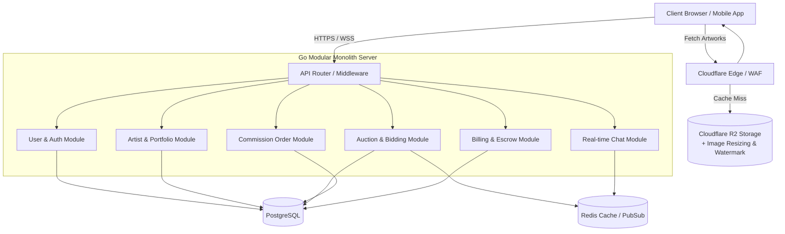

# DICE Platform: System Architecture Blueprint

## 1. ภาพรวมสถาปัตยกรรม (Architecture Overview)
DICE Platform ถูกออกแบบภายใต้คอนเซปต์ **Modular Monolith** ร่วมกับ **Clean Architecture** ซึ่งหมายความว่าในระยะแรก ระบบทั้งหมดจะทำงานอยู่บนเซิร์ฟเวอร์เดียวเพื่อประหยัดต้นทุนและทรัพยากร (Lightweight & Cost-effective) แต่ภายในซอร์สโค้ดจะถูกแบ่งขอบเขตเป็น "โมดูล" (Modules) อย่างชัดเจนและเป็นอิสระต่อกัน เมื่อใดที่ทราฟฟิกฝั่งใดฝั่งหนึ่งสูงขึ้น (เช่น ระบบประมูล) เราสามารถดึงเฉพาะโมดูลนั้นแยกออกไปเป็น **Microservices** ได้ทันทีโดยที่โค้ดไม่เละครับ

## 2. เทคโนโลยีที่เลือกใช้ (The "Light, Fast & Clean" Stack)
จากการวิเคราะห์ ผมขอเสนอ Stack ที่เร็วที่สุด กินทรัพยากรน้อยที่สุด และจัดการโค้ดได้คลีนที่สุดครับ:

- **Frontend (Web Application):** `Next.js (React) + TypeScript + Tailwind CSS`
  - *เหตุผล:* โหลดหน้าเว็บได้เร็วด้วย Server-Side Rendering (SSR) ดีต่อ SEO ของศิลปิน และมีระบบ Ecosystem ที่ยอดเยี่ยมในการทำ UI ที่สวยงามและคลีน
- **Backend (API & Business Logic):** `Go (Golang) + Fiber Framework`
  - *เหตุผล:* Go เป็นภาษาที่เด่นมากเรื่องความเร็วและกินทรัพยากรเครื่องน้อยมาก (Low Memory Footprint) เหมาะกับการทำ Clean Architecture อย่างยิ่ง และรองรับการทำระบบ Real-time (Concurrency) ได้ดีเยี่ยม
- **Database:** `PostgreSQL`
  - *เหตุผล:* จัดการข้อมูลที่มีความสัมพันธ์ซับซ้อน (เช่น การทำธุรกรรม, บิล, ข้อมูลผู้ใช้) ได้อย่างแม่นยำ ปลอดภัย และเสถียรที่สุด
- **Storage & CDN:** `Cloudflare R2`
  - *เหตุผล:* จัดเก็บภาพความละเอียดสูงได้ในราคาที่ถูกมาก (ไม่มีค่า Egress Fee) รองรับการทำ Dynamic Image Resizing และ Watermarking ได้ผ่าน Cloudflare Edge ทันที ทำให้ประหยัดแรงเซิร์ฟเวอร์เราไปได้มหาศาล
- **Cache & Real-time:** `Redis`
  - *เหตุผล:* ใช้สำหรับจัดการระบบ Real-time Chat ใน Commission Room, ทำ Live Bidding สำหรับระบบ Auction, และ Caching ข้อมูลเพื่อความรวดเร็ว

## 3. ผังโครงสร้างสถาปัตยกรรม (System Architecture Diagram)

## 4. โครงสร้างภายในแต่ละโมดูล (Clean Layered Architecture)
เพื่อป้องกันโค้ด "เละ" ภายในแต่ละโมดูลของ Go (เช่น โมดูล Commission) จะถูกแบ่ง Layer อย่างเข้มงวด:
1. **Delivery/Handler Layer:** รับ Request จากหน้าเว็บ (HTTP/WebSockets)
2. **Usecase Layer:** หัวใจหลักของระบบ ใส่ Business Logic ทั้งหมดที่นี่ (เช่น ตรวจสอบความถูกต้องของการสั่ง Commission)
3. **Repository Layer:** ทำหน้าที่คุยกับ Database (PostgreSQL/Redis) เพียงอย่างเดียว
4. **Domain Layer:** เก็บ Data Models (Structs) และ Interfaces ทั้งหมด

## 5. แผนการดำเนินงาน (Next Action Plan)
เพื่อให้โครงการดำเนินไปอย่างเป็นระบบ ผมขอเสนอแผนงานเป็นเฟสดังนี้ครับ:

- **Phase 1: Foundation & DevOps Setup**
  - ติดตั้งโปรเจกต์โครงสร้างของ Next.js และ Go Clean Architecture
  - เชื่อมต่อ PostgreSQL และระบบ Authentication เบื้องต้น
- **Phase 2: Identity, Portfolio & Storage**
  - ทำระบบสมัครสมาชิก/ยืนยันตัวตนศิลปิน
  - เชื่อมต่อระบบอัปโหลดภาพไปที่ Cloudflare R2 พร้อมระบบลายน้ำ (Watermarking)
- **Phase 3: Commission Engine & Chat Workspace**
  - สร้างระบบรับงาน Commission และออก Milestone Invoices
  - สร้างห้องแชท Real-time สำหรับการคุยและส่ง Draft งาน
- **Phase 4: Auction & Escrow Integration**
  - ระบบประมูลแบบ Real-time (Live Bidding)
  - เชื่อมต่อ Payment Gateway สำหรับระบบ Escrow และการชำระเงิน
