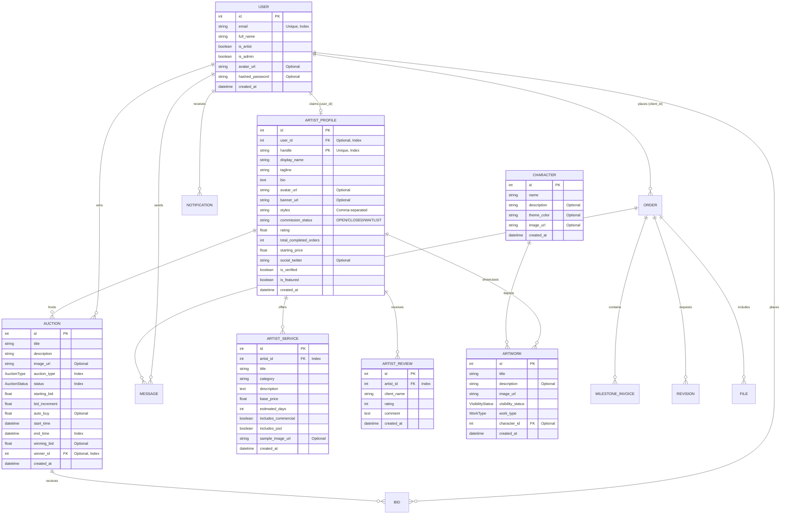

# Database Entity-Relationship (ER) Diagram

This document describes the database schema for the application, built using **SQLModel / SQLAlchemy** and SQLite in High-Performance WAL Mode.

## ER Diagram (Mermaid)

Below is the visual representation of the database tables and their relationships.

---

## Detailed Schema Definitions

### 1. User (`User`)
Represents registered accounts on the platform (Clients, Artists, Administrators).
* **Relationships**:
  * Optionally links to 1 `ArtistProfile` (`user_id`).
  * Places many `Order`s (`client_id`).
  * Receives many `Notification`s (`user_id`).

### 2. Artist Profile (`ArtistProfile`)
Represents individual artist studio profiles in the multi-artist marketplace.
* **Fields**:
  * `handle`: Unique URL identifier (e.g. `@kiriko_art`).
  * `display_name`: Studio name / Pen name.
  * `styles`: Multi-style tags (e.g. `VTuber 2D, Anime Full Body`).
  * `commission_status`: `OPEN`, `CLOSED`, `WAITLIST`.

### 3. Artist Service (`ArtistService`)
Represents pricing packages offered by an artist.
* **Relationships**:
  * Belongs to an `ArtistProfile` (`artist_id`).

### 4. Artist Review (`ArtistReview`)
Represents client ratings and testimonials for an artist.
* **Relationships**:
  * Belongs to an `ArtistProfile` (`artist_id`).
