# รายละเอียดโมดูลระบบงานย่อยที่พัฒนาแล้วเสร็จ (Implemented Subsystems Specification)
**หัวข้อโครงงาน:** แพลตฟอร์มการจัดการคอมมิชชันและประมูลผลงานศิลปะสำหรับศิลปินฟรีแลนซ์ (Freelance Art Commission and Live Auction Management Platform)

เอกสารฉบับนี้รวบรวมรายละเอียดข้อกำหนดและคุณลักษณะเฉพาะของ **"ระบบงานย่อยที่พัฒนาและใช้งานได้จริงแล้วในปัจจุบัน"** อ้างอิงโดยตรงจากไฟล์ซอร์สโค้ดในโครงงาน เพื่อใช้ประกอบการเขียน **บทที่ 3 (การออกแบบระบบ)** และ **บทที่ 4 (การผลการดำเนินงาน)** ในเล่มบัณฑิตนิพนธ์:

---

## 🗺️ สรุประบบงานย่อยที่ใช้งานได้จริง (Actual Implemented Map)

```mermaid
graph TD
    subgraph Implemented Subsystems [ระบบงานย่อยที่ใช้งานได้จริงในโค้ดปัจจุบัน]
        direction TB
        I1[1. ระบบจัดการสิทธิ์และระบุตัวตน auth.py]
        I2[2. ระบบคลังแกลเลอรีผลงาน portfolio.py]
        I3[3. ระบบเคาะราคาประมูลแกนหลัก auctions.py]
        I4[4. ระบบคิวงานคอมมิชชัน orders.py]
        I5[5. ระบบแบ่งชำระเงินและแนบสลิป orders.py]
        I6[6. ทะเบียนประวัติสิทธิ์ตัวละคร characters.py]
        I7[7. ระบบเก็บบันทึกแจ้งเตือน notifications.py]
        I8[8. ระบบคำนวณสถิติหลังบ้าน analytics.py]
    end
    
    style Implemented Subsystems fill:#ebf5fb,stroke:#2980b9,stroke-width:2px
    style I1 fill:#fff,stroke:#27ae60,stroke-width:1px
    style I2 fill:#fff,stroke:#27ae60,stroke-width:1px
    style I3 fill:#fff,stroke:#27ae60,stroke-width:1px
    style I4 fill:#fff,stroke:#27ae60,stroke-width:1px
    style I5 fill:#fff,stroke:#27ae60,stroke-width:1px
    style I6 fill:#fff,stroke:#27ae60,stroke-width:1px
    style I7 fill:#fff,stroke:#27ae60,stroke-width:1px
    style I8 fill:#fff,stroke:#27ae60,stroke-width:1px
```

---

## 1. ระบบย่อยบริหารจัดการสิทธิ์และการระบุตัวตน (User Authentication & Identity Subsystem)
*   **วัตถุประสงค์:** ทำหน้าที่สมัครสมาชิก ตรวจสอบการเข้าสู่ระบบ และคัดกรองระดับสิทธิ์ผู้ใช้เพื่อความปลอดภัยของข้อมูลธุรกรรม
*   **กระบวนการทำงาน (Workflow):**
    1.  ผู้ใช้สมัครสมาชิกผ่านฟอร์มหน้าบ้าน ระบบส่งข้อมูลมาที่ API และทำการแฮชรหัสผ่านด้วย `bcrypt`
    2.  ผู้ใช้เข้าสู่ระบบด้วยอีเมลและรหัสผ่าน ระบบส่งคืนค่า JWT Access Token กลับไปฝังไว้ในหน้าบ้าน
    3.  เมื่อเรียกใช้หน้าควบคุม ระบบจะอ่าน Token เพื่อจำแนกบทบาทสิทธิ์ (สิทธิ์ศิลปิน: `is_artist=True` หรือสิทธิ์ลูกค้าทั่วไป: `is_artist=False`)
*   **ไฟล์อ้างอิงในโครงการ:**
    *   หลังบ้าน: [backend/api/routers/auth.py](file:///C:/Users/fainl/Desktop/FFF_Projrct/backend/api/routers/auth.py) (Endpoint: `/api/auth/register`, `/api/auth/token`)
    *   ความปลอดภัย: [backend/core/auth.py](file:///C:/Users/fainl/Desktop/FFF_Projrct/backend/core/auth.py) (ระบบ JWT Decryption & Password Hashing)
    *   โมเดลฐานข้อมูล: [backend/models/user.py](file:///C:/Users/fainl/Desktop/FFF_Projrct/backend/models/user.py) (ตาราง `"user"`)

---

## 2. ระบบย่อยการจัดการพอร์ตโฟลิโอแกลเลอรี (Portfolio & Gallery Subsystem)
*   **วัตถุประสงค์:** ทำหน้าที่เก็บบันทึก อัปโหลด และลบรูปภาพผลงานศิลปะเพื่อแสดงความสามารถของศิลปิน
*   **กระบวนการทำงาน (Workflow):**
    1.  ศิลปินอัปโหลดรูปภาพ ระบุชื่อผลงาน คำอธิบาย แท็ก และตั้งค่า Visibility (Public/Private) ผ่าน Dashboard
    2.  ระบบหลังบ้านรับไฟล์ บันทึกไฟล์ลง Disk และเก็บบันทึกที่อยู่รูปภาพ (File Path) ลงฐานข้อมูล SQLite
    3.  ผู้ใช้ทั่วไปเข้าชมหน้า Portfolio ระบบจะสืบค้นเฉพาะรูปภาพที่มีสถานะเป็นสาธารณะ (Public) ขึ้นมาแสดงผล
*   **ไฟล์อ้างอิงในโครงการ:**
    *   หลังบ้าน: [backend/api/routers/portfolio.py](file:///C:/Users/fainl/Desktop/FFF_Projrct/backend/api/routers/portfolio.py) (Endpoint: `/api/portfolio`)
    *   โมเดลฐานข้อมูล: [backend/models/portfolio.py](file:///C:/Users/fainl/Desktop/FFF_Projrct/backend/models/portfolio.py) (ตาราง `"portfolio_item"`)

---

## 3. ระบบย่อยการจัดประมูลชิ้นงานและสู้ราคา (Core Auction Bidding Subsystem)
*   **วัตถุประสงค์:** ทำหน้าที่ควบคุมการเปิดประมูลภาพวาด เสนอราคาบิดสู้ราคา และการปิดรับราคาประมูลผลงาน
*   **กระบวนการทำงาน (Workflow):**
    1.  ศิลปินกรอกแบบฟอร์มเปิดประมูลใหม่ โดยตั้งราคาบิดเริ่มต้น (SB) ยอดบิดขั้นต่ำ และราคาลัดซื้อทันที (AB)
    2.  ลูกค้าสมาชิกกรอกตัวเลขเสนอราคา (Bid) ระบบตรวจสอบว่าตัวเลขนั้นผ่านเกณฑ์ยอดเสนอสูงสุดคนก่อนหน้าบวกราคาบิดขั้นต่ำหรือไม่ หากผ่านระบบจะบันทึก Log และอัปเดตราคาล่าสุด
    3.  หากลูกค้าคลิกเลือกซื้อทันที (AB) หรือแอดมินคลิกปุ่มปิดประมูลด้วยตนเอง (Close Auction) ระบบจะหยุดรับบิดและเปลี่ยนสถานะการเสนอราคาสุดท้ายเป็นยอดราคาที่ชนะประมูล (winning_bid)
*   **ไฟล์อ้างอิงในโครงการ:**
    *   หลังบ้าน: [backend/api/routers/auctions.py](file:///C:/Users/fainl/Desktop/FFF_Projrct/backend/api/routers/auctions.py) (Endpoint: `/api/auctions`, `/api/auctions/{id}/bid`, `/api/auctions/{id}/close`)
    *   โมเดลฐานข้อมูล: [backend/models/auction.py](file:///C:/Users/fainl/Desktop/FFF_Projrct/backend/models/auction.py) (ตาราง `"auction"`, `"bid"`)

---

## 4. ระบบย่อยการจัดการใบสั่งจ้างคอมมิชชันและคิวงาน (Commission Slot & Queue Management Subsystem)
*   **วัตถุประสงค์:** บริหารจัดการสถานะความคืบหน้าของออเดอร์งานจ้างของศิลปินอย่างเป็นระบบ
*   **กระบวนการทำงาน (Workflow):**
    1.  เมื่อห้องประมูลชิ้นงานคอมมิชชันหรือสล็อตเปิดจ้างงานปิดตัวลง ระบบจะแปลงสถานะข้อมูลสร้างออเดอร์คิวงานใหม่ขึ้นมาอัตโนมัติ
    2.  ศิลปินอัปเดตสเตจขั้นตอนความคืบหน้าในระบบแดชบอร์ดหลังบ้าน (Pending -> Sketching -> Lining -> Coloring -> Completed)
    3.  เมื่อเริ่มเข้าสเตจส่งตรวจงานร่าง ศิลปินจะอัปโหลดภาพตัวอย่างร่างเพื่อให้ลูกค้ากดพรีวิวและเขียนความคิดเห็นฟีดแบกขอแก้ไขงานวาด
*   **ไฟล์อ้างอิงในโครงการ:**
    *   หลังบ้าน: [backend/api/routers/orders.py](file:///C:/Users/fainl/Desktop/FFF_Projrct/backend/api/routers/orders.py) (Endpoint: `/api/orders`)
    *   โมเดลฐานข้อมูล: [backend/models/order.py](file:///C:/Users/fainl/Desktop/FFF_Projrct/backend/models/order.py) (ตาราง `"order"`, `"order_comment"`, `"order_wip"`)

---

## 5. ระบบย่อยการเงินงวดและส่งแนบสลิปชำระเงิน (Milestone Billing & Payment Subsystem)
*   **วัตถุประสงค์:** บริหารจัดการแบ่งงวดชำระเงินและตรวจสอบรูปสลิปก่อนส่งมอบงานศิลปะตัวจริง
*   **กระบวนการทำงาน (Workflow):**
    1.  เมื่อเกิดคิวงานระบบจะสร้างงวดใบชำระเงิน (Milestone Invoices) เช่น งวดที่ 1 จ่าย 50% เพื่อเริ่มสเก็ตช์ภาพ และงวดที่ 2 จ่าย 50% หลังเสร็จสมบูรณ์
    2.  ลูกค้าโอนเงินผ่านระบบธนาคารออฟไลน์ และกดส่งแนบหลักฐานรูปสลิปการโอนเงิน (Payment Slip Upload) เข้าระบบ
    3.  ศิลปินเรียกตรวจสอบภาพสลิปใบโอนเงินผ่านหน้าจอตรวจสอบ และคลิกปุ่มอนุมัติยอดเงิน (Verify Slip) ระบบจะปลดล็อคให้ศิลปินส่งไฟล์งานแท้ในขั้นตอนถัดไป
*   **ไฟล์อ้างอิงในโครงการ:**
    *   หลังบ้าน: [backend/api/routers/orders.py](file:///C:/Users/fainl/Desktop/FFF_Projrct/backend/api/routers/orders.py) (Endpoint: `/api/orders/{id}/invoices`, `/api/orders/invoices/{inv_id}/pay`)
    *   โมเดลฐานข้อมูล: [backend/models/order.py](file:///C:/Users/fainl/Desktop/FFF_Projrct/backend/models/order.py) (ตาราง `"milestone_invoice"`)

---

## 6. ระบบย่อยฐานข้อมูลทะเบียนกรรมสิทธิ์ตัวละคร (Adoptables Ownership Registry Subsystem)
*   **วัตถุประสงค์:** ทำหน้าที่จัดเก็บบันทึกประวัติกรรมสิทธิ์ตัวละครที่ได้มีการขายออกไปแล้ว เพื่อระบุความเป็นเจ้าของปัจจุบัน
*   **กระบวนการทำงาน (Workflow):**
    1.  เมื่อการประมูลชิ้นงานอดอป (Adoptable) สำเร็จเสร็จสิ้น และยอดชำระเงินงวด AB/Winning Bid ได้รับการอนุมัติ 100%
    2.  ระบบหลังบ้านจะอัปเดตเพิ่มข้อมูลชิ้นงาน ดีไซน์ และชื่อรหัส เข้าไปในตารางทะเบียน และผูกไอดีเข้ากับ UID ของบัญชีผู้ชนะประมูล
    3.  ผู้ใช้ที่เป็นเจ้าของสามารถล็อกอินมาเรียกดูแกลเลอรีตัวละครลิขสิทธิ์ทั้งหมดที่ตนถือครองอยู่ในระบบปัจจุบันได้
*   **ไฟล์อ้างอิงในโครงการ:**
    *   หลังบ้าน: [backend/api/routers/characters.py](file:///C:/Users/fainl/Desktop/FFF_Projrct/backend/api/routers/characters.py) (Endpoint: `/api/characters`)
    *   โมเดลฐานข้อมูล: [backend/models/character.py](file:///C:/Users/fainl/Desktop/FFF_Projrct/backend/models/character.py) (ตาราง `"character"`)

---

## 7. ระบบย่อยการแจ้งเตือนภายในแพลตฟอร์ม (In-App Notification Subsystem)
*   **วัตถุประสงค์:** บันทึกประวัติแจ้งข้อมูลความเคลื่อนไหวทางธุรกรรมให้แก่ผู้ใช้งานเพื่อไม่ให้พลาดสิทธิ์
*   **กระบวนการทำงาน (Workflow):**
    1.  เมื่อเกิดอีเวนต์ในระบบ เช่น "มีคนเสนอราคาประมูลใหม่ชนะราคาแซงคุณ" หรือ "สลิปชำระเงินได้รับการอนุมัติแล้ว"
    2.  ระบบหลังบ้านเขียนบันทึกประวัติแจ้งเตือนลงฐานข้อมูล SQLite พร้อมผูก UID และตั้งสถานะ `is_read = False`
    3.  เมื่อผู้ใช้งานเปิดหน้าเว็บ ระบบจะดึงข้อความแจ้งเตือนมาแสดงผลและเปิดให้กด "ทำเครื่องหมายว่าอ่านแล้ว" เพื่อเคลียร์สถานะข้อความ
*   **ไฟล์อ้างอิงในโครงการ:**
    *   หลังบ้าน: [backend/api/routers/notifications.py](file:///C:/Users/fainl/Desktop/FFF_Projrct/backend/api/routers/notifications.py) (Endpoint: `/api/notifications`)
    *   โมเดลฐานข้อมูล: [backend/models/notification.py](file:///C:/Users/fainl/Desktop/FFF_Projrct/backend/models/notification.py) (ตาราง `"notification"`)

---

---

## 9. ระบบย่อยศูนย์รวมหลายศิลปินและการลงทะเบียนฐานข้อมูลจริง (Multi-Artist Platform & Real DB Onboarding Subsystem)
*   **วัตถุประสงค์:** ทำหน้าที่บริหารจัดการศูนย์รวมศิลปินหลายคน คลังค้นหาศิลปิน (Directory Selection Hub) ฟอร์มลงทะเบียนศิลปินใหม่เข้าฐานข้อมูลจริง และหน้าโปรไฟล์ส่วนตัวเฉพาะศิลปินรายคน
*   **กระบวนการทำงาน (Workflow):**
    1.  ผู้สมัครกรอกข้อมูลผ่านฟอร์มหน้าบ้าน (`/artists/register`) ระบุแฮนเดิล `@username`, นามปากกา, สโลแกน, คำแนะนำตัว, ราคาเริ่มต้น, และชิปเลือกสไตล์งานวาด
    2.  ระบบหลังบ้านส่งข้อมูลมาที่ `POST /api/artists/register` ตรวจสอบความซ้ำของแฮนเดิลและบันทึกลงในตาราง `ArtistProfile` ของ SQLite จริง
    3.  เมื่อผู้ว่าจ้างเปิดหน้าหลัก (`/`) ระบบจะเรียก `GET /api/artists` ดึงรายชื่อศิลปินจาก DB จริงมาแสดงผลในการ์ดศิลปิน
    4.  เมื่อผู้ใช้คลิกเลือกศิลปิน ระบบจะนำไปยังหน้าโปรไฟล์ส่วนตัว (`/artists/[handle]`) ดึงข้อมูล 6 แท็บย่อย (Services, Portfolio, Auctions, Characters, Reviews, Q&A Inquiry Chat)
*   **ไฟล์อ้างอิงในโครงการ:**
    *   หลังบ้าน: [backend/api/routers/artists.py](file:///C:/Users/fainl/Desktop/Dice/backend/api/routers/artists.py) (Endpoint: `/api/artists`)
    *   โมเดลฐานข้อมูล: [backend/models/artist.py](file:///C:/Users/fainl/Desktop/Dice/backend/models/artist.py) (ตาราง `"artistprofile"`, `"artistservice"`, `"artistreview"`)
    *   หน้าบ้าน: [frontend/src/app/[locale]/artists/register/page.tsx](file:///C:/Users/fainl/Desktop/Dice/frontend/src/app/[locale]/artists/register/page.tsx) และ [frontend/src/app/[locale]/artists/[handle]/page.tsx](file:///C:/Users/fainl/Desktop/Dice/frontend/src/app/[locale]/artists/[handle]/page.tsx)
