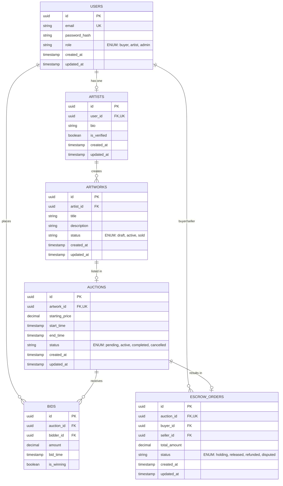

# DICE Platform: PostgreSQL Schema Specification Blueprint

สวัสดีครับ ผมคือ Senior Database Architect & Data Modeling Specialist ประจำโครงการ DICE Platform
วันนี้ผมได้ทำการออกแบบโครงสร้างฐานข้อมูล PostgreSQL ที่เน้นประสิทธิภาพขั้นสูงสุด (High-Performance) รองรับ Concurrency สำหรับระบบลงทะเบียนศิลปิน, การประมูล (Auctions), และระบบ Escrow อย่างสมบูรณ์แบบครับ

## 1. Entity Relationship Diagram (ERD)



## 2. SQLModel / SQLAlchemy Implementation

> [!NOTE]
> โครงสร้างด้านล่างใช้ `SQLModel` ซึ่งผนวกความสามารถของ Pydantic และ SQLAlchemy เข้าด้วยกัน ทำให้การตรวจสอบข้อมูลและการ Query เป็นไปอย่างรวดเร็วและปลอดภัย

```python
from typing import Optional, List
from datetime import datetime
from decimal import Decimal
import uuid
from sqlmodel import SQLModel, Field, Relationship, Column, String, DateTime, Numeric
from sqlalchemy import Index, UniqueConstraint

class User(SQLModel, table=True):
    __tablename__ = "users"
    id: uuid.UUID = Field(default_factory=uuid.uuid4, primary_key=True)
    email: str = Field(sa_column=Column("email", String, unique=True, index=True, nullable=False))
    password_hash: str = Field(nullable=False)
    role: str = Field(default="buyer")
    created_at: datetime = Field(default_factory=datetime.utcnow, sa_column=Column(DateTime(timezone=True)))
    updated_at: datetime = Field(default_factory=datetime.utcnow, sa_column=Column(DateTime(timezone=True)))

    artist: Optional["Artist"] = Relationship(back_populates="user", sa_relationship_kwargs={"uselist": False})
    bids: List["Bid"] = Relationship(back_populates="bidder")

class Artist(SQLModel, table=True):
    __tablename__ = "artists"
    id: uuid.UUID = Field(default_factory=uuid.uuid4, primary_key=True)
    user_id: uuid.UUID = Field(foreign_key="users.id", unique=True, nullable=False)
    bio: Optional[str] = Field(default=None)
    is_verified: bool = Field(default=False, index=True)
    created_at: datetime = Field(default_factory=datetime.utcnow)
    updated_at: datetime = Field(default_factory=datetime.utcnow)

    user: User = Relationship(back_populates="artist")
    artworks: List["Artwork"] = Relationship(back_populates="artist")

class Artwork(SQLModel, table=True):
    __tablename__ = "artworks"
    id: uuid.UUID = Field(default_factory=uuid.uuid4, primary_key=True)
    artist_id: uuid.UUID = Field(foreign_key="artists.id", nullable=False, index=True)
    title: str = Field(nullable=False)
    description: Optional[str] = Field(default=None)
    status: str = Field(default="draft", index=True) # draft, active, sold
    created_at: datetime = Field(default_factory=datetime.utcnow)
    updated_at: datetime = Field(default_factory=datetime.utcnow)

    artist: Artist = Relationship(back_populates="artworks")
    auction: Optional["Auction"] = Relationship(back_populates="artwork", sa_relationship_kwargs={"uselist": False})

class Auction(SQLModel, table=True):
    __tablename__ = "auctions"
    __table_args__ = (
        Index("ix_auction_status_endtime", "status", "end_time"),
    )
    id: uuid.UUID = Field(default_factory=uuid.uuid4, primary_key=True)
    artwork_id: uuid.UUID = Field(foreign_key="artworks.id", unique=True, nullable=False)
    starting_price: Decimal = Field(sa_column=Column(Numeric(12, 2), nullable=False))
    start_time: datetime = Field(nullable=False)
    end_time: datetime = Field(nullable=False)
    status: str = Field(default="pending") # pending, active, completed, cancelled
    created_at: datetime = Field(default_factory=datetime.utcnow)
    updated_at: datetime = Field(default_factory=datetime.utcnow)

    artwork: Artwork = Relationship(back_populates="auction")
    bids: List["Bid"] = Relationship(back_populates="auction")
    escrow_order: Optional["EscrowOrder"] = Relationship(back_populates="auction", sa_relationship_kwargs={"uselist": False})

class Bid(SQLModel, table=True):
    __tablename__ = "bids"
    __table_args__ = (
        Index("ix_bid_auction_amount", "auction_id", "amount", postgresql_using="btree"),
    )
    id: uuid.UUID = Field(default_factory=uuid.uuid4, primary_key=True)
    auction_id: uuid.UUID = Field(foreign_key="auctions.id", nullable=False)
    bidder_id: uuid.UUID = Field(foreign_key="users.id", nullable=False, index=True)
    amount: Decimal = Field(sa_column=Column(Numeric(12, 2), nullable=False))
    bid_time: datetime = Field(default_factory=datetime.utcnow)
    is_winning: bool = Field(default=False)

    auction: Auction = Relationship(back_populates="bids")
    bidder: User = Relationship(back_populates="bids")

class EscrowOrder(SQLModel, table=True):
    __tablename__ = "escrow_orders"
    id: uuid.UUID = Field(default_factory=uuid.uuid4, primary_key=True)
    auction_id: uuid.UUID = Field(foreign_key="auctions.id", unique=True, nullable=False)
    buyer_id: uuid.UUID = Field(foreign_key="users.id", nullable=False, index=True)
    seller_id: uuid.UUID = Field(foreign_key="users.id", nullable=False, index=True)
    total_amount: Decimal = Field(sa_column=Column(Numeric(12, 2), nullable=False))
    status: str = Field(default="holding", index=True) # holding, released, refunded, disputed
    created_at: datetime = Field(default_factory=datetime.utcnow)
    updated_at: datetime = Field(default_factory=datetime.utcnow)

    auction: Auction = Relationship(back_populates="escrow_order")
```

## 3. Indexes Optimization & Data Integrity

> [!TIP]
> การออกแบบ Index และ Constraints มุ่งเน้นไปที่การลด Latency ในจังหวะที่มีการใช้งานพร้อมกันสูง (High Concurrency)

1.  **Unique Indexes & Foreign Keys:**
    *   `users.email`: สร้าง Unique Index เพื่อป้องกันการลงทะเบียนซ้ำ
    *   `artists.user_id`: บังคับ 1-to-1 Mapping ระหว่าง User และ Artist
    *   `auctions.artwork_id` และ `escrow_orders.auction_id`: สร้าง Unique Constraint เพื่อรับประกันว่า 1 ชิ้นงานมีการประมูลได้ 1 ครั้ง ณ เวลาหนึ่งๆ และผลลัพธ์ของประมูลมีแค่ 1 Escrow
2.  **Composite Indexes (เพื่อการ Query ที่รวดเร็ว):**
    *   `ix_auction_status_endtime`: ใช้สำหรับการค้นหา Auction ที่กำลัง Active และเรียงลำดับเวลาปิดประมูล (ใช้มากสุดในหน้า Feed)
    *   `ix_bid_auction_amount` (B-Tree): ใช้เพื่อหาว่าใครเป็น Top Bidder ของการประมูลนั้นๆ ด้วยความเร็ว O(log N) รองรับจังหวะ Snipe Bidding ช่วงใกล้ปิดประมูล
3.  **Data Types & Constraints:**
    *   ใช้ `UUID` สำหรับ Primary Keys แทนที่ Serial Integer เพื่อป้องกัน ID Guessing (เพิ่ม Security) และง่ายต่อการทำ Distributed Database ในอนาคต
    *   ใช้ `Numeric(12, 2)` สำหรับเก็บจำนวนเงิน เพื่อรักษาความแม่นยำของจุดทศนิยม ป้องกันปัญหา Precision Loss
