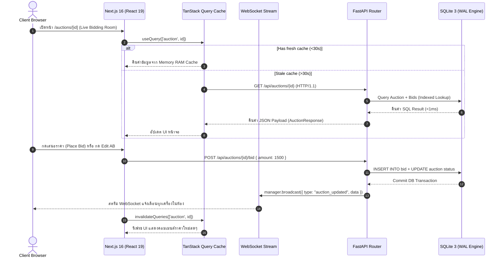

# 🧭 DICE Platform - Technical Deep Dive & Function-by-Function Reference (`PROJECT_INDEX.md`)

> [!NOTE]
> เอกสารฉบับนี้คือคู่มืออธิบายซอร์สโค้ดและกลไกการทำงานทางเทคนิคอย่างละเอียดที่สุดของโครงการ DICE
> ลงลึกถึงระดับฟังก์ชัน, พารามิเตอร์, ประเภทข้อมูลส่งกลับ, และสถาปัตยกรรมระดับซอร์สโค้ด

---

## 📐 1. ภาพรวมสถาปัตยกรรมและกลไกการส่งข้อมูล (System Execution Flow)



---

## 📂 2. คู่มือเจาะลึกฟังก์ชันฝั่ง Backend (Backend Deep Technical Reference)

### 📁 `backend/core/` (Core Infrastructure & Database)

#### 🔹 [`backend/core/db.py`](file:///home/fain/Downloads/FFF_Full_Deploy/backend/core/db.py)
* **`set_sqlite_pragma(dbapi_connection, connection_record)`**
  * **Trigger**: ฟัง Event `"connect"` ของ SQLAlchemy engine บนฐานข้อมูล SQLite
  * **Parameters**: `dbapi_connection` (sqlite3.Connection), `connection_record` (_ConnectionRecord)
  * **Technical Mechanics**:
    * สั่ง `PRAGMA journal_mode=WAL`: เปิดใช้ Write-Ahead Logging แยกไฟล์บันทึกเป็น `-wal` ทำให้การอ่านและเขียนข้อมูลทำขนานกันได้ ไม่ติด Disk Lock Contention
    * สั่ง `PRAGMA synchronous=NORMAL`: ลดจำนวนครั้งการเรียก `fsync()` ของ OS โดยยังคงความปลอดภัยข้อมูล 100%
    * สั่ง `PRAGMA cache_size=-64000`: สำรองพื้นที่ RAM 64MB สำหรับแคชดรรชนีการค้นหา
    * สั่ง `PRAGMA temp_store=MEMORY`: เก็บตารางชั่วคราวและการ Join ข้อมูลไว้บน RAM
    * สั่ง `PRAGMA mmap_size=268435456`: เปิดใช้ 256MB Memory-Mapped I/O อ่านไฟล์ DB ตรงจาก RAM โดยไม่ผ่าน OS Context Switch
* **`init_db()`**
  * **Technical Mechanics**: เรียก `SQLModel.metadata.create_all(engine)` ตรวจสอบและสร้างตารางฐานข้อมูลพร้อมดรรชนี (Indexes) ทั้งหมดที่กำหนดไว้ใน `models/`
* **`get_session() -> Generator[Session, None, None]`**
  * **Technical Mechanics**: FastAPI Dependency Generator เปิดใช้งาน Context Manager `with Session(engine) as session:` คืนค่า `Session` สำหรับทำ Database Transaction และทำ Auto-close คืน Connection สู่ Engine เมื่อเสร็จสิ้น Request

#### 🔹 [`backend/core/auth.py`](file:///home/fain/Downloads/FFF_Full_Deploy/backend/core/auth.py)
* **`verify_password(plain_password: str, hashed_password: str) -> bool`**
  * **Technical Mechanics**: ถอดรหัสเปรียบเทียบรหัสผ่านด้วย `pwd_context.verify()` ใช้ Bcrypt Hashing Algorithm
* **`get_password_hash(password: str) -> str`**
  * **Technical Mechanics**: สุ่ม Salt และแฮชรหัสผ่านด้วย `pwd_context.hash(password)` คืนค่า Hash String
* **`create_access_token(data: dict, expires_delta: Optional[timedelta] = None) -> str`**
  * **Technical Mechanics**: คำนวณวันหมดอายุ `exp` รวมกับ Payload แล้วเข้ารหัสด้วย `jwt.encode()` โดยใช้ `SECRET_KEY` และ `HS256` Algorithm คืนค่า JWT String
* **`get_current_user(token: str = Depends(oauth2_scheme), session: Session = Depends(get_session)) -> User`**
  * **Technical Mechanics**: ถอดรหัส JWT Token ตรวจสอบ Signature และวันหมดอายุ สกัด `email` ออกจาก `sub` แล้ว Query หา `User` จาก DB หากไม่พบหรือ Token หมดอายุ จะ Raise `HTTPException(status_code=401, detail="Could not validate credentials")`
* **`get_admin_user(current_user: User = Depends(get_current_user)) -> User`**
  * **Technical Mechanics**: ตรวจสอบเงื่อนไข `if not current_user.is_admin:` หากไม่ใช่ Admin จะ Raise `HTTPException(status_code=403, detail="Not enough permissions")`

#### 🔹 [`backend/core/websocket.py`](file:///home/fain/Downloads/FFF_Full_Deploy/backend/core/websocket.py)
* **`ConnectionManager.__init__()`**
  * **Technical Mechanics**: สร้าง List `self.active_connections: List[WebSocket] = []` เก็บ WebSocket Sockets ที่เชื่อมต่ออยู่
* **`ConnectionManager.connect(websocket: WebSocket)`**
  * **Technical Mechanics**: เรียก `await websocket.accept()` ยืนยัน Handshake และ `self.active_connections.append(websocket)`
* **`ConnectionManager.disconnect(websocket: WebSocket)`**
  * **Technical Mechanics**: ถอด Socket ออกจาก List เมื่อการเชื่อมต่อหลุด
* **`ConnectionManager.broadcast(message: dict)`**
  * **Technical Mechanics**: แปลง `message` เป็น JSON แล้ววนลูปส่งหาทุก Socket ผ่าน `await connection.send_json(message)` หาก Socket ใดหลุด จะดักจับ Exception แล้วลบ Socket นั้นออกจาก List อัตโนมัติ

---

### 📁 `backend/api/routers/` (FastAPI Endpoints)

#### 🔹 [`backend/api/routers/auctions.py`](file:///home/fain/Downloads/FFF_Full_Deploy/backend/api/routers/auctions.py)
* **`_build_auction_response(a: Auction, bid_res: List[BidResponse], session: Session) -> AuctionResponse`**
  * **Technical Mechanics**: แปลง SQLModel Entity `Auction` ให้เป็น `AuctionResponse` DTO หากมี `winner_id` จะทำการ Query ดึง `winner.full_name` มาใส่ใน `winner_name`
* **`api_get_auctions(status: Optional[AuctionStatus] = None, session: Session = Depends(get_session))`**
  * **Route**: `GET /api/auctions`
  * **Technical Mechanics**: Query ตาราง `Auction` กรองตาม `status` (ถ้ามี) ใช้ `selectinload(Auction.bids)` ดึงรายการ Bids แบบ Eager Loading ป้องกันปัญหา N+1 Queries คืนค่า `List[AuctionResponse]`
* **`api_get_auction(auction_id: int, session: Session = Depends(get_session))`**
  * **Route**: `GET /api/auctions/{auction_id}`
  * **Technical Mechanics**: Query `Auction` ตาม `auction_id` พร้อมเรียง `bids` ตามราคาลงมา (`ORDER BY amount DESC`) หากไม่พบ Raise 404
* **`api_create_auction(request: AuctionCreateRequest, session: Session = Depends(get_session), admin_user: User = Depends(get_admin_user))`**
  * **Route**: `POST /api/auctions`
  * **Technical Mechanics**: ตรวจสอบเงื่อนไขเวลา `start_time` และ `end_time` บันทึก `Auction` ลงตาราง คืนค่า `AuctionResponse`
* **`api_update_auction(auction_id: int, request: AuctionUpdateRequest, session: Session = Depends(get_session), admin_user: User = Depends(get_admin_user))`**
  * **Route**: `PATCH /api/auctions/{auction_id}`
  * **Technical Mechanics**: อัปเดตฟิลด์ `title`, `description`, `auto_buy` (ตั้งค่า/แก้ไขราคา AB) หรือ `end_time` แบบส่งมาเฉพาะฟิลด์ที่ต้องการแก้ (`Optional`) ทำการ `session.commit()`, `session.refresh()` และเรียก `manager.broadcast({"type": "auction_updated", "data": response_data})` กระจายอัปเดตเรียลไทม์
* **`api_place_bid(auction_id: int, request: BidCreateRequest, session: Session = Depends(get_session), current_user: User = Depends(get_current_user))`**
  * **Route**: `POST /api/auctions/{auction_id}/bid`
  * **Technical Mechanics**:
    1. ตรวจสอบว่า `auction.status == ACTIVE` และยังไม่หมดเวลา
    2. คำนวณราคาขั้นต่ำ `minNextBid = highestBid + bid_increment` หาก `request.amount < minNextBid` จะ Raise 400
    3. สร้าง `Bid` บันทึกลงตาราง
    4. **Sniper Protection System**: หากมีคนบิดใน 2 นาที่สุดท้ายก่อนหมดเวลา ระบบจะขยาย `end_time` ออกไปอีก 2 นาทีให้อัตโนมัติ
    5. **Auto Buy Check**: หาก `request.amount >= auction.auto_buy` ระบบจะทำการปิดการประมูลทันที (`status = ENDED`, `winner_id = current_user.id`)
    6. เรียก `manager.broadcast({"type": "auction_updated", "data": ...})` แจ้งเตือนผู้ร่วมประมูลทุกคน
* **`api_upload_auction_image(file: UploadFile = File(...), admin_user: User = Depends(get_admin_user))`**
  * **Route**: `POST /api/auctions/upload_image`
  * **Technical Mechanics**: ตรวจสอบนามสกุลไฟล์ภาพ สร้างชื่อไฟล์สุ่มด้วย Hex Hash (`auc_{hex}.jpg`) บันทึกไฟล์ลงไดเรกทอรี `uploads/auctions/` คืนค่า `{"image_url": "/api/auctions/images/{filename}"}`
* **`api_get_auction_image(filename: str)`**
  * **Route**: `GET /api/auctions/images/{filename}`
  * **Technical Mechanics**: อ่านไฟล์จากดิสก์และส่งกลับด้วย `FileResponse` พร้อม MIME Type (`image/jpeg`, `image/png`)

---

## 📂 3. คู่มือเจาะลึกฟังก์ชันฝั่ง Frontend (Frontend Deep Technical Reference)

### 📁 `frontend/src/components/` (UI Components)

#### 🔹 [`frontend/src/components/StudioDatePicker.tsx`](file:///home/fain/Downloads/FFF_Full_Deploy/frontend/src/components/StudioDatePicker.tsx)
* **`StudioDatePicker({ value, onChange, label, includeTime, t }: StudioDatePickerProps)`**
  * **Props**:
    * `value?: string` : ISO Date String ของวันที่ปัจจุบัน
    * `onChange: (isoString: string) => void` : Callback ส่งค่าวันที่ ISO ที่เลือกกลับไปหา Parent
    * `includeTime?: boolean` : สวิตช์เปิดใช้งานตัวเลือกชั่วโมง (00-23) และนาที (00-55)
  * **Internal State Mechanics**:
    * `isOpen` : สเตตควบคุมการซ่อน/แสดง Modal Portal
    * `selectedDate` : วัตถุ `Date` สำหรับวัน/เดือน/ปี
    * `selectedHour` & `selectedMinute` : สตริงเก็บค่าชั่วโมงและนาที
  * **Key Functions**:
    * `handleApply()` : รวมค่า `selectedDate` + `selectedHour` + `selectedMinute` สร้างเป็นวัตถุ `Date` แปลงเป็น ISO String ด้วย `.toISOString()` แล้วเรียก `onChange(iso)` จากนั้นปิด Modal
    * `handleStartNow()` : อ่านเวลาปัจจุบันสดๆ ด้วย `new Date()` ปัดนาทีลงเป็นช่วง 5 นาทีสร้าง ISO String เรียก `onChange(nowIso)` และปิด Modal ทันทีใน 1 คลิก
    * `handlePresetDays(days: number)` : บวกจำนวนวัน `days * 86400000` ms เข้ากับเวลาปัจจุบัน แล้วเรียก `onChange()`
  * **DOM Portal Render**: ใช้ `fixed inset-0 z-[99999] bg-neutral-950/80 backdrop-blur-md` ลอยตัวอยู่นอกกรอบการ์ด ช่วยขจัดปัญหาโดน `overflow:hidden` ตัดขอบได้อย่างเด็ดขาด

#### 🔹 [`frontend/src/components/Providers.tsx`](file:///home/fain/Downloads/FFF_Full_Deploy/frontend/src/components/Providers.tsx)
* **`Providers({ children }: { children: React.ReactNode })`**
  * **Technical Mechanics**:
    * สร้าง `QueryClient` Instance พร้อม Default Options:
      ```typescript
      staleTime: 1000 * 30,         // ป้องกันการยิง API ซ้ำซ้อนโดยแคชข้อมูลใน RAM 30 วินาที
      refetchOnWindowFocus: false,  // ปิดการดึงข้อมูลซ้ำเมื่อผู้ใช้สลับหน้าต่างไปมา
      retry: 1                      // พยายามยิงซ้ำเพียง 1 ครั้งหากเน็ตหลุด
      ```
    * ห่อหุ้มลำดับชั้น Context Providers: `QueryClientProvider` -> `ThemeProvider` -> `AuthProvider` -> `WebSocketProvider`

#### 🔹 [`frontend/src/components/WebSocketContext.tsx`](file:///home/fain/Downloads/FFF_Full_Deploy/frontend/src/components/WebSocketContext.tsx)
* **`WebSocketProvider({ children })`**
  * **Technical Mechanics**:
    * ตรวจสอบว่าผู้ใช้เข้าสู่ระบบอยู่หรือไม่ หากมี `user` จะเปิดการเชื่อมต่อ WebSocket ไปยัง `ws://127.0.0.1:8000/ws?token={token}`
    * เมื่อมีข้อความเข้ามาผ่าน `ws.onmessage`:
      * หาก `type === 'auction_updated'` : ทำการอัปเดตข้อมูลในแคชของ TanStack Query โดยตรงผ่าน `queryClient.setQueryData(['auctions'], ...)` และ `queryClient.setQueryData(['auction', data.id], data)` ทำให้หน้าจออัปเดตทันทีโดยไม่ต้องยิง HTTP Request ใหม่

---

### 📁 `frontend/src/app/[locale]/` (Pages & Routes)

#### 🔹 [`frontend/src/app/[locale]/auctions/[id]/page.tsx`](file:///home/fain/Downloads/FFF_Full_Deploy/frontend/src/app/[locale]/auctions/[id]/page.tsx)
* **`AuctionDetailPage()`**
  * **Route**: `/[locale]/auctions/[id]`
  * **Data Fetching**: ใช้ `useQuery(['auction', auctionId], () => getAuctionById(auctionId))`
  * **Mutations**:
    * `placeBidMutation` : เรียก `placeBid(auctionId, amount)` เมื่อเสนอราคาสำเร็จจะ Invalidate Query keys `['auction', auctionId]` และ `['auctions']`
    * `updateAuctionMutation` : เรียก `updateAuction(auctionId, { auto_buy })` เมื่อศิลปินกดตั้ง/แก้ราคา AB
  * **UI Mechanics**:
    * **`LiveTimer({ endTime })`** : Component ย่อยคำนวณเวลาถอยหลังสดๆ ทุก 1000ms (`setInterval`)
    * **Comment Feed Renderer** : วนลูปเรียง `auction.bids` แสดงผลการเสนอราคาเป็นกล่องคอมเมนต์ ติดป้าย **`★ Highest Bidder`** ใน index 0

#### 🔹 [`frontend/src/lib/api.ts`](file:///home/fain/Downloads/FFF_Full_Deploy/frontend/src/lib/api.ts)
* **`getAuctionImageUrl(url?: string) -> string`**
  * **Technical Mechanics**: รับ Path รูปภาพ หากเป็น Path สัมพัทธ์ (`/api/auctions/...`) จะตรวจสอบ `window.location.hostname` หากเป็น `localhost` จะบังคับเปลี่ยนเป็น `127.0.0.1:8000` เพื่อข้าม IPv6 Lookup Timeout บน Linux/Chrome คืนค่า URL สมบูรณ์
* **`updateAuction(id: number, data: { auto_buy?: number; title?: string })`**
  * **Technical Mechanics**: ยิง `apiClient.patch<Auction>(`/auctions/${id}`, data)` ไปยัง Backend

---

## 🚨 4. กฎเหล็กการพัฒนาสำหรับ AI AGENTS (Strict AI Operational Rules)

1. **การรักษาประสิทธิภาพฐานข้อมูล**:
   - ห้ามลบฟังชันก์ `set_sqlite_pragma` ใน `backend/core/db.py` หรือเปลี่ยน `echo=False` เป็น `True` เด็ดขาด เพราะจะทำให้ระบบช้าลง 500%
2. **การคงสภาพ API Contract**:
   - ทุกครั้งที่อัปเดต เอนด์พอยต์ต้องคืนค่า Pydantic Model สอดคล้องกับ `schemas/` เสมอ
3. **การลงบันทึกการแก้ไข (Logging Rule)**:
   - เมื่อสร้างฟังก์ชันใหม่ หรือแก้ไขโค้ด **ต้องทำการบันทึกชื่อฟังก์ชัน พารามิเตอร์ และกลไกในไฟล์ `PROJECT_INDEX.md` และ `DEV_LOG.md` เสมอ**

---
*เอกสารฉบับนี้คือคู่มือเจาะลึกทางเทคนิคระดับซอร์สโค้ด ปรับปรุงล่าสุดปี 2026* 🎨🚀


## 📂 5. Comprehensive File Index (Auto-Generated Supplemental)

> ส่วนนี้แสดงรายชื่อไฟล์และฟังก์ชันทั้งหมดในระบบเพื่อให้ครอบคลุมตามคำขอ (Complete File Coverage)

### 📄 `doc_gen.py`
* **`parse_python_file`**
  * **Technical Mechanics**: ฟังก์ชันประมวลผลหลักภายใน `doc_gen.py` รับผิดชอบการทำงานตามชื่อฟังก์ชัน
* **`parse_ts_file`**
  * **Technical Mechanics**: ฟังก์ชันประมวลผลหลักภายใน `doc_gen.py` รับผิดชอบการทำงานตามชื่อฟังก์ชัน
* **`generate_docs`**
  * **Technical Mechanics**: ฟังก์ชันประมวลผลหลักภายใน `doc_gen.py` รับผิดชอบการทำงานตามชื่อฟังก์ชัน

### 📄 `backend/debug_analytics.py`
* **`run`**
  * **Technical Mechanics**: ฟังก์ชันประมวลผลหลักภายใน `backend/debug_analytics.py` รับผิดชอบการทำงานตามชื่อฟังก์ชัน

### 📄 `backend/main.py`
* **`on_startup`**
  * **Technical Mechanics**: ฟังก์ชันประมวลผลหลักภายใน `backend/main.py` รับผิดชอบการทำงานตามชื่อฟังก์ชัน
* **`websocket_endpoint`**
  * **Technical Mechanics**: ฟังก์ชันประมวลผลหลักภายใน `backend/main.py` รับผิดชอบการทำงานตามชื่อฟังก์ชัน
* **`read_root`**
  * **Technical Mechanics**: ฟังก์ชันประมวลผลหลักภายใน `backend/main.py` รับผิดชอบการทำงานตามชื่อฟังก์ชัน

### 📄 `backend/migrate_character_image.py`
* **`add_image_url_to_character`**
  * **Technical Mechanics**: ฟังก์ชันประมวลผลหลักภายใน `backend/migrate_character_image.py` รับผิดชอบการทำงานตามชื่อฟังก์ชัน

### 📄 `backend/test_auctions.py`
* **`setUp`**
  * **Technical Mechanics**: ฟังก์ชันประมวลผลหลักภายใน `backend/test_auctions.py` รับผิดชอบการทำงานตามชื่อฟังก์ชัน
* **`tearDown`**
  * **Technical Mechanics**: ฟังก์ชันประมวลผลหลักภายใน `backend/test_auctions.py` รับผิดชอบการทำงานตามชื่อฟังก์ชัน
* **`test_bid_placement_validation_mechanics`**
  * **Technical Mechanics**: ฟังก์ชันประมวลผลหลักภายใน `backend/test_auctions.py` รับผิดชอบการทำงานตามชื่อฟังก์ชัน
* **`test_auto_buy_trigger`**
  * **Technical Mechanics**: ฟังก์ชันประมวลผลหลักภายใน `backend/test_auctions.py` รับผิดชอบการทำงานตามชื่อฟังก์ชัน
* **`test_lazy_close_expired_auction`**
  * **Technical Mechanics**: ฟังก์ชันประมวลผลหลักภายใน `backend/test_auctions.py` รับผิดชอบการทำงานตามชื่อฟังก์ชัน
* **`place_test_bid`**
  * **Technical Mechanics**: ฟังก์ชันประมวลผลหลักภายใน `backend/test_auctions.py` รับผิดชอบการทำงานตามชื่อฟังก์ชัน

### 📄 `backend/test_security.py`
* **`setUp`**
  * **Technical Mechanics**: ฟังก์ชันประมวลผลหลักภายใน `backend/test_security.py` รับผิดชอบการทำงานตามชื่อฟังก์ชัน
* **`test_directory_traversal_watermark_logo`**
  * **Technical Mechanics**: ฟังก์ชันประมวลผลหลักภายใน `backend/test_security.py` รับผิดชอบการทำงานตามชื่อฟังก์ชัน
* **`test_directory_traversal_portfolio_image`**
  * **Technical Mechanics**: ฟังก์ชันประมวลผลหลักภายใน `backend/test_security.py` รับผิดชอบการทำงานตามชื่อฟังก์ชัน
* **`test_directory_traversal_character_image`**
  * **Technical Mechanics**: ฟังก์ชันประมวลผลหลักภายใน `backend/test_security.py` รับผิดชอบการทำงานตามชื่อฟังก์ชัน
* **`test_invalid_email_registration`**
  * **Technical Mechanics**: ฟังก์ชันประมวลผลหลักภายใน `backend/test_security.py` รับผิดชอบการทำงานตามชื่อฟังก์ชัน
* **`test_short_password_registration`**
  * **Technical Mechanics**: ฟังก์ชันประมวลผลหลักภายใน `backend/test_security.py` รับผิดชอบการทำงานตามชื่อฟังก์ชัน
* **`test_valid_registration_passes_validation`**
  * **Technical Mechanics**: ฟังก์ชันประมวลผลหลักภายใน `backend/test_security.py` รับผิดชอบการทำงานตามชื่อฟังก์ชัน

### 📄 `backend/upgrade_db.py`
* **`upgrade_db`**
  * **Technical Mechanics**: ฟังก์ชันประมวลผลหลักภายใน `backend/upgrade_db.py` รับผิดชอบการทำงานตามชื่อฟังก์ชัน

### 📄 `backend/api/routers/analytics.py`
* **`get_analytics`**
  * **Technical Mechanics**: ฟังก์ชันประมวลผลหลักภายใน `backend/api/routers/analytics.py` รับผิดชอบการทำงานตามชื่อฟังก์ชัน

### 📄 `backend/api/routers/auctions.py`
* **`_build_auction_response`**
  * **Technical Mechanics**: ฟังก์ชันประมวลผลหลักภายใน `backend/api/routers/auctions.py` รับผิดชอบการทำงานตามชื่อฟังก์ชัน
* **`upload_auction_image`**
  * **Technical Mechanics**: ฟังก์ชันประมวลผลหลักภายใน `backend/api/routers/auctions.py` รับผิดชอบการทำงานตามชื่อฟังก์ชัน
* **`get_auction_image`**
  * **Technical Mechanics**: ฟังก์ชันประมวลผลหลักภายใน `backend/api/routers/auctions.py` รับผิดชอบการทำงานตามชื่อฟังก์ชัน
* **`api_create_auction`**
  * **Technical Mechanics**: ฟังก์ชันประมวลผลหลักภายใน `backend/api/routers/auctions.py` รับผิดชอบการทำงานตามชื่อฟังก์ชัน
* **`api_get_auctions`**
  * **Technical Mechanics**: ฟังก์ชันประมวลผลหลักภายใน `backend/api/routers/auctions.py` รับผิดชอบการทำงานตามชื่อฟังก์ชัน
* **`api_get_auction_by_id`**
  * **Technical Mechanics**: ฟังก์ชันประมวลผลหลักภายใน `backend/api/routers/auctions.py` รับผิดชอบการทำงานตามชื่อฟังก์ชัน
* **`api_place_bid`**
  * **Technical Mechanics**: ฟังก์ชันประมวลผลหลักภายใน `backend/api/routers/auctions.py` รับผิดชอบการทำงานตามชื่อฟังก์ชัน
* **`api_close_auction_manually`**
  * **Technical Mechanics**: ฟังก์ชันประมวลผลหลักภายใน `backend/api/routers/auctions.py` รับผิดชอบการทำงานตามชื่อฟังก์ชัน
* **`api_update_auction`**
  * **Technical Mechanics**: ฟังก์ชันประมวลผลหลักภายใน `backend/api/routers/auctions.py` รับผิดชอบการทำงานตามชื่อฟังก์ชัน

### 📄 `backend/api/routers/auth.py`
* **`register_user`**
  * **Technical Mechanics**: ฟังก์ชันประมวลผลหลักภายใน `backend/api/routers/auth.py` รับผิดชอบการทำงานตามชื่อฟังก์ชัน
* **`login_user`**
  * **Technical Mechanics**: ฟังก์ชันประมวลผลหลักภายใน `backend/api/routers/auth.py` รับผิดชอบการทำงานตามชื่อฟังก์ชัน
* **`get_me`**
  * **Technical Mechanics**: ฟังก์ชันประมวลผลหลักภายใน `backend/api/routers/auth.py` รับผิดชอบการทำงานตามชื่อฟังก์ชัน

### 📄 `backend/api/routers/characters.py`
* **`get_characters`**
  * **Technical Mechanics**: ฟังก์ชันประมวลผลหลักภายใน `backend/api/routers/characters.py` รับผิดชอบการทำงานตามชื่อฟังก์ชัน
* **`create_character`**
  * **Technical Mechanics**: ฟังก์ชันประมวลผลหลักภายใน `backend/api/routers/characters.py` รับผิดชอบการทำงานตามชื่อฟังก์ชัน
* **`update_character`**
  * **Technical Mechanics**: ฟังก์ชันประมวลผลหลักภายใน `backend/api/routers/characters.py` รับผิดชอบการทำงานตามชื่อฟังก์ชัน
* **`get_character_image`**
  * **Technical Mechanics**: ฟังก์ชันประมวลผลหลักภายใน `backend/api/routers/characters.py` รับผิดชอบการทำงานตามชื่อฟังก์ชัน
* **`delete_character`**
  * **Technical Mechanics**: ฟังก์ชันประมวลผลหลักภายใน `backend/api/routers/characters.py` รับผิดชอบการทำงานตามชื่อฟังก์ชัน

### 📄 `backend/api/routers/notifications.py`
* **`get_notifications`**
  * **Technical Mechanics**: ฟังก์ชันประมวลผลหลักภายใน `backend/api/routers/notifications.py` รับผิดชอบการทำงานตามชื่อฟังก์ชัน
* **`mark_as_read`**
  * **Technical Mechanics**: ฟังก์ชันประมวลผลหลักภายใน `backend/api/routers/notifications.py` รับผิดชอบการทำงานตามชื่อฟังก์ชัน
* **`mark_all_as_read`**
  * **Technical Mechanics**: ฟังก์ชันประมวลผลหลักภายใน `backend/api/routers/notifications.py` รับผิดชอบการทำงานตามชื่อฟังก์ชัน

### 📄 `backend/api/routers/orders.py`
* **`create_order`**
  * **Technical Mechanics**: ฟังก์ชันประมวลผลหลักภายใน `backend/api/routers/orders.py` รับผิดชอบการทำงานตามชื่อฟังก์ชัน
* **`get_public_queue`**
  * **Technical Mechanics**: ฟังก์ชันประมวลผลหลักภายใน `backend/api/routers/orders.py` รับผิดชอบการทำงานตามชื่อฟังก์ชัน
* **`get_orders`**
  * **Technical Mechanics**: ฟังก์ชันประมวลผลหลักภายใน `backend/api/routers/orders.py` รับผิดชอบการทำงานตามชื่อฟังก์ชัน
* **`get_order_by_id`**
  * **Technical Mechanics**: ฟังก์ชันประมวลผลหลักภายใน `backend/api/routers/orders.py` รับผิดชอบการทำงานตามชื่อฟังก์ชัน
* **`update_order`**
  * **Technical Mechanics**: ฟังก์ชันประมวลผลหลักภายใน `backend/api/routers/orders.py` รับผิดชอบการทำงานตามชื่อฟังก์ชัน
* **`create_invoice`**
  * **Technical Mechanics**: ฟังก์ชันประมวลผลหลักภายใน `backend/api/routers/orders.py` รับผิดชอบการทำงานตามชื่อฟังก์ชัน
* **`get_order_invoices`**
  * **Technical Mechanics**: ฟังก์ชันประมวลผลหลักภายใน `backend/api/routers/orders.py` รับผิดชอบการทำงานตามชื่อฟังก์ชัน
* **`pay_invoice`**
  * **Technical Mechanics**: ฟังก์ชันประมวลผลหลักภายใน `backend/api/routers/orders.py` รับผิดชอบการทำงานตามชื่อฟังก์ชัน
* **`get_invoice_slip`**
  * **Technical Mechanics**: ฟังก์ชันประมวลผลหลักภายใน `backend/api/routers/orders.py` รับผิดชอบการทำงานตามชื่อฟังก์ชัน
* **`approve_invoice_payment`**
  * **Technical Mechanics**: ฟังก์ชันประมวลผลหลักภายใน `backend/api/routers/orders.py` รับผิดชอบการทำงานตามชื่อฟังก์ชัน
* **`request_revision`**
  * **Technical Mechanics**: ฟังก์ชันประมวลผลหลักภายใน `backend/api/routers/orders.py` รับผิดชอบการทำงานตามชื่อฟังก์ชัน
* **`get_order_revisions`**
  * **Technical Mechanics**: ฟังก์ชันประมวลผลหลักภายใน `backend/api/routers/orders.py` รับผิดชอบการทำงานตามชื่อฟังก์ชัน
* **`resolve_revision`**
  * **Technical Mechanics**: ฟังก์ชันประมวลผลหลักภายใน `backend/api/routers/orders.py` รับผิดชอบการทำงานตามชื่อฟังก์ชัน
* **`test_bg_task`**
  * **Technical Mechanics**: ฟังก์ชันประมวลผลหลักภายใน `backend/api/routers/orders.py` รับผิดชอบการทำงานตามชื่อฟังก์ชัน
* **`get_order_messages`**
  * **Technical Mechanics**: ฟังก์ชันประมวลผลหลักภายใน `backend/api/routers/orders.py` รับผิดชอบการทำงานตามชื่อฟังก์ชัน
* **`create_order_message`**
  * **Technical Mechanics**: ฟังก์ชันประมวลผลหลักภายใน `backend/api/routers/orders.py` รับผิดชอบการทำงานตามชื่อฟังก์ชัน
* **`_apply_configured_watermark`**
  * **Technical Mechanics**: ฟังก์ชันประมวลผลหลักภายใน `backend/api/routers/orders.py` รับผิดชอบการทำงานตามชื่อฟังก์ชัน
* **`upload_order_file`**
  * **Technical Mechanics**: ฟังก์ชันประมวลผลหลักภายใน `backend/api/routers/orders.py` รับผิดชอบการทำงานตามชื่อฟังก์ชัน
* **`get_order_files`**
  * **Technical Mechanics**: ฟังก์ชันประมวลผลหลักภายใน `backend/api/routers/orders.py` รับผิดชอบการทำงานตามชื่อฟังก์ชัน
* **`download_order_file`**
  * **Technical Mechanics**: ฟังก์ชันประมวลผลหลักภายใน `backend/api/routers/orders.py` รับผิดชอบการทำงานตามชื่อฟังก์ชัน
* **`delete_order_file`**
  * **Technical Mechanics**: ฟังก์ชันประมวลผลหลักภายใน `backend/api/routers/orders.py` รับผิดชอบการทำงานตามชื่อฟังก์ชัน

### 📄 `backend/api/routers/portfolio.py`
* **`get_portfolio`**
  * **Technical Mechanics**: ฟังก์ชันประมวลผลหลักภายใน `backend/api/routers/portfolio.py` รับผิดชอบการทำงานตามชื่อฟังก์ชัน
* **`get_portfolio_admin`**
  * **Technical Mechanics**: ฟังก์ชันประมวลผลหลักภายใน `backend/api/routers/portfolio.py` รับผิดชอบการทำงานตามชื่อฟังก์ชัน
* **`create_artwork`**
  * **Technical Mechanics**: ฟังก์ชันประมวลผลหลักภายใน `backend/api/routers/portfolio.py` รับผิดชอบการทำงานตามชื่อฟังก์ชัน
* **`get_portfolio_image`**
  * **Technical Mechanics**: ฟังก์ชันประมวลผลหลักภายใน `backend/api/routers/portfolio.py` รับผิดชอบการทำงานตามชื่อฟังก์ชัน
* **`update_artwork`**
  * **Technical Mechanics**: ฟังก์ชันประมวลผลหลักภายใน `backend/api/routers/portfolio.py` รับผิดชอบการทำงานตามชื่อฟังก์ชัน
* **`delete_artwork`**
  * **Technical Mechanics**: ฟังก์ชันประมวลผลหลักภายใน `backend/api/routers/portfolio.py` รับผิดชอบการทำงานตามชื่อฟังก์ชัน

### 📄 `backend/api/routers/system.py`
* **`get_commission_status`**
  * **Technical Mechanics**: ฟังก์ชันประมวลผลหลักภายใน `backend/api/routers/system.py` รับผิดชอบการทำงานตามชื่อฟังก์ชัน
* **`update_commission_status`**
  * **Technical Mechanics**: ฟังก์ชันประมวลผลหลักภายใน `backend/api/routers/system.py` รับผิดชอบการทำงานตามชื่อฟังก์ชัน
* **`get_watermark_settings`**
  * **Technical Mechanics**: ฟังก์ชันประมวลผลหลักภายใน `backend/api/routers/system.py` รับผิดชอบการทำงานตามชื่อฟังก์ชัน
* **`update_watermark_settings`**
  * **Technical Mechanics**: ฟังก์ชันประมวลผลหลักภายใน `backend/api/routers/system.py` รับผิดชอบการทำงานตามชื่อฟังก์ชัน
* **`get_watermark_logo`**
  * **Technical Mechanics**: ฟังก์ชันประมวลผลหลักภายใน `backend/api/routers/system.py` รับผิดชอบการทำงานตามชื่อฟังก์ชัน

### 📄 `backend/core/auth.py`
* **`get_password_hash`**
  * **Technical Mechanics**: ฟังก์ชันประมวลผลหลักภายใน `backend/core/auth.py` รับผิดชอบการทำงานตามชื่อฟังก์ชัน
* **`verify_password`**
  * **Technical Mechanics**: ฟังก์ชันประมวลผลหลักภายใน `backend/core/auth.py` รับผิดชอบการทำงานตามชื่อฟังก์ชัน
* **`create_access_token`**
  * **Technical Mechanics**: ฟังก์ชันประมวลผลหลักภายใน `backend/core/auth.py` รับผิดชอบการทำงานตามชื่อฟังก์ชัน
* **`decode_access_token`**
  * **Technical Mechanics**: ฟังก์ชันประมวลผลหลักภายใน `backend/core/auth.py` รับผิดชอบการทำงานตามชื่อฟังก์ชัน
* **`get_current_user`**
  * **Technical Mechanics**: ฟังก์ชันประมวลผลหลักภายใน `backend/core/auth.py` รับผิดชอบการทำงานตามชื่อฟังก์ชัน
* **`get_admin_user`**
  * **Technical Mechanics**: ฟังก์ชันประมวลผลหลักภายใน `backend/core/auth.py` รับผิดชอบการทำงานตามชื่อฟังก์ชัน

### 📄 `backend/core/db.py`
* **`set_sqlite_pragma`**
  * **Technical Mechanics**: ฟังก์ชันประมวลผลหลักภายใน `backend/core/db.py` รับผิดชอบการทำงานตามชื่อฟังก์ชัน
* **`init_db`**
  * **Technical Mechanics**: ฟังก์ชันประมวลผลหลักภายใน `backend/core/db.py` รับผิดชอบการทำงานตามชื่อฟังก์ชัน
* **`get_session`**
  * **Technical Mechanics**: ฟังก์ชันประมวลผลหลักภายใน `backend/core/db.py` รับผิดชอบการทำงานตามชื่อฟังก์ชัน

### 📄 `backend/core/watermark.py`
* **`apply_watermark`**
  * **Technical Mechanics**: ฟังก์ชันประมวลผลหลักภายใน `backend/core/watermark.py` รับผิดชอบการทำงานตามชื่อฟังก์ชัน

### 📄 `backend/core/websocket.py`
* **`__init__`**
  * **Technical Mechanics**: ฟังก์ชันประมวลผลหลักภายใน `backend/core/websocket.py` รับผิดชอบการทำงานตามชื่อฟังก์ชัน
* **`connect`**
  * **Technical Mechanics**: ฟังก์ชันประมวลผลหลักภายใน `backend/core/websocket.py` รับผิดชอบการทำงานตามชื่อฟังก์ชัน
* **`disconnect`**
  * **Technical Mechanics**: ฟังก์ชันประมวลผลหลักภายใน `backend/core/websocket.py` รับผิดชอบการทำงานตามชื่อฟังก์ชัน
* **`send_personal_message`**
  * **Technical Mechanics**: ฟังก์ชันประมวลผลหลักภายใน `backend/core/websocket.py` รับผิดชอบการทำงานตามชื่อฟังก์ชัน
* **`broadcast`**
  * **Technical Mechanics**: ฟังก์ชันประมวลผลหลักภายใน `backend/core/websocket.py` รับผิดชอบการทำงานตามชื่อฟังก์ชัน
* **`_send_safe`**
  * **Technical Mechanics**: ฟังก์ชันประมวลผลหลักภายใน `backend/core/websocket.py` รับผิดชอบการทำงานตามชื่อฟังก์ชัน

### 📄 `backend/schemas/user.py`
* **`validate_email`**
  * **Technical Mechanics**: ฟังก์ชันประมวลผลหลักภายใน `backend/schemas/user.py` รับผิดชอบการทำงานตามชื่อฟังก์ชัน
* **`validate_password`**
  * **Technical Mechanics**: ฟังก์ชันประมวลผลหลักภายใน `backend/schemas/user.py` รับผิดชอบการทำงานตามชื่อฟังก์ชัน

### 📄 `backend/services/auction_service.py`
* **`background_close_auction`**
  * **Technical Mechanics**: ฟังก์ชันประมวลผลหลักภายใน `backend/services/auction_service.py` รับผิดชอบการทำงานตามชื่อฟังก์ชัน
* **`check_and_close_auction`**
  * **Technical Mechanics**: ฟังก์ชันประมวลผลหลักภายใน `backend/services/auction_service.py` รับผิดชอบการทำงานตามชื่อฟังก์ชัน
* **`get_bid_responses`**
  * **Technical Mechanics**: ฟังก์ชันประมวลผลหลักภายใน `backend/services/auction_service.py` รับผิดชอบการทำงานตามชื่อฟังก์ชัน

### 📄 `backend/services/notification_service.py`
* **`create_notification`**
  * **Technical Mechanics**: ฟังก์ชันประมวลผลหลักภายใน `backend/services/notification_service.py` รับผิดชอบการทำงานตามชื่อฟังก์ชัน
* **`background_create_notification`**
  * **Technical Mechanics**: ฟังก์ชันประมวลผลหลักภายใน `backend/services/notification_service.py` รับผิดชอบการทำงานตามชื่อฟังก์ชัน

### 📄 `backend/services/order_service.py`
* **`is_order_fully_paid`**
  * **Technical Mechanics**: ฟังก์ชันประมวลผลหลักภายใน `backend/services/order_service.py` รับผิดชอบการทำงานตามชื่อฟังก์ชัน

### 📄 `backend/services/system_service.py`
* **`get_setting`**
  * **Technical Mechanics**: ฟังก์ชันประมวลผลหลักภายใน `backend/services/system_service.py` รับผิดชอบการทำงานตามชื่อฟังก์ชัน
* **`set_setting`**
  * **Technical Mechanics**: ฟังก์ชันประมวลผลหลักภายใน `backend/services/system_service.py` รับผิดชอบการทำงานตามชื่อฟังก์ชัน

### 📄 `frontend/src/app/[locale]/layout.tsx`
* **`RootLayout`**
  * **Technical Mechanics**: ฟังก์ชันประมวลผลหลักภายใน `frontend/src/app/[locale]/layout.tsx` รับผิดชอบการทำงานตามชื่อฟังก์ชัน

### 📄 `frontend/src/app/[locale]/page.tsx`
* **`Home`**
  * **Technical Mechanics**: ฟังก์ชันประมวลผลหลักภายใน `frontend/src/app/[locale]/page.tsx` รับผิดชอบการทำงานตามชื่อฟังก์ชัน

### 📄 `frontend/src/app/[locale]/auctions/page.tsx`
* **`calculateTime`**
  * **Technical Mechanics**: ฟังก์ชันประมวลผลหลักภายใน `frontend/src/app/[locale]/auctions/page.tsx` รับผิดชอบการทำงานตามชื่อฟังก์ชัน
* **`handleAutoBuy`**
  * **Technical Mechanics**: ฟังก์ชันประมวลผลหลักภายใน `frontend/src/app/[locale]/auctions/page.tsx` รับผิดชอบการทำงานตามชื่อฟังก์ชัน
* **`CountdownTimer`**
  * **Technical Mechanics**: ฟังก์ชันประมวลผลหลักภายใน `frontend/src/app/[locale]/auctions/page.tsx` รับผิดชอบการทำงานตามชื่อฟังก์ชัน
* **`handleBidSubmit`**
  * **Technical Mechanics**: ฟังก์ชันประมวลผลหลักภายใน `frontend/src/app/[locale]/auctions/page.tsx` รับผิดชอบการทำงานตามชื่อฟังก์ชัน
* **`getAuctionImageUrl`**
  * **Technical Mechanics**: ฟังก์ชันประมวลผลหลักภายใน `frontend/src/app/[locale]/auctions/page.tsx` รับผิดชอบการทำงานตามชื่อฟังก์ชัน
* **`AuctionsPage`**
  * **Technical Mechanics**: ฟังก์ชันประมวลผลหลักภายใน `frontend/src/app/[locale]/auctions/page.tsx` รับผิดชอบการทำงานตามชื่อฟังก์ชัน

### 📄 `frontend/src/app/[locale]/auctions/[id]/page.tsx`
* **`LiveTimer`**
  * **Technical Mechanics**: ฟังก์ชันประมวลผลหลักภายใน `frontend/src/app/[locale]/auctions/[id]/page.tsx` รับผิดชอบการทำงานตามชื่อฟังก์ชัน
* **`AuctionDetailPage`**
  * **Technical Mechanics**: ฟังก์ชันประมวลผลหลักภายใน `frontend/src/app/[locale]/auctions/[id]/page.tsx` รับผิดชอบการทำงานตามชื่อฟังก์ชัน
* **`calculate`**
  * **Technical Mechanics**: ฟังก์ชันประมวลผลหลักภายใน `frontend/src/app/[locale]/auctions/[id]/page.tsx` รับผิดชอบการทำงานตามชื่อฟังก์ชัน
* **`handleQuickBidAdd`**
  * **Technical Mechanics**: ฟังก์ชันประมวลผลหลักภายใน `frontend/src/app/[locale]/auctions/[id]/page.tsx` รับผิดชอบการทำงานตามชื่อฟังก์ชัน
* **`handleAutoBuy`**
  * **Technical Mechanics**: ฟังก์ชันประมวลผลหลักภายใน `frontend/src/app/[locale]/auctions/[id]/page.tsx` รับผิดชอบการทำงานตามชื่อฟังก์ชัน
* **`handleBidSubmit`**
  * **Technical Mechanics**: ฟังก์ชันประมวลผลหลักภายใน `frontend/src/app/[locale]/auctions/[id]/page.tsx` รับผิดชอบการทำงานตามชื่อฟังก์ชัน
* **`getAuctionImageUrl`**
  * **Technical Mechanics**: ฟังก์ชันประมวลผลหลักภายใน `frontend/src/app/[locale]/auctions/[id]/page.tsx` รับผิดชอบการทำงานตามชื่อฟังก์ชัน

### 📄 `frontend/src/app/[locale]/characters/page.tsx`
* **`CharactersPage`**
  * **Technical Mechanics**: ฟังก์ชันประมวลผลหลักภายใน `frontend/src/app/[locale]/characters/page.tsx` รับผิดชอบการทำงานตามชื่อฟังก์ชัน

### 📄 `frontend/src/app/[locale]/dashboard/admin/AnalyticsPanel.tsx`
* **`AnalyticsPanel`**
  * **Technical Mechanics**: ฟังก์ชันประมวลผลหลักภายใน `frontend/src/app/[locale]/dashboard/admin/AnalyticsPanel.tsx` รับผิดชอบการทำงานตามชื่อฟังก์ชัน

### 📄 `frontend/src/app/[locale]/dashboard/admin/page.tsx`
* **`add24Hours`**
  * **Technical Mechanics**: ฟังก์ชันประมวลผลหลักภายใน `frontend/src/app/[locale]/dashboard/admin/page.tsx` รับผิดชอบการทำงานตามชื่อฟังก์ชัน
* **`openEditCharModal`**
  * **Technical Mechanics**: ฟังก์ชันประมวลผลหลักภายใน `frontend/src/app/[locale]/dashboard/admin/page.tsx` รับผิดชอบการทำงานตามชื่อฟังก์ชัน
* **`handleSaveCharacter`**
  * **Technical Mechanics**: ฟังก์ชันประมวลผลหลักภายใน `frontend/src/app/[locale]/dashboard/admin/page.tsx` รับผิดชอบการทำงานตามชื่อฟังก์ชัน
* **`handleUploadFile`**
  * **Technical Mechanics**: ฟังก์ชันประมวลผลหลักภายใน `frontend/src/app/[locale]/dashboard/admin/page.tsx` รับผิดชอบการทำงานตามชื่อฟังก์ชัน
* **`handleCreateArtwork`**
  * **Technical Mechanics**: ฟังก์ชันประมวลผลหลักภายใน `frontend/src/app/[locale]/dashboard/admin/page.tsx` รับผิดชอบการทำงานตามชื่อฟังก์ชัน
* **`openEditArtModal`**
  * **Technical Mechanics**: ฟังก์ชันประมวลผลหลักภายใน `frontend/src/app/[locale]/dashboard/admin/page.tsx` รับผิดชอบการทำงานตามชื่อฟังก์ชัน
* **`handleUpdateStatus`**
  * **Technical Mechanics**: ฟังก์ชันประมวลผลหลักภายใน `frontend/src/app/[locale]/dashboard/admin/page.tsx` รับผิดชอบการทำงานตามชื่อฟังก์ชัน
* **`openAddCharModal`**
  * **Technical Mechanics**: ฟังก์ชันประมวลผลหลักภายใน `frontend/src/app/[locale]/dashboard/admin/page.tsx` รับผิดชอบการทำงานตามชื่อฟังก์ชัน
* **`getNowISO`**
  * **Technical Mechanics**: ฟังก์ชันประมวลผลหลักภายใน `frontend/src/app/[locale]/dashboard/admin/page.tsx` รับผิดชอบการทำงานตามชื่อฟังก์ชัน
* **`AdminDashboard`**
  * **Technical Mechanics**: ฟังก์ชันประมวลผลหลักภายใน `frontend/src/app/[locale]/dashboard/admin/page.tsx` รับผิดชอบการทำงานตามชื่อฟังก์ชัน
* **`handleEditArtwork`**
  * **Technical Mechanics**: ฟังก์ชันประมวลผลหลักภายใน `frontend/src/app/[locale]/dashboard/admin/page.tsx` รับผิดชอบการทำงานตามชื่อฟังก์ชัน
* **`getStatusBadgeClass`**
  * **Technical Mechanics**: ฟังก์ชันประมวลผลหลักภายใน `frontend/src/app/[locale]/dashboard/admin/page.tsx` รับผิดชอบการทำงานตามชื่อฟังก์ชัน
* **`handleCreateInvoice`**
  * **Technical Mechanics**: ฟังก์ชันประมวลผลหลักภายใน `frontend/src/app/[locale]/dashboard/admin/page.tsx` รับผิดชอบการทำงานตามชื่อฟังก์ชัน
* **`handleCreateAuction`**
  * **Technical Mechanics**: ฟังก์ชันประมวลผลหลักภายใน `frontend/src/app/[locale]/dashboard/admin/page.tsx` รับผิดชอบการทำงานตามชื่อฟังก์ชัน
* **`handleSetPrice`**
  * **Technical Mechanics**: ฟังก์ชันประมวลผลหลักภายใน `frontend/src/app/[locale]/dashboard/admin/page.tsx` รับผิดชอบการทำงานตามชื่อฟังก์ชัน

### 📄 `frontend/src/app/[locale]/dashboard/admin/WatermarkPanel.tsx`
* **`WatermarkPanel`**
  * **Technical Mechanics**: ฟังก์ชันประมวลผลหลักภายใน `frontend/src/app/[locale]/dashboard/admin/WatermarkPanel.tsx` รับผิดชอบการทำงานตามชื่อฟังก์ชัน
* **`handleFileChange`**
  * **Technical Mechanics**: ฟังก์ชันประมวลผลหลักภายใน `frontend/src/app/[locale]/dashboard/admin/WatermarkPanel.tsx` รับผิดชอบการทำงานตามชื่อฟังก์ชัน
* **`handleSave`**
  * **Technical Mechanics**: ฟังก์ชันประมวลผลหลักภายใน `frontend/src/app/[locale]/dashboard/admin/WatermarkPanel.tsx` รับผิดชอบการทำงานตามชื่อฟังก์ชัน

### 📄 `frontend/src/app/[locale]/dashboard/client/page.tsx`
* **`handleUploadSlip`**
  * **Technical Mechanics**: ฟังก์ชันประมวลผลหลักภายใน `frontend/src/app/[locale]/dashboard/client/page.tsx` รับผิดชอบการทำงานตามชื่อฟังก์ชัน
* **`handleDownload`**
  * **Technical Mechanics**: ฟังก์ชันประมวลผลหลักภายใน `frontend/src/app/[locale]/dashboard/client/page.tsx` รับผิดชอบการทำงานตามชื่อฟังก์ชัน
* **`ClientDashboard`**
  * **Technical Mechanics**: ฟังก์ชันประมวลผลหลักภายใน `frontend/src/app/[locale]/dashboard/client/page.tsx` รับผิดชอบการทำงานตามชื่อฟังก์ชัน
* **`getStatusBadgeClass`**
  * **Technical Mechanics**: ฟังก์ชันประมวลผลหลักภายใน `frontend/src/app/[locale]/dashboard/client/page.tsx` รับผิดชอบการทำงานตามชื่อฟังก์ชัน
* **`handleCreateOrder`**
  * **Technical Mechanics**: ฟังก์ชันประมวลผลหลักภายใน `frontend/src/app/[locale]/dashboard/client/page.tsx` รับผิดชอบการทำงานตามชื่อฟังก์ชัน
* **`getStepIndex`**
  * **Technical Mechanics**: ฟังก์ชันประมวลผลหลักภายใน `frontend/src/app/[locale]/dashboard/client/page.tsx` รับผิดชอบการทำงานตามชื่อฟังก์ชัน

### 📄 `frontend/src/app/[locale]/login/page.tsx`
* **`handleSubmit`**
  * **Technical Mechanics**: ฟังก์ชันประมวลผลหลักภายใน `frontend/src/app/[locale]/login/page.tsx` รับผิดชอบการทำงานตามชื่อฟังก์ชัน
* **`LoginPage`**
  * **Technical Mechanics**: ฟังก์ชันประมวลผลหลักภายใน `frontend/src/app/[locale]/login/page.tsx` รับผิดชอบการทำงานตามชื่อฟังก์ชัน

### 📄 `frontend/src/app/[locale]/portfolio/page.tsx`
* **`PortfolioPage`**
  * **Technical Mechanics**: ฟังก์ชันประมวลผลหลักภายใน `frontend/src/app/[locale]/portfolio/page.tsx` รับผิดชอบการทำงานตามชื่อฟังก์ชัน

### 📄 `frontend/src/components/AuthContext.tsx`
* **`useAuth`**
  * **Technical Mechanics**: ฟังก์ชันประมวลผลหลักภายใน `frontend/src/components/AuthContext.tsx` รับผิดชอบการทำงานตามชื่อฟังก์ชัน
* **`loginUser`**
  * **Technical Mechanics**: ฟังก์ชันประมวลผลหลักภายใน `frontend/src/components/AuthContext.tsx` รับผิดชอบการทำงานตามชื่อฟังก์ชัน
* **`registerUser`**
  * **Technical Mechanics**: ฟังก์ชันประมวลผลหลักภายใน `frontend/src/components/AuthContext.tsx` รับผิดชอบการทำงานตามชื่อฟังก์ชัน
* **`AuthProvider`**
  * **Technical Mechanics**: ฟังก์ชันประมวลผลหลักภายใน `frontend/src/components/AuthContext.tsx` รับผิดชอบการทำงานตามชื่อฟังก์ชัน

### 📄 `frontend/src/components/ChatBox.tsx`
* **`handleSubmit`**
  * **Technical Mechanics**: ฟังก์ชันประมวลผลหลักภายใน `frontend/src/components/ChatBox.tsx` รับผิดชอบการทำงานตามชื่อฟังก์ชัน
* **`ChatBox`**
  * **Technical Mechanics**: ฟังก์ชันประมวลผลหลักภายใน `frontend/src/components/ChatBox.tsx` รับผิดชอบการทำงานตามชื่อฟังก์ชัน
* **`scrollToBottom`**
  * **Technical Mechanics**: ฟังก์ชันประมวลผลหลักภายใน `frontend/src/components/ChatBox.tsx` รับผิดชอบการทำงานตามชื่อฟังก์ชัน

### 📄 `frontend/src/components/Header.tsx`
* **`switchLanguage`**
  * **Technical Mechanics**: ฟังก์ชันประมวลผลหลักภายใน `frontend/src/components/Header.tsx` รับผิดชอบการทำงานตามชื่อฟังก์ชัน
* **`Header`**
  * **Technical Mechanics**: ฟังก์ชันประมวลผลหลักภายใน `frontend/src/components/Header.tsx` รับผิดชอบการทำงานตามชื่อฟังก์ชัน
* **`handleLogout`**
  * **Technical Mechanics**: ฟังก์ชันประมวลผลหลักภายใน `frontend/src/components/Header.tsx` รับผิดชอบการทำงานตามชื่อฟังก์ชัน

### 📄 `frontend/src/components/NotificationBell.tsx`
* **`NotificationBell`**
  * **Technical Mechanics**: ฟังก์ชันประมวลผลหลักภายใน `frontend/src/components/NotificationBell.tsx` รับผิดชอบการทำงานตามชื่อฟังก์ชัน
* **`handleClickOutside`**
  * **Technical Mechanics**: ฟังก์ชันประมวลผลหลักภายใน `frontend/src/components/NotificationBell.tsx` รับผิดชอบการทำงานตามชื่อฟังก์ชัน

### 📄 `frontend/src/components/Providers.tsx`
* **`Providers`**
  * **Technical Mechanics**: ฟังก์ชันประมวลผลหลักภายใน `frontend/src/components/Providers.tsx` รับผิดชอบการทำงานตามชื่อฟังก์ชัน

### 📄 `frontend/src/components/SecureImage.tsx`
* **`fetchImage`**
  * **Technical Mechanics**: ฟังก์ชันประมวลผลหลักภายใน `frontend/src/components/SecureImage.tsx` รับผิดชอบการทำงานตามชื่อฟังก์ชัน
* **`SecureImage`**
  * **Technical Mechanics**: ฟังก์ชันประมวลผลหลักภายใน `frontend/src/components/SecureImage.tsx` รับผิดชอบการทำงานตามชื่อฟังก์ชัน

### 📄 `frontend/src/components/WebSocketContext.tsx`
* **`useWebSocket`**
  * **Technical Mechanics**: ฟังก์ชันประมวลผลหลักภายใน `frontend/src/components/WebSocketContext.tsx` รับผิดชอบการทำงานตามชื่อฟังก์ชัน
* **`connect`**
  * **Technical Mechanics**: ฟังก์ชันประมวลผลหลักภายใน `frontend/src/components/WebSocketContext.tsx` รับผิดชอบการทำงานตามชื่อฟังก์ชัน
* **`WebSocketProvider`**
  * **Technical Mechanics**: ฟังก์ชันประมวลผลหลักภายใน `frontend/src/components/WebSocketContext.tsx` รับผิดชอบการทำงานตามชื่อฟังก์ชัน

### 📄 `frontend/src/components/BottomNav.tsx`
* **`BottomNav`**
  * **Technical Mechanics**: ฟังก์ชันประมวลผลหลักภายใน `frontend/src/components/BottomNav.tsx` รับผิดชอบการทำงานตามชื่อฟังก์ชัน
* **`isItemActive`**
  * **Technical Mechanics**: ฟังก์ชันประมวลผลหลักภายใน `frontend/src/components/BottomNav.tsx` รับผิดชอบการทำงานตามชื่อฟังก์ชัน

### 📄 `frontend/src/components/PriceCalculator.tsx`
* **`PriceCalculator`**
  * **Technical Mechanics**: ฟังก์ชันประมวลผลหลักภายใน `frontend/src/components/PriceCalculator.tsx` รับผิดชอบการทำงานตามชื่อฟังก์ชัน

### 📄 `frontend/src/components/ThemeContext.tsx`
* **`setCustomBgUrl`**
  * **Technical Mechanics**: ฟังก์ชันประมวลผลหลักภายใน `frontend/src/components/ThemeContext.tsx` รับผิดชอบการทำงานตามชื่อฟังก์ชัน
* **`ThemeProvider`**
  * **Technical Mechanics**: ฟังก์ชันประมวลผลหลักภายใน `frontend/src/components/ThemeContext.tsx` รับผิดชอบการทำงานตามชื่อฟังก์ชัน
* **`useTheme`**
  * **Technical Mechanics**: ฟังก์ชันประมวลผลหลักภายใน `frontend/src/components/ThemeContext.tsx` รับผิดชอบการทำงานตามชื่อฟังก์ชัน
* **`setBgOpacity`**
  * **Technical Mechanics**: ฟังก์ชันประมวลผลหลักภายใน `frontend/src/components/ThemeContext.tsx` รับผิดชอบการทำงานตามชื่อฟังก์ชัน
* **`setLayoutMode`**
  * **Technical Mechanics**: ฟังก์ชันประมวลผลหลักภายใน `frontend/src/components/ThemeContext.tsx` รับผิดชอบการทำงานตามชื่อฟังก์ชัน
* **`setTheme`**
  * **Technical Mechanics**: ฟังก์ชันประมวลผลหลักภายใน `frontend/src/components/ThemeContext.tsx` รับผิดชอบการทำงานตามชื่อฟังก์ชัน

### 📄 `frontend/src/components/ThemeSwitcher.tsx`
* **`handleClickOutside`**
  * **Technical Mechanics**: ฟังก์ชันประมวลผลหลักภายใน `frontend/src/components/ThemeSwitcher.tsx` รับผิดชอบการทำงานตามชื่อฟังก์ชัน
* **`ThemeSwitcher`**
  * **Technical Mechanics**: ฟังก์ชันประมวลผลหลักภายใน `frontend/src/components/ThemeSwitcher.tsx` รับผิดชอบการทำงานตามชื่อฟังก์ชัน

### 📄 `frontend/src/components/QueueRoadmap.tsx`
* **`QueueRoadmap`**
  * **Technical Mechanics**: ฟังก์ชันประมวลผลหลักภายใน `frontend/src/components/QueueRoadmap.tsx` รับผิดชอบการทำงานตามชื่อฟังก์ชัน

### 📄 `frontend/src/components/StudioDatePicker.tsx`
* **`handleSetNow`**
  * **Technical Mechanics**: ฟังก์ชันประมวลผลหลักภายใน `frontend/src/components/StudioDatePicker.tsx` รับผิดชอบการทำงานตามชื่อฟังก์ชัน
* **`isToday`**
  * **Technical Mechanics**: ฟังก์ชันประมวลผลหลักภายใน `frontend/src/components/StudioDatePicker.tsx` รับผิดชอบการทำงานตามชื่อฟังก์ชัน
* **`isSelected`**
  * **Technical Mechanics**: ฟังก์ชันประมวลผลหลักภายใน `frontend/src/components/StudioDatePicker.tsx` รับผิดชอบการทำงานตามชื่อฟังก์ชัน
* **`formatOutput`**
  * **Technical Mechanics**: ฟังก์ชันประมวลผลหลักภายใน `frontend/src/components/StudioDatePicker.tsx` รับผิดชอบการทำงานตามชื่อฟังก์ชัน
* **`handleSelectDay`**
  * **Technical Mechanics**: ฟังก์ชันประมวลผลหลักภายใน `frontend/src/components/StudioDatePicker.tsx` รับผิดชอบการทำงานตามชื่อฟังก์ชัน
* **`getFirstDayOfMonth`**
  * **Technical Mechanics**: ฟังก์ชันประมวลผลหลักภายใน `frontend/src/components/StudioDatePicker.tsx` รับผิดชอบการทำงานตามชื่อฟังก์ชัน
* **`handleClickOutside`**
  * **Technical Mechanics**: ฟังก์ชันประมวลผลหลักภายใน `frontend/src/components/StudioDatePicker.tsx` รับผิดชอบการทำงานตามชื่อฟังก์ชัน
* **`getDaysInMonth`**
  * **Technical Mechanics**: ฟังก์ชันประมวลผลหลักภายใน `frontend/src/components/StudioDatePicker.tsx` รับผิดชอบการทำงานตามชื่อฟังก์ชัน
* **`handleTimeChange`**
  * **Technical Mechanics**: ฟังก์ชันประมวลผลหลักภายใน `frontend/src/components/StudioDatePicker.tsx` รับผิดชอบการทำงานตามชื่อฟังก์ชัน
* **`handleQuickAddDays`**
  * **Technical Mechanics**: ฟังก์ชันประมวลผลหลักภายใน `frontend/src/components/StudioDatePicker.tsx` รับผิดชอบการทำงานตามชื่อฟังก์ชัน
* **`prevMonth`**
  * **Technical Mechanics**: ฟังก์ชันประมวลผลหลักภายใน `frontend/src/components/StudioDatePicker.tsx` รับผิดชอบการทำงานตามชื่อฟังก์ชัน
* **`StudioDatePicker`**
  * **Technical Mechanics**: ฟังก์ชันประมวลผลหลักภายใน `frontend/src/components/StudioDatePicker.tsx` รับผิดชอบการทำงานตามชื่อฟังก์ชัน
* **`nextMonth`**
  * **Technical Mechanics**: ฟังก์ชันประมวลผลหลักภายใน `frontend/src/components/StudioDatePicker.tsx` รับผิดชอบการทำงานตามชื่อฟังก์ชัน

### 📄 `frontend/src/lib/api.ts`
* **`createCharacter`**
  * **Technical Mechanics**: ฟังก์ชันประมวลผลหลักภายใน `frontend/src/lib/api.ts` รับผิดชอบการทำงานตามชื่อฟังก์ชัน
* **`markNotificationAsRead`**
  * **Technical Mechanics**: ฟังก์ชันประมวลผลหลักภายใน `frontend/src/lib/api.ts` รับผิดชอบการทำงานตามชื่อฟังก์ชัน
* **`getCharacters`**
  * **Technical Mechanics**: ฟังก์ชันประมวลผลหลักภายใน `frontend/src/lib/api.ts` รับผิดชอบการทำงานตามชื่อฟังก์ชัน
* **`register`**
  * **Technical Mechanics**: ฟังก์ชันประมวลผลหลักภายใน `frontend/src/lib/api.ts` รับผิดชอบการทำงานตามชื่อฟังก์ชัน
* **`createOrder`**
  * **Technical Mechanics**: ฟังก์ชันประมวลผลหลักภายใน `frontend/src/lib/api.ts` รับผิดชอบการทำงานตามชื่อฟังก์ชัน
* **`getFiles`**
  * **Technical Mechanics**: ฟังก์ชันประมวลผลหลักภายใน `frontend/src/lib/api.ts` รับผิดชอบการทำงานตามชื่อฟังก์ชัน
* **`updateAuction`**
  * **Technical Mechanics**: ฟังก์ชันประมวลผลหลักภายใน `frontend/src/lib/api.ts` รับผิดชอบการทำงานตามชื่อฟังก์ชัน
* **`payInvoice`**
  * **Technical Mechanics**: ฟังก์ชันประมวลผลหลักภายใน `frontend/src/lib/api.ts` รับผิดชอบการทำงานตามชื่อฟังก์ชัน
* **`markAllNotificationsAsRead`**
  * **Technical Mechanics**: ฟังก์ชันประมวลผลหลักภายใน `frontend/src/lib/api.ts` รับผิดชอบการทำงานตามชื่อฟังก์ชัน
* **`resolveRevision`**
  * **Technical Mechanics**: ฟังก์ชันประมวลผลหลักภายใน `frontend/src/lib/api.ts` รับผิดชอบการทำงานตามชื่อฟังก์ชัน
* **`createInvoice`**
  * **Technical Mechanics**: ฟังก์ชันประมวลผลหลักภายใน `frontend/src/lib/api.ts` รับผิดชอบการทำงานตามชื่อฟังก์ชัน
* **`sendMessage`**
  * **Technical Mechanics**: ฟังก์ชันประมวลผลหลักภายใน `frontend/src/lib/api.ts` รับผิดชอบการทำงานตามชื่อฟังก์ชัน
* **`getPublicQueue`**
  * **Technical Mechanics**: ฟังก์ชันประมวลผลหลักภายใน `frontend/src/lib/api.ts` รับผิดชอบการทำงานตามชื่อฟังก์ชัน
* **`getAnalytics`**
  * **Technical Mechanics**: ฟังก์ชันประมวลผลหลักภายใน `frontend/src/lib/api.ts` รับผิดชอบการทำงานตามชื่อฟังก์ชัน
* **`updateOrder`**
  * **Technical Mechanics**: ฟังก์ชันประมวลผลหลักภายใน `frontend/src/lib/api.ts` รับผิดชอบการทำงานตามชื่อฟังก์ชัน
* **`getPortfolio`**
  * **Technical Mechanics**: ฟังก์ชันประมวลผลหลักภายใน `frontend/src/lib/api.ts` รับผิดชอบการทำงานตามชื่อฟังก์ชัน
* **`getMessages`**
  * **Technical Mechanics**: ฟังก์ชันประมวลผลหลักภายใน `frontend/src/lib/api.ts` รับผิดชอบการทำงานตามชื่อฟังก์ชัน
* **`approveInvoice`**
  * **Technical Mechanics**: ฟังก์ชันประมวลผลหลักภายใน `frontend/src/lib/api.ts` รับผิดชอบการทำงานตามชื่อฟังก์ชัน
* **`closeAuction`**
  * **Technical Mechanics**: ฟังก์ชันประมวลผลหลักภายใน `frontend/src/lib/api.ts` รับผิดชอบการทำงานตามชื่อฟังก์ชัน
* **`getCommissionStatus`**
  * **Technical Mechanics**: ฟังก์ชันประมวลผลหลักภายใน `frontend/src/lib/api.ts` รับผิดชอบการทำงานตามชื่อฟังก์ชัน
* **`login`**
  * **Technical Mechanics**: ฟังก์ชันประมวลผลหลักภายใน `frontend/src/lib/api.ts` รับผิดชอบการทำงานตามชื่อฟังก์ชัน
* **`updateCharacter`**
  * **Technical Mechanics**: ฟังก์ชันประมวลผลหลักภายใน `frontend/src/lib/api.ts` รับผิดชอบการทำงานตามชื่อฟังก์ชัน
* **`getOrders`**
  * **Technical Mechanics**: ฟังก์ชันประมวลผลหลักภายใน `frontend/src/lib/api.ts` รับผิดชอบการทำงานตามชื่อฟังก์ชัน
* **`getMe`**
  * **Technical Mechanics**: ฟังก์ชันประมวลผลหลักภายใน `frontend/src/lib/api.ts` รับผิดชอบการทำงานตามชื่อฟังก์ชัน
* **`requestRevision`**
  * **Technical Mechanics**: ฟังก์ชันประมวลผลหลักภายใน `frontend/src/lib/api.ts` รับผิดชอบการทำงานตามชื่อฟังก์ชัน
* **`getAuctionById`**
  * **Technical Mechanics**: ฟังก์ชันประมวลผลหลักภายใน `frontend/src/lib/api.ts` รับผิดชอบการทำงานตามชื่อฟังก์ชัน
* **`getAuctions`**
  * **Technical Mechanics**: ฟังก์ชันประมวลผลหลักภายใน `frontend/src/lib/api.ts` รับผิดชอบการทำงานตามชื่อฟังก์ชัน
* **`deleteArtwork`**
  * **Technical Mechanics**: ฟังก์ชันประมวลผลหลักภายใน `frontend/src/lib/api.ts` รับผิดชอบการทำงานตามชื่อฟังก์ชัน
* **`uploadAuctionImage`**
  * **Technical Mechanics**: ฟังก์ชันประมวลผลหลักภายใน `frontend/src/lib/api.ts` รับผิดชอบการทำงานตามชื่อฟังก์ชัน
* **`getNotifications`**
  * **Technical Mechanics**: ฟังก์ชันประมวลผลหลักภายใน `frontend/src/lib/api.ts` รับผิดชอบการทำงานตามชื่อฟังก์ชัน
* **`getOrderById`**
  * **Technical Mechanics**: ฟังก์ชันประมวลผลหลักภายใน `frontend/src/lib/api.ts` รับผิดชอบการทำงานตามชื่อฟังก์ชัน
* **`deleteCharacter`**
  * **Technical Mechanics**: ฟังก์ชันประมวลผลหลักภายใน `frontend/src/lib/api.ts` รับผิดชอบการทำงานตามชื่อฟังก์ชัน
* **`placeBid`**
  * **Technical Mechanics**: ฟังก์ชันประมวลผลหลักภายใน `frontend/src/lib/api.ts` รับผิดชอบการทำงานตามชื่อฟังก์ชัน
* **`getPortfolioAdmin`**
  * **Technical Mechanics**: ฟังก์ชันประมวลผลหลักภายใน `frontend/src/lib/api.ts` รับผิดชอบการทำงานตามชื่อฟังก์ชัน
* **`updateCommissionStatus`**
  * **Technical Mechanics**: ฟังก์ชันประมวลผลหลักภายใน `frontend/src/lib/api.ts` รับผิดชอบการทำงานตามชื่อฟังก์ชัน
* **`deleteOrderFile`**
  * **Technical Mechanics**: ฟังก์ชันประมวลผลหลักภายใน `frontend/src/lib/api.ts` รับผิดชอบการทำงานตามชื่อฟังก์ชัน
* **`getInvoices`**
  * **Technical Mechanics**: ฟังก์ชันประมวลผลหลักภายใน `frontend/src/lib/api.ts` รับผิดชอบการทำงานตามชื่อฟังก์ชัน
* **`createAuction`**
  * **Technical Mechanics**: ฟังก์ชันประมวลผลหลักภายใน `frontend/src/lib/api.ts` รับผิดชอบการทำงานตามชื่อฟังก์ชัน
* **`createArtwork`**
  * **Technical Mechanics**: ฟังก์ชันประมวลผลหลักภายใน `frontend/src/lib/api.ts` รับผิดชอบการทำงานตามชื่อฟังก์ชัน
* **`getRevisions`**
  * **Technical Mechanics**: ฟังก์ชันประมวลผลหลักภายใน `frontend/src/lib/api.ts` รับผิดชอบการทำงานตามชื่อฟังก์ชัน
* **`uploadOrderFile`**
  * **Technical Mechanics**: ฟังก์ชันประมวลผลหลักภายใน `frontend/src/lib/api.ts` รับผิดชอบการทำงานตามชื่อฟังก์ชัน
* **`downloadOrderFile`**
  * **Technical Mechanics**: ฟังก์ชันประมวลผลหลักภายใน `frontend/src/lib/api.ts` รับผิดชอบการทำงานตามชื่อฟังก์ชัน
* **`updateArtwork`**
  * **Technical Mechanics**: ฟังก์ชันประมวลผลหลักภายใน `frontend/src/lib/api.ts` รับผิดชอบการทำงานตามชื่อฟังก์ชัน

