# ขอบเขตระบบย่อยที่จะพัฒนาเพิ่มเติมในอนาคต (Proposed Future Modules)
**หัวข้อโครงงาน:** แพลตฟอร์มการจัดการคอมมิชชันและประมูลผลงานศิลปะสำหรับศิลปินฟรีแลนซ์ (Freelance Art Commission and Live Auction Management Platform)

เอกสารฉบับนี้แยกส่วนวิเคราะห์ระบบย่อยและโมดูลการทำงานที่ **"ยังไม่มีในโค้ดระบบปัจจุบัน"** (เป็นโมดูลที่จะนำมาพัฒนาต่อยอดเป็นระบบสมบูรณ์ในอนาคตเพื่อความพร้อมของบัณฑิตนิพนธ์) พร้อมนำเสนอไอเดียโมดูลขั้นสูงเพิ่มเติมอีกหลากหลายระบบเพื่อเสริมความเป็นเลิศทางวิชาการ:

---

## 🧭 แผนผังโมดูลเสนอพัฒนาเพิ่มเติม (Proposed Future Expansion Map)

```mermaid
graph TD
    subgraph Future Modules [โมดูลย่อยที่จะพัฒนาเพิ่มเติมในอนาคต]
        direction TB
        F1[8. ระบบวิเคราะห์สถิติ & BI]
        F2[9. ระบบแชทสด & ต่อรอง]
        F3[10. ระบบไกล่เกลี่ย & ให้ดาวรีวิว]
        F4[11. ระบบคลังและจัดการเวอร์ชันไฟล์งาน]
        F5[12. ระบบสัญญาซื้อขาย PDF และ Digital Sign-off]
        F6[13. ระบบแนะนำนักวาดด้วย AI-Matching]
        F7[14. ระบบลงขันคอมมิชชันกลุ่ม Crowdfunding]
        F8[15. ระบบป้องกันการแคปภาพหน้าจอ WIP Protection]
        F9[16. ระบบแจ้งเตือนผ่าน Line Notify & SMS]
    end
    
    style Future Modules fill:#fcf3cf,stroke:#f39c12,stroke-width:2px
    style F1 fill:#fff,stroke:#e67e22,stroke-width:1px
    style F2 fill:#fff,stroke:#e67e22,stroke-width:1px
    style F3 fill:#fff,stroke:#e67e22,stroke-width:1px
    style F4 fill:#fff,stroke:#3498db,stroke-width:1px
    style F5 fill:#fff,stroke:#3498db,stroke-width:1px
    style F6 fill:#fff,stroke:#9b59b6,stroke-width:1px
    style F7 fill:#fff,stroke:#2ecc71,stroke-width:1px
    style F8 fill:#fff,stroke:#e74c3c,stroke-width:1px
    style F9 fill:#fff,stroke:#2ecc71,stroke-width:1px
```

---

## 📊 ส่วนที่ 1: ระบบย่อยที่เสนอเพิ่ม (จากแผน 10 โมดูลเดิม - ยังไม่มีในโค้ดปัจจุบัน)

### 8. ระบบย่อยวิเคราะห์ข้อมูลสถิติและการตลาดภาพรวม (Data Analytics & Business Intelligence Subsystem)
*   **โมดูลวิเคราะห์ยอดขายและการเงิน (Sales & Revenue Analytics):** ประมวลผลและนำเสนอรายงานรายได้รวม รายเดือน ในรูปแบบกราฟเส้นหรือกราฟแท่ง (Line/Bar Charts ด้วย Recharts)
*   **โมดูลติดตามประสิทธิภาพการทำงาน (Artist Performance Analytics):** คำนวณความเร็วเฉลี่ยในการปิดคิวงานวาด (Turnaround Time) เพื่อช่วยให้ศิลปินบริหารเวลาได้ดีขึ้น
*   **โมดูลวิเคราะห์พฤติกรรมการประมูล (Bidder Engagement Metrics):** บันทึกสถิติว่าแนวภาพใดหรือแท็กใด (Tags) มีอัตราการสู้ราคาประมูลสูงสุด

### 9. ระบบย่อยห้องสนทนาและการต่อรองข้อตกลงพิเศษ (Live Chat & Negotiation Subsystem)
*   **โมดูลสนทนาสดแบบเรียลไทม์ (Live Chat Messaging Module):** ห้องคุยงานส่วนตัวระหว่างลูกค้าและศิลปินของแต่ละโปรเจกต์คอมมิชชัน อัปเดตข้อความสดผ่าน WebSocket
*   **โมดูลส่งไฟล์ตัวอย่างในแชท (In-Chat Asset Sharing):** รองรับการส่งไฟล์ภาพประกอบตัวอย่างหรือลิงก์พรีวิวผ่านหน้าต่างแชท
*   **โมดูลเสนอราคาข้อตกลงพิเศษ (Custom Offer & Quotation):** ศิลปินสามารถพิมพ์ราคาและเงื่อนไขจ้างเพิ่มเติมส่งเข้าไปในแชท เพื่อให้ลูกค้ากดคลิกยอมรับระบบจะทำการออกใบแจ้งหนี้งวดใหม่ให้ทันที

### 10. ระบบย่อยจัดการข้อพิพาทและรีวิวความน่าเชื่อถือ (Dispute Resolution & Rating Subsystem)
*   **โมดูลรายงานข้อพิพาทและไกล่เกลี่ย (Dispute & Escrow Arbitration):** ลูกค้าสามารถกดยื่นข้อร้องเรียนหากเลยกำหนดเวลากำหนดส่งภาพและศิลปินเงียบหาย เพื่อให้แอดมินกลางตรวจสอบและคืนเงินมัดจำ
*   **โมดูลประเมินคะแนนสะสมและรีวิว (Rating & Review Module):** ลูกค้ารีวิวให้คะแนนศิลปินหลังส่งมอบงานเสร็จสิ้น และศิลปินสามารถบันทึกประวัติความประพฤติในการจ่ายเงินของลูกค้าเพื่อป้องกันการเคาะราคาเล่น

---

## 🚀 ส่วนที่ 2: ระบบย่อยใหม่เพิ่มเติมเชิงลึก (เพื่อยกระดับความสมบูรณ์วิชาการ)

### 11. ระบบย่อยคลังไฟล์งานและบันทึกประวัติเวอร์ชัน (Cloud Asset Library & Version Control Subsystem)
ระบบช่วยให้ศิลปินแบ็คอัปและแชร์ไฟล์อาร์ตเวิร์กขนาดใหญ่ให้กับลูกค้าได้เป็นระเบียบ
*   **โมดูลบันทึกประวัติการส่งงานย้อนหลัง (WIP Versioning Module):** จัดเก็บประวัติไฟล์งานร่าง (WIP) ทั้งหมดที่เคยส่งตรวจ ช่วยให้ลูกค้าสามารถกดย้อนดูเวอร์ชันภาพสเก็ตช์ก่อนการแก้เพื่อเทียบเคียงความต่างได้
*   **โมดูลคลังไฟล์ความละเอียดสูงบนคลาวด์ (Secure Cloud Storage Integration):** การเชื่อมต่อ API ของ Amazon S3 หรือ Google Cloud Storage เพื่อรับส่งไฟล์ภาพขนาดใหญ่พิเศษ (เช่น .PSD, .CSP) ที่มีน้ำหนักไฟล์สูงแบบจำกัดเวลาความปลอดภัย

### 12. ระบบย่อยสัญญาซื้อขายดิจิทัลอัจฉริยะ (Digital Agreement & Auto PDF Contract Subsystem)
ระบบช่วยลดโอกาสการถูกลูกค้าละเมิดสิทธิ์ลิขสิทธิ์ของรูปภาพนอกเหนือจากที่ตกลงกันไว้
*   **โมดูลตรวจสอบขอบเขตการใช้งานตามกฎหมาย (Digital Agreement Sign-off):** ออกเอกสารยอมรับสัญญาอิเล็กทรอนิกส์ก่อนลูกค้าเคาะราคาประมูลหรือจ่ายเงิน
*   **โมดูลออกเอกสารสัญญา PDF อัตโนมัติ (Automated PDF Contract Generator):** แปลงข้อมูลบรีฟ ชื่อผู้ว่าจ้าง ยอดชำระเงิน และเงื่อนไขการใช้ภาพ (Personal/Commercial) ให้เป็นใบสัญญาซื้อขายในรูปแบบไฟล์ PDF พร้อมประทับตราดิจิทัลลายเซ็นของคู่กรณีอัตโนมัติ

### 13. ระบบย่อยแนะนำผลงานและจับคู่สไตล์ด้วยปัญญาประดิษฐ์ (AI-Powered Recommendation & Matching Subsystem)
ดึงเทคโนโลยีวิเคราะห์ข้อมูลเชิงคาดการณ์ (Predictive Analytics) มาช่วยเพิ่มยอดขายงานประมูล
*   **โมดูลแนะนำภาพแนวที่ชอบ (Style-Based Recommendation):** แนะนำภาพวาดหรือ Adoptable ประมูลใหม่ๆ ให้กับผู้ซื้อบนหน้าแรกตามประวัติการเคาะสู้ราคาที่ผ่านมา
*   **โมดูลจับคู่บรีฟลูกค้ากับศิลปิน (Smart Brief Matcher):** เมื่อลูกค้าโพสต์บรีฟงานความต้องการจ้าง ระบบจะวิเคราะห์คีย์เวิร์ดคำและแนะนำศิลปินที่มีสไตล์การวาดตรงกับความต้องการของลูกค้าโดยอ้างอิงจากแท็กผลงานใน Portfolio

### 14. ระบบย่อยลงขันจ้างคอมมิชชันแบบกลุ่ม (Crowdfunding & Group Commission Subsystem)
ฟังก์ชันที่ตอบโจทย์สังคมนักวาดการ์ตูน/นิยายที่ชอบรวมตัวกันจ้างภาพประกอบกลุ่มขนาดใหญ่
*   **โมดูลตั้งเป้าหมายระดมทุน (Milestone Crowdfund Starter):** ศิลปินตั้งเป้าหมายยอดเงิน (Goal) สำหรับภาพประกอบรวมกลุ่ม (เช่น ภาพรวมสมาชิกในกิลด์ หรือภาพหน้าปกนิยาย)
*   **โมดูลแบ่งสรรยอดเงินโอน (Split Payment Module):** เปิดโอกาสให้ผู้จ้างหลายคนโอนร่วมกันคนละส่วน โดยระบบจะแสดงบาร์เปอร์เซ็นต์ความสำเร็จของทุน เมื่อครบเป้าหมายจึงจะเปิดระบบคิวงานอัติโนมัติ

### 15. ระบบย่อยป้องกันการสกรีนช็อตและปกป้องภาพร่างระดับสูง (Anti-Screenshot & WIP Obfuscation Subsystem)
ระบบความปลอดภัยพิเศษที่สกัดปัญหาลูกค้าแคปหน้าจอภาพ WIP เพื่อนำไปตัดเส้นทับแล้วนำรูปไปใช้โดยไม่จ่ายเงินกวดสุดท้าย
*   **โมดูลจำกัดเวลาเข้าลิงก์ดูรูป (WIP Link Self-Destruction):** ลิงก์ที่ส่งให้ลูกค้าตรวจงานร่างจะมีอายุการเข้าชมจำกัด (เช่น ดูได้แค่ 3 ครั้ง หรือลิงก์หมดอายุใน 1 ชั่วโมง)
*   **โมดูลทำลายลายเส้นด้วยฟิลเตอร์เบลอ (Dynamic Blur Canvas Filter):** ภาพที่แสดงบนหน้าจอลูกค้าจะผ่าน Canvas API ทำการเบลอหรือใส่ Noise รบกวนอย่างแรง ซึ่งจะกดยกเลิกเบลอเฉพาะจุดได้ชั่วคราวเมื่อกดแช่เท่านั้น ทำให้ไม่สามารถกดบันทึกหน้าจอหรือแคปภาพสมบูรณ์ไปได้ง่ายๆ

### 16. ระบบย่อยส่งการแจ้งเตือนหลายช่องทาง (Multi-channel Notification Subsystem)
*   **โมดูล Line Notify Integration:** สำหรับการส่งแจ้งเตือนราคาแซงเข้าห้องแชต Line ส่วนตัวหรือกลุ่มของลูกค้า (ได้รับความนิยมสูงสุดในประเทศไทย)
*   **โมดูลพุชข้อความผ่านเบราว์เซอร์ (Web Push Notifications):** การยิงพุชเตือนตรงไปที่โทรศัพท์มือถือผ่าน Service Workers ในเบราว์เซอร์ของลูกค้าแม้นหน้านั้นจะไม่ได้เปิดแท็บ SomJeed ค้างไว้อยู่
