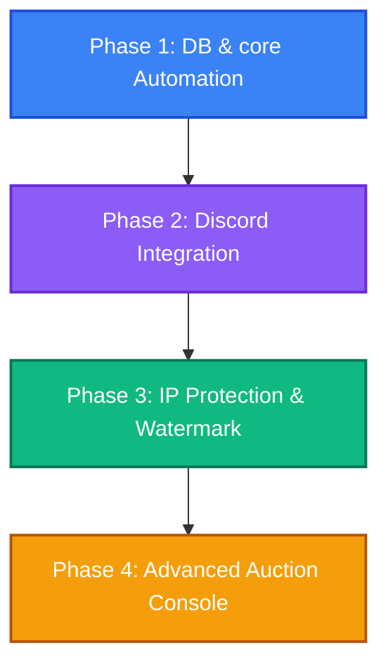
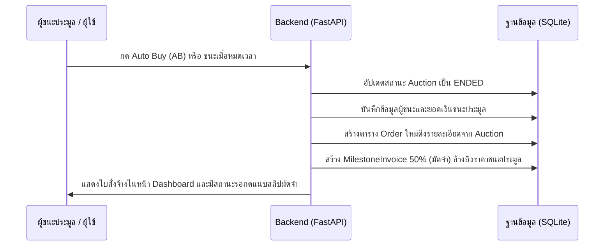
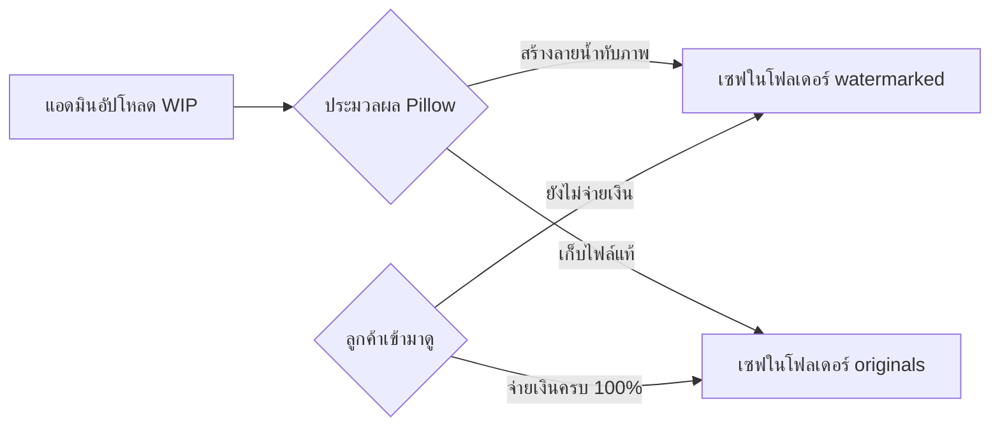

# SomJeed Platform: Comprehensive Development Roadmap & Feature Plan

แผนกลยุทธ์การขยายฟีเจอร์สำหรับแพลตฟอร์มคอมมิชชันและประมูลผลงานนักวาด (SomJeed) เพื่อยกระดับความปลอดภัย ความน่าเชื่อถือ และความสะดวกสบายในการซื้อขายเชิงพาณิชย์ให้เทียบเท่าระดับสากล

---

## 🗺️ แผนภาพรวมการพัฒนา (Development Roadmap)



---

## 🛠️ รายละเอียดฟีเจอร์เชิงลึก & แผนการทำงาน (Actionable Feature Details)

### 1. ระบบออกใบสั่งจ้างอัตโนมัติ (Instant Auto-Order Flow)
เมื่อการประมูลสิ้นสุดลง (ไม่ว่าจะจบตามเวลาปกติ หรือมีคนกด Auto Buy) ระบบจะแปลงสถานะการประมูลให้เป็น **ใบสั่งจ้างทำงาน (Order)** และสร้าง **ใบเรียกเก็บเงินงวดแรก (Milestone Invoice)** ให้กับผู้ชนะทันที

#### 🔄 ลำดับขั้นตอนการทำงาน (Workflow)


#### 🗄️ การอัปเดต Schema ของฐานข้อมูล (Database Schema Adjustments)
เพิ่มฟิลด์เชื่อมโยงระหว่างตาราง `Auction` และ `Order` เพื่อให้ระบบสืบค้นกลับได้สะดวก:

```sql
-- เพิ่มคอลัมน์ auction_id ในตาราง order เพื่ออ้างอิงแหล่งที่มา
ALTER TABLE "order" ADD COLUMN auction_id INTEGER REFERENCES auction(id);
```

---

### 2. ระบบป้องกันการขโมยภาพร่าง (Dynamic Watermarking System)
ช่วยป้องกันปัญหาลูกค้าบางรายเซฟรูปภาพร่าง (WIP) ไปใช้งานโดยไม่ชำระส่วนที่เหลือ โดยระบบจะแชร์ภาพที่มีการสลักลายน้ำแบบกึ่งโปร่งใส (Dynamic Text Overlay) บนหน้าเว็บ

#### 💡 แนวทางการพัฒนาระบบลายน้ำ
*   **การเรนเดอร์ลายน้ำฝั่ง Server-Side:** เมื่อแอดมินอัปโหลดภาพร่างประเภท `WIP` เข้าสู่หลังบ้าน ระบบ Python จะใช้ไลบรารี `Pillow` เพื่อสร้างลายน้ำสุ่มลงบนภาพ และจัดเก็บแยกไฟล์ไว้ในโฟลเดอร์ `uploads/watermarked`
*   **การปลดล็อกไฟล์จริง (Final Unlock):** เมื่อใบเสร็จยอดสุดท้าย (Balance Invoice) ถูกชำระเงินและกดยืนยันโดยแอดมินแล้ว ระบบจะเปลี่ยนลิงก์การดาวน์โหลดของลูกค้า ให้ชี้ไปยังไฟล์ภาพจริงความละเอียดสูงไร้ลายน้ำที่เก็บรักษาไว้ในส่วนปลอดภัย



---

### 3. ระบบแจ้งเตือนผ่าน Discord (Discord Webhook Notifications)
เชื่อมโยงพฤติกรรมบนเว็บไซต์เข้ากับเซิร์ฟเวอร์ Discord ของนักวาด/สตูดิโอ เพื่อกระตุ้นให้เกิดการแข่งขันประมูลและความเคลื่อนไหวที่รวดเร็วขึ้น

#### 📋 ประเภทการส่งแจ้งเตือน (Notification Matrix)

| เหตุการณ์ (Event) | ข้อมูลที่ส่งไปยัง Discord | รูปแบบการแสดงผล |
| :--- | :--- | :--- |
| **เปิดประมูลใหม่** | ชื่อตัวละคร/สเกลงาน, ราคาเริ่มต้น (SB), ราคาซื้อขาด (AB), ลิงก์เข้าสู่หน้าห้องประมูล | Embed Card พร้อมรูปผลงานพรีวิวขนาดใหญ่ |
| **มีการสู้ราคา (New Bid)** | ยอดเงินใหม่, ชื่อผู้ประมูล (ปิดบังบางตัวอักษร เช่น A***n), ลิงก์ห้องประมูล | Embed Card สีเขียว โชว์ความเคลื่อนไหวราคาปัจจุบัน |
| **โดนแซงราคา (Outbid Alert)** | แจ้งเตือนตรงหาลูกค้าที่เคยสู้ราคาผ่านระบบบอร์ดเว็บ | ข้อความแจ้งเตือนส่วนตัวหรืออัปเดตแจ้งเตือนในระบบ |
| **สิ้นสุดการประมูล** | ยอดเงินสิ้นสุด, ผู้ชนะประมูลอย่างเป็นทางการ, แจ้งปิดรับราคา | Embed Card สีเทา/ดำ สรุปผลการปิดประมูลอย่างเป็นทางการ |

> [!TIP]
> ควรสร้างสิทธิ์การใช้งาน (Role/Channel) แยกต่างหากใน Discord สำหรับงานประมูลโดยเฉพาะ เพื่อส่งเสียงเตือนเฉพาะกลุ่มลูกค้าที่ต้องการติดตามข่าวสารอย่างใกล้ชิด

---

### 💬 4. ระบบกระดานถามตอบหน้าประมูล (Auction Q&A & Discussion)
เพิ่มช่องทางการสื่อสารสำหรับให้ผู้ที่สนใจเข้าสอบถามสิทธิ์การใช้งาน หรือส่งข้อเสนอปรับเปลี่ยนเล็กๆ น้อยๆ เพื่อเพิ่มความน่าเชื่อถือให้กับผู้ประมูลทุกคน

#### 🗄️ โครงสร้างตารางฐานข้อมูลใหม่ (New DB Table Schema)
```sql
CREATE TABLE "auction_comment" (
    "id" INTEGER PRIMARY KEY AUTOINCREMENT,
    "auction_id" INTEGER NOT NULL REFERENCES auction(id),
    "user_id" INTEGER NOT NULL REFERENCES user(id),
    "content" TEXT NOT NULL,
    "parent_id" INTEGER REFERENCES auction_comment(id), -- สำหรับการตอบกลับ (Reply) จากนักวาด
    "created_at" DATETIME DEFAULT CURRENT_TIMESTAMP
);
```

---

### 📊 5. แผงควบคุมระบบการประมูลสำหรับแอดมิน (Admin Auction Manager Console)
เพื่อให้ศิลปินใช้งานระบบได้โดยไม่ต้องสั่งงานผ่าน SQL Command หรือเปิดตารางฐานข้อมูลโดยตรง

#### 💡 ฟีเจอร์ที่ต้องมีในหน้า Admin Console:
*   **Draft & Schedule:** สร้างห้องประมูลล่วงหน้า ป้อนข้อมูล และเลือกเวลาเปิด-ปิดการประมูลแบบตั้งเวลาล่วงหน้า
*   **Bid Moderation:** ลบหรือตัดสิทธิ์การประมูล (Retract Bid) ในกรณีที่ตรวจพบว่าเป็นผู้ใช้ป่วนหรือบัญชีปลอม
*   **Winner Verification:** ระบบกดตรวจสอบสลิปการโอนเงินค่าประมูล และกดตรวจสอบสิทธิ์ในการเริ่มโปรเจกต์งาน

---

## 🚀 แผนการนำไปปฏิบัติงาน (Execution Plan)

> [!IMPORTANT]
> เพื่อการพัฒนาที่ปลอดภัยและยั่งยืน ควรทดลองพัฒนาระบบตามลำดับขั้นตอนดังนี้เพื่อลดโอกาสเกิด Bug สะสม:

### ขั้นที่ 1: ปรับปรุงความสมบูรณ์ฝั่งฐานข้อมูล & หลังบ้าน (Backend Data Health)
*   [ ] เขียนคำสั่งอัปเดตโมเดล Order ในฝั่ง FastAPI ให้เชื่อมโยงกับตารางประมูล (`auction_id`)
*   [ ] พัฒนาฟังก์ชันสร้างใบสั่งซื้ออัติโนมัติเมื่อกด Auto Buy และทดสอบความเข้ากันได้ของระบบการชำระเงิน

### ขั้นที่ 2: พัฒนาระบบลายน้ำและการส่งภาพแบบสตรีมมิ่ง (WIP Watermark)
*   [ ] ติดตั้งชุดโปรแกรมจัดการภาพสำหรับหลังบ้าน: `pip install Pillow`
*   [ ] เขียนตัวแปลงรูปภาพสลักลายน้ำอเนกประสงค์
*   [ ] ทดสอบการป้องกันลิงก์รูปภาพดิบโดยควบคุมสิทธิ์เข้าถึงผ่าน Endpoint พิเศษ เช่น `/api/orders/{id}/wip` เท่านั้น

### ขั้นที่ 3: ออกแบบหน้าจอควบคุมและการตกแต่งเพิ่มเติม (Frontend Polish)
*   [ ] นำใบหน้าสั่งงาน (Forms) ของแอดมินไปเพิ่มลงในหน้า `/dashboard/admin`
*   [ ] อัปเดตการแสดงผลไอคอนการแจ้งเตือน (Notifications) และเสียงแจ้งเตือนแบบเรียลไทม์ผ่าน WebSocket

---

## 👥 5 ปัญหาของศิลปินที่ทำงานบน Facebook Group & ไอเดียแก้ไขด้วยเว็บ SomJeed

จากการวิเคราะห์พฤติกรรมของนักวาดและศิลปิน Adoptable ที่เน้นการซื้อขาย/ประมูลบน **Facebook Groups** (เช่น กลุ่มประมูล Adoptable หรือกลุ่มคอมมิชชันต่าง ๆ ของไทย) มักจะพบปัญหาคลาสสิก 5 ประการดังนี้ ซึ่งระบบเว็บ SomJeed สามารถเข้าไปแก้ปัญหาเหล่านี้ได้อย่างยั่งยืนครับ:

### ⚠️ ปัญหาที่ 1: การป่วนราคา / ประมูลชนะแล้วหนีหาย (Ghost Bidders & Troll Accounts)
*   **พฤติกรรมบน Facebook:** ลูกค้าบางคนใช้บัญชีอวตาร (Clone/Fake Account) เข้ามาเคาะราคาประมูลเพื่อป่วน หรือบางคนกุมราคาประมูลไว้จนชนะ แต่สุดท้ายกลับเงียบหาย (Ghosting) ลบเม้นต์หนี หรือไม่ยอมชำระเงิน ทำให้ศิลปินเสียเวลาและเสียโอกาสขายให้คนอื่น
*   **💡 ไอเดียแก้ปัญหา (Verified Bidder & Deposit Hold):**
    *   **เชื่อมต่อบัญชีโซเชียลจริง:** ผู้ใช้ที่ต้องการเข้าร่วมการประมูลบนเว็บจะต้องเชื่อมต่อระบบยืนยันตัวตนผ่านบัญชี Facebook/Discord จริง และยืนยันอีเมลก่อนเคาะราคาได้
    *   **ระบบมัดจำสิทธิ์การประมูล (Security Deposit/Hold):** สำหรับผลงานชิ้นที่มีราคา AB สูงๆ สามารถเปิดใช้งานฟังก์ชัน "โอนมัดจำสิทธิ์ประมูลขั้นต่ำ" (เช่น 50 บาท) ก่อนเข้าเคาะราคา หากประมูลชนะ ยอดนี้จะถูกหักลบกับค่าภาพร่าง หากประมูลแพ้จะได้เงินคืน แต่หากประมูลชนะแล้วหนี ยอดนี้จะถูกริบเป็นของศิลปินทันทีและบัญชีนั้นจะติดแบล็คลิสต์ (Banned) อัตโนมัติ

### ⚠️ ปัญหาที่ 2: ระบบแจ้งเตือนคนโดน "เคาะสู้ราคา" ช้าเกินไป (Delayed Outbid Tagging)
*   **พฤติกรรมบน Facebook:** เมื่อมีคนมาเคาะราคาแซง ศิลปินต้องมานั่งพิมพ์แท็กหาคนก่อนหน้าด้วยตนเอง บางครั้งพิมพ์แท็กตกหล่น หรือ Facebook ไม่แจ้งเตือนแท็ก ส่งผลให้คนประมูลก่อนหน้าไม่รู้ตัวว่าราคาโดนแซงไปแล้วจนกระทั่งหมดเวลาประมูล ทำให้ศิลปินเสียรายได้ที่จะได้เพิ่มขึ้นจากการแข่งราคา
*   **💡 ไอเดียแก้ปัญหา (Automated Outbid Trigger):**
    *   **ยิงแจ้งเตือนผ่านช่องทางตรงทันที:** เมื่อมีคนเคาะราคาสูงกว่า ระบบเว็บจะส่งการแจ้งเตือนแบบทันท่วงที (Real-time Push Notification) ไปยังมือถือของผู้ประมูลคนก่อนหน้าทันที หรือส่งแจ้งเตือนผ่าน DM ใน Discord/Email อัตโนมัติ
    *   **แสดงสถานะ Leading/Outbid บนหน้าจอชัดเจน:** หน้าเว็บมีแถบสีบอกชัดเจนว่าคุณยังเป็นผู้เสนอราคาสูงสุดอยู่หรือไม่ โดยไม่ต้องกดรีเฟรชหน้าเว็บ

### ⚠️ ปัญหาที่ 3: ดราม่าเรื่องลำดับเวลาช่วงท้ายประมูล (Timestamp Sorting Conflicts & Sniping Drama)
*   **พฤติกรรมบน Facebook:** ช่วงนาทีสุดท้ายของการปิดประมูล ลูกค้ามักจะแห่กันมาเคาะราคาพร้อมกัน แต่ระบบเรียงคอมเมนต์ของ Facebook มักเรียงลำดับเม้นต์ไม่เท่ากันในแต่ละเครื่องคอม/มือถือ (เครื่องศิลปินเห็นคน A เม้นต์ก่อน แต่เครื่องคน B เห็นตัวเองเม้นต์ก่อน) ทำให้เกิดการโต้เถียง ทะเลาะ และดราม่าในกลุ่มบ่อยครั้ง
*   **💡 ไอเดียแก้ปัญหา (Absolute Server Millisecond Log & Anti-Sniping):**
    *   **เก็บบันทึกระดับมิลลิวินาที (Millisecond Server Logs):** ระบบประมูลบนเว็บ SomJeed จะยึดเวลาจากเครื่องแม่ข่าย (Server Clock) เป็นหลัก โดยบันทึกเวลาที่ได้รับราคาประมูลอย่างละเอียดระดับมิลลิวินาที (e.g. 20:59:59.452) และโชว์บอร์ดประวัติการเคาะอย่างชัดเจน โปร่งใส ปราศจากข้อกังขา
    *   **ระบบต่อเวลาสไนเปอร์อัติโนมัติ (Anti-Sniping Extension):** หากมีการเคาะสู้ราคาในช่วง 5 นาทีสุดท้าย ระบบจะต่อเวลาประมูลเพิ่มไปอีก 5 นาทีโดยอัตโนมัติ เพื่อให้ผู้สู้ราคาคนอื่นมีเวลากดสู้ราคาอย่างยุติธรรม

### ⚠️ ปัญหาที่ 4: การตามหาคิวงานวาดและภาพร่างที่กระจัดกระจาย (Lost WIPs and Queue updates in Group Feed)
*   **พฤติกรรมบน Facebook:** เมื่อศิลปินรับคิวงานเยอะ (5-10 คิว) การโพสต์อัปเดตงานในกลุ่มหรือทักแชทคุยงานใน Messenger มักจะสับสน ภาพร่างกระจัดกระจายหายไปในข้อความแชท หรือโพสต์อัปเดตคิวโดนโพสต์อื่นในกลุ่ม Facebook กลบหายไปจนหมด ทำให้ลูกค้าชอบทักถามเรื่อย ๆ ว่า "ถึงคิวหนูหรือยัง?"
*   **💡 ไอเดียแก้ปัญหา (Self-Service Client Board & Centralized Assets):**
    *   **บอร์ดคิวงานกลาง (Public Queue Roadmap):** ศิลปินลงอัปเดตสถานะงานวาดในที่เดียวบนเว็บไซต์ และลูกค้าสามารถใช้ลิงก์สากลมาส่องดูได้เลยว่าคิวงานของตนกำลังอยู่ในขั้นตอนใด (Sketching, Lining, Coloring)
    *   **กล่องเก็บไฟล์งานประจำออเดอร์:** ใน Dashboard ลูกค้าจะมีประวัติการส่งภาพร่าง WIP แต่ละเวอร์ชัน รวมถึงสามารถเข้ามากดคุยส่งฟีดแบกแก้ไขงาน (Revision quota) และมีปุ่มดาวน์โหลดไฟล์งานจริงที่จัดเก็บบันทึกไว้เป็นระบบถาวร ไม่สูญหายเหมือนเซฟจากแชทโซเชียล

### ⚠️ ปัญหาที่ 5: ปัญหาการรับเงินลูกค้าต่างชาติและการแปลงสกุลเงิน (Cross-border Payments & Exchange Rate Issues)
*   **พฤติกรรมบน Facebook:** ศิลปินไทยที่โพสต์ผลงานแนว Adoptable บ่อยครั้งจะมีลูกค้าต่างชาติเข้ามาร่วมประมูลผ่านกลุ่มอินเตอร์ ทว่าการรับเงินผ่าน PayPal ส่วนตัวมักโดนหักค่าธรรมเนียมสูงปรี๊ด หรือลูกค้าต่างชาติสับสนกับช่องทางการโอนเงิน PromptPay ของไทย
*   **💡 ไอเดียแก้ปัญหา (Multi-currency checkout with Stripe & PayPal API):**
    *   **แปลงราคาและสกุลเงินอัติโนมัติ:** เมื่อลูกค้าต่างชาติเข้าร่วมประมูลหรือชำระเงิน ระบบจะคำนวณอัตราแลกเปลี่ยนปัจจุบันให้ทันที (THB เป็น USD)
    *   **ช่องทางชำระเงินสองฝั่ง:** เชื่อมต่อกับ Stripe / PayPal API ทำให้ฝั่งลูกค้าต่างชาติสามารถจ่ายเงินด้วยบัตรเครดิตส่วนตัวได้อย่างรวดเร็ว ขณะที่ระบบของศิลปินจะได้รับการยืนยันยอดเงินโอนเข้าบัญชีไทยในรูปแบบสกุลเงินบาทโดยอัตโนมัติ พร้อมส่งสลิปหลักฐานยืนยันอัติโนมัติ

### ⚠️ ปัญหาที่ 6: มิจฉาชีพสร้างโปรไฟล์ปลอมมาแอบอ้างสวมรอยทักแชทลูกค้า (Artist Impersonation Scams)
*   **พฤติกรรมบน Facebook:** มิจฉาชีพมักเฝ้าสังเกตคอมเมนต์ในโพสต์ประมูล เมื่อประมูลจบหรือใกล้จบ มิจฉาชีพจะสร้างบัญชี Facebook ปลอมที่มีชื่อและรูปโปรไฟล์เหมือนศิลปินเป๊ะๆ แล้วแอบทักแชท DM ไปหาผู้ร่วมประมูลสำรอง (Runner-up) หรือผู้ชนะ โดยหลอกว่า "คนที่ชนะประมูลสิทธิ์หลุด กรุณาโอนเงินเข้าบัญชีนี้ด่วน" ทำให้ลูกค้าเสียเงินฟรีและศิลปินเสียชื่อเสียง
*   **💡 ไอเดียแก้ปัญหา (Secure Off-Facebook Invoicing Platform):**
    *   **บล็อกการยืนยันเงินผ่านแชท:** เว็บไซต์จะระบุแจ้งเตือนหน้าโฮมเด่นชัดว่า *"ระบบไม่มีการทักแชท Facebook เพื่อเรียกเก็บเงินแยกต่างหาก การทำธุรกรรมทั้งหมดต้องเกิดและชำระผ่านหน้าระบบแดชบอร์ดบนเว็บไซต์ SomJeed เท่านั้น"*
    *   **รหัสบิลและลิงก์ชำระเฉพาะตัว (Unique Invoice Token):** ลิงก์ใบเรียกเก็บเงินจะถูกผูกเข้ากับระบบ Token ที่ปลอดภัย ป้องกันไม่ให้บุคคลภายนอกที่ไม่ใช่สมาชิกและไม่ใช่ผู้มีสิทธิ์เข้าถึงเลขบัญชีหรือข้อมูลการชำระเงินได้

### ⚠️ ปัญหาที่ 7: ความยุ่งยากของการแบ่งผ่อนชำระสำหรับงานมูลค่าสูง (Payment Plan Defaults & Tracking Overhead)
*   **พฤติกรรมบน Facebook:** Adoptable หรือโมเดล VTuber มักมีราคาประมูลจบที่ค่อนข้างสูง (หลักหมื่นบาท) ศิลปินจึงต้องมีตัวเลือกการผ่อนจ่าย (Payment Plan) เช่น ผ่อน 3 งวด/3 เดือน แต่ปัญหาคือศิลปินต้องคอยตามจดบันทึกยอดเงินเอง ทวงยอดทุกสัปดาห์ และเสี่ยงต่อการที่ลูกค้าจ่ายงวดแรกๆ แล้วยกเลิก/หายตัวไปกลางคัน ทำให้งานค้างและปล่อยขายต่อยาก
*   **💡 ไอเดียแก้ปัญหา (Automated Installment Manager & Deposit Forfeiture Contract):**
    *   **ระบบคำนวณงวดการชำระเงิน:** ศิลปินสามารถระบุเงื่อนไขผ่อนชำระลงในกติกาประมูลได้เลย หน้าระบบจะคำนวณยอดเงินแต่ละงวด (Installment Splits) และส่งเมลแจ้งเตือนลูกค้าเมื่อถึงกำหนดชำระโดยอัตโนมัติ
    *   **สัญญาเก็บรักษาไฟล์จนกว่าจะจ่ายครบ:** ระบบจะทำการล็อคสิทธิ์ดาวน์โหลดภาพแท้ และปล่อยภาพลายน้ำพรีวิวเท่านั้น จนกว่างวดสุดท้ายจะกดยืนยันชำระเงินเรียบร้อย หากเลยกำหนดและเบี้ยวจ่าย ระบบจะปิดออเดอร์และริบเงินมัดจำงวดแรกๆ ตามเงื่อนไขสัญญาอย่างเป็นธรรม

### ⚠️ ปัญหาที่ 8: การละเมินเงื่อนไขการใช้งานและการแอบอ้างสิทธิ์ (TOS Abuse & AI/NFT Protections)
*   **พฤติกรรมบน Facebook:** ลูกค้าบางคนนำภาพ Adoptable ไปดัดแปลง ดัดแปลงดีไซน์ นำไปขายสินค้า (Merchandise) เชิงพาณิชย์โดยไม่ได้จ่ายค่าลิขสิทธิ์เชิงพาณิชย์ หรือหนักสุดคือนำภาพไปเทรนป้อนระบบ AI Generator หรือนำไปทำรูปสลักสิทธิ์ NFT ซึ่งขัดต่อกฎของนักวาดไทยส่วนใหญ่
*   **💡 ไอเดียแก้ปัญหา (Standardized License Badges & Contract Attachment):**
    *   **ตราสัญลักษณ์สิทธิ์การใช้งาน (Standardized License Badges):** หน้ารายละเอียดผลงานและหน้าสั่งจ้างจะมีป้าย Badge ชัดเจนเพื่อบังคับข้อตกลง เช่น "สิทธิ์การใช้งานส่วนบุคคล (Personal Use Only)", "ห้ามป้อนข้อมูลเข้า AI (AI Training Banned)", "ห้ามทำ NFT" 
    *   **ข้อตกลงแบบ Digital Sign-off:** ก่อนลูกค้าจะกดยืนยันชำระเงิน ต้องคลิกยอมรับเงื่อนไขลิขสิทธิ์นี้อย่างชัดเจน ซึ่งมีผลทางกฎหมายดิจิทัลและผูกเข้ากับหลักฐานบัญชีสมาชิกของตนเอง

### ⚠️ ปัญหาที่ 9: การเปลี่ยนมือสิทธิ์ความเป็นเจ้าของผลงานในตลาดรอง (Secondary Market Resell & Trade Tracking)
*   **พฤติกรรมบน Facebook:** ภาพตัวละคร (Adoptable) มักจะมีการขายต่อ (Resell) แลกเปลี่ยน (Trade) หรือยกให้คนอื่น (Gift) ในตลาดรองบ่อยครั้ง ซึ่งเมื่อเปลี่ยนมือไปหลายครั้ง ศิลปินจะขาดการเชื่อมโยงและไม่รู้เลยว่าใครเป็นเจ้าของสิทธิ์ดีไซน์คนปัจจุบัน ทำให้ตรวจสอบสิทธิ์การนำไปใช้วาดต่อหรือ Live2D ได้ยากมาก
*   **💡 ไอเดียแก้ปัญหา (Ownership Transfer Ledger):**
    *   **ระบบบันทึกกรรมสิทธิ์ผู้ครอบครอง (Proof of Ownership):** แพลตฟอร์ม SomJeed มีหน้าเช็คประวัติผลงานชิ้นนั้นๆ ว่าใครเป็นเจ้าของสิทธิ์คนปัจจุบัน
    *   **ระบบกดโอนสิทธิ์บนเว็บ (Ownership Transfer System):** เมื่อเจ้าของผลงานต้องการขายต่อหรือโอนให้เพื่อน พวกเขาต้องมากดส่งโอนสิทธิ์ (Transfer request) บนเว็บไซต์ โดยใส่ชื่อบัญชีของผู้รับโอน ระบบจะบันทึกประวัติการเปลี่ยนมือสัญญานี้อย่างเป็นทางการ ศิลปินและสังคมสามารถมาค้นหาประวัติได้ทันทีเพื่อป้องกันการนำดีไซน์ที่ขโมยมาแอบขายต่อ

### ⚠️ ปัญหาที่ 10: ยอดเข้าถึง (Reach) ของผลงานตกต่ำจากการบดบังของโพสต์อื่น (Facebook Algorithm Suppression)
*   **พฤติกรรมบน Facebook:** การโพสต์ขายงานวาดหรือจัดประมูลบนกลุ่ม Facebook มักโดนปิดกั้นการมองเห็นโดยอัลกอริทึม หากโพสต์นั้นแนบลิงก์ภายนอก หรือโพสต์รูปที่มีตัวหนังสือเยอะ โพสต์ประมูลจึงถูกปล่อยทิ้งให้เงียบเหงา ศิลปินปิดงานได้ยอดต่ำกว่าที่ควรจะเป็น
*   **💡 ไอเดียแก้ปัญหา (Public RSS, Newsletter Syndication & SEO Optimization):**
    *   **ระบบจดหมายข่าวอัพเดทประมูล (Auction Newsletter):** สมาชิกที่กดสมัครจดหมายข่าวไว้ จะได้อีเมลและแจ้งเตือนผ่านบอทดิสคอร์ดทันทีเมื่อมีรายการประมูลผลงานใหม่ขึ้นมา ไม่ต้องพึ่งพา Reach ของกลุ่ม Facebook
    *   **หน้าเว็บที่สแกนเจอผ่าน Google (SEO-Friendly Showcase):** ผลงานประมูลที่ถูกเปิดเป็นสาธารณะ จะถูกจัดดัชนีเข้าสู่หน้าการค้นหาบน Google ทำให้ผู้ที่ค้นหาแนวดีไซน์ที่เกี่ยวข้องสามารถค้นเจอห้องประมูลของคุณได้โดยตรงจากภายนอกโซเชียลมีเดีย
