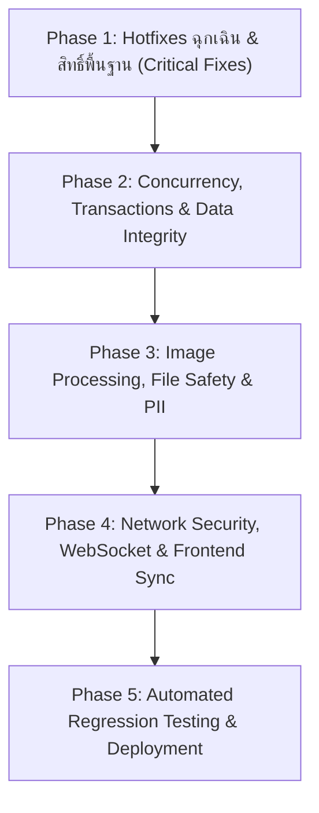

# 📋 แผนปฏิบัติการแก้ไขช่องโหว่ความปลอดภัยและปรับปรุงเสถียรภาพระบบ DICE Platform
> **Comprehensive Step-by-Step Security Remediation & System Hardening Blueprint**  
> **ระดับความเข้มงวด:** สูงสุด (Zero-Hallucination & Deterministic Sub-task Execution)  
> **เป้าหมาย:** แก้ไขช่องโหว่ 24 รายการให้ครบถ้วน 100% พร้อมชุดทดสอบยืนยันและแผนสำรอง (Rollback Plan)

---

## 🎯 1. สรุปภาพรวมและโครงสร้างแผนงาน (Execution Architecture)

แผนการทำงานถูกแบ่งออกเป็น **4 เฟสหลัก** เรียงลำดับตามความสำคัญเร่งด่วน โดยแต่ละงานย่อยระบุ **ไฟล์เป้าหมาย (Target File)**, **บรรทัดที่ได้รับผลกระทบ (Affected Lines)**, **ขั้นตอนการแก้โค้ดอย่างละเอียด (Exact Implementation Steps)**, และ **วิธีทดสอบยืนยันผล (Verification Method)**

---

## 🚀 เฟส 1: Hotfixes ฉุกเฉินและระบบสิทธิ์พื้นฐาน (Critical & Access Control Fixes)

### งานย่อย 1.1: แก้ไข `NameError: artist_user` ในระบบประมูลและแชทประมูล
- **ไฟล์เป้าหมาย:** [`backend/api/routers/auctions.py`](file:///home/fain/Dice/backend/api/routers/auctions.py#L227-L233)
- **บรรทัดที่ต้องแก้ไข:** บรรทัด 227–233 (`api_place_bid`), บรรทัด 397–402 (`api_get_auction_messages`), บรรทัด 417–422 (`api_create_auction_message`)
- **การดำเนินการ:**
  1. ลบโค้ดตรวจสอบสิทธิ์ `if not artist_user.is_admin:` ออกจากทั้ง 3 ฟังก์ชัน เนื่องจากฟังก์ชันเหล่านี้เปิดให้ลูกค้าและผู้ใช้ทั่วไปเข้าถึงได้
  2. ใน `api_place_bid` เพิ่มเงื่อนไขตรวจสอบป้องกันศิลปินบิดแข่งในห้องประมูลของตนเอง (`if auction.artist and auction.artist.user_id == current_user.id: raise HTTPException(400, "Artists cannot place bids on their own auctions")`)
  3. เพิ่มเงื่อนไขป้องกันการบิดซ้ำหากตนเองเป็นผู้บิดราคาสูงสุดอยู่แล้ว (`if highest_bid and highest_bid.bidder_id == current_user.id: raise HTTPException(400, "You already hold the highest bid")`)
- **การทดสอบยืนยัน:**
  - ยิงคำสั่ง `POST /api/auctions/{id}/bid` ด้วย User Client ➔ ต้องได้รับ HTTP 200 และบิดสำเร็จ (ไม่เกิด Error 500)
  - ทดสอบใช้บัญชีศิลปินเจ้าของห้องบิด ➔ ต้องได้รับ HTTP 400 ปฏิเสธการบิด

---

### งานย่อย 1.2: แก้ไขตรรกะตรวจเช็คยอดชำระเงินเต็มจำนวน (Escrow Full-Payment Invariant)
- **ไฟล์เป้าหมาย:** [`backend/services/order_service.py`](file:///home/fain/Dice/backend/services/order_service.py#L4-L8)
- **บรรทัดที่ต้องแก้ไข:** บรรทัด 4–8 ฟังก์ชัน `is_order_fully_paid`
- **การดำเนินการ:**
  1. ดึงข้อมูล `order = session.get(Order, order_id)`
  2. ตรวจสอบว่า `order` มีอยู่จริง และ `order.agreed_price > 0`
  3. ตรวจสอบว่ามีใบแจ้งหนี้อย่างน้อย 1 ใบ และทุกใบที่ออกมีสถานะ `is_paid == True`
  4. คำนวณ `total_paid = sum(inv.amount for inv in invoices if inv.is_paid)` และตรวจสอบว่า `total_paid >= round(order.agreed_price, 2)`
- **การทดสอบยืนยัน:**
  - สร้างออเดอร์ราคา 1,000 บาท ออกใบแจ้งหนี้มัดจำ 200 บาท จ่ายแล้ว ➔ `is_order_fully_paid()` ต้องคืนค่า `False`
  - ออกใบแจ้งหนี้งวดสุดท้าย 800 บาท จ่ายครบ ➔ `is_order_fully_paid()` ต้องคืนค่า `True`

---

### งานย่อย 1.3: ปิดช่องโหว่ Watermark Fail-Open Leakage
- **ไฟล์เป้าหมาย:** [`backend/core/watermark.py`](file:///home/fain/Dice/backend/core/watermark.py#L230-L238)
- **บรรทัดที่ต้องแก้ไข:** บรรทัด 230–238 บล็อก `except Exception as e:` ใน `apply_watermark`
- **การดำเนินการ:**
  1. ลบคำสั่ง `im.save(output_image_path)` ในบล็อก `except` ทิ้งทั้งหมด
  2. เพิ่มโค้ดลบไฟล์ `output_image_path` ที่อาจเขียนค้างไว้ทิ้ง (`if os.path.exists(output_image_path): os.remove(output_image_path)`)
  3. Log รายละเอียด Error ด้วย `logging.error(...)` และคืนค่า `False`
- **การทดสอบยืนยัน:**
  - ส่งไฟล์ภาพที่จงใจให้เกิด Error ใน Pillow ➔ ไฟล์ปลายทางใน `uploads/watermarked/` ต้องไม่ถูกบันทึกภาพต้นฉบับดิบ และฟังก์ชันคืนค่า `False`

---

### งานย่อย 1.4: เพิ่ม Authentication ให้ระบบสร้างบริการศิลปิน & แก้ไข Profile Admin
- **ไฟล์เป้าหมาย:** [`backend/api/routers/artists.py`](file:///home/fain/Dice/backend/api/routers/artists.py#L186-L204,L344-L377)
- **บรรทัดที่ต้องแก้ไข:** บรรทัด 344–377 (`add_artist_service`), บรรทัด 186–204 (`get_my_profile` / `update_my_profile`)
- **การดำเนินการ:**
  1. ใน `add_artist_service` ใส่ Dependency `artist_user: User = Depends(get_artist_user)`
  2. ตรวจสอบสิทธิ์ว่า `artist_user.is_admin` หรือ `artist.user_id == artist_user.id` เท่านั้น หากไม่ใช่ให้ส่ง `HTTP 403 Forbidden`
  3. ใน `get_my_profile` และ `update_my_profile` ลบโค้ด `profile = session.exec(select(ArtistProfile)).first()` ทิ้ง (ไม่ให้ fallback ไปทับศิลปินคนอื่น) หากไม่มีโปรไฟล์ให้คืนค่า `HTTP 404`
- **การทดสอบยืนยัน:**
  - ยิง `POST /api/artists/{handle}/services` โดยไม่ส่ง Token ➔ ได้รับ HTTP 401
  - ยิงโดยส่ง Token ของศิลปินคนอื่น ➔ ได้รับ HTTP 403

---

### งานย่อย 1.5: แก้ไข BOLA ล็อกศิลปินในระบบออเดอร์ (Invoices, Slips, Deliverables)
- **ไฟล์เป้าหมาย:** [`backend/api/routers/orders.py`](file:///home/fain/Dice/backend/api/routers/orders.py#L199-L625)
- **บรรทัดที่ต้องแก้ไข:** บรรทัด 202, 254, 341, 381, 401, 565, 591, 603
- **การดำเนินการ:**
  1. สร้างฟังก์ชันกลาง `_is_order_member(order: Order, user: User) -> bool` ที่คืนค่า `True` เมื่อเป็น Admin, หรือ `order.client_id == user.id`, หรือ `order.artist_id == user.id`
  2. แก้ไขจุดตรวจสอบสิทธิ์ทุกจุดใน `orders.py` ให้ใช้ฟังก์ชันกลางนี้
  3. ใน `download_order_file` (บรรทัด 603) กำหนดให้ศิลปินเจ้าของงานและ Admin ได้รับไฟล์ต้นฉบับคมชัดเสมอโดยไม่ต้องติดเงื่อนไขการชำระเงิน
- **การทดสอบยืนยัน:**
  - ล็อกอินด้วยบัญชีศิลปิน เรียกดูสลิปเงิน `GET /api/invoices/{id}/slip` ➔ ต้องเปิดดูภาพสลิปได้สำเร็จ (HTTP 200)

---

## 🔒 เฟส 2: Concurrency, Transactions & Data Integrity

### งานย่อย 2.1: ใส่ Pessimistic Row Locking (`with_for_update()`) ในระบบบิดราคา
- **ไฟล์เป้าหมาย:** [`backend/api/routers/auctions.py`](file:///home/fain/Dice/backend/api/routers/auctions.py#L243-L263)
- **การดำเนินการ:**
  1. ใช้ `select(Auction).where(Auction.id == auction_id).with_for_update()` เพื่อล็อกแถวข้อมูลของห้องประมูล
  2. ใช้ `select(Bid).where(Bid.auction_id == auction_id).order_by(Bid.amount.desc()).with_for_update()` เพื่อล็อกราคาบิดสูงสุด
  3. คำนวณ `min_required_bid = round(highest_bid.amount + auction.bid_increment, 2)` และบันทึกบิดใหม่อย่างเป็นลำดับ (Atomic Serialization)
- **การทดสอบยืนยัน:**
  - ยิงคำสั่งเสนอราคาพร้อมกัน 10 คำสั่งในเสี้ยววินาทีเดียวกัน (Concurrent Requests) ➔ ต้องไม่มีบิดราคาซ้ำกัน และราคาทุกบิดต้องเรียงลำดับถูกต้องตาม `bid_increment`

---

### งานย่อย 2.2: รวบกระบวนการปิดประมูล (Auto-Buy & Expiration) ให้สมบูรณ์ใน Transaction เดียว
- **ไฟล์เป้าหมาย:** [`backend/services/auction_service.py`](file:///home/fain/Dice/backend/services/auction_service.py#L16-L107), [`backend/api/routers/auctions.py:L286-L294`](file:///home/fain/Dice/backend/api/routers/auctions.py#L286-L294)
- **การดำเนินการ:**
  1. สร้างฟังก์ชัน `finalize_auction_closure(auction: Auction, winner_id: int, winning_bid: float, session: Session)`
  2. ทำการอัปเดต `auction.status = AuctionStatus.ENDED`, สร้าง `Order`, สร้าง `MilestoneInvoice` และบันทึก `DBFile` ใน `session.commit()` เดียวกัน
  3. แก้ไข `api_place_bid` เมื่อเกิด Auto-Buy ให้เรียกใช้ฟังก์ชันปิดประมูลนี้โดยตรง
  4. แมป `artist_id` ของออเดอร์ให้ตรงกับ `User.id` ของศิลปินจริง (ไม่ Hardcode เป็น 1)
- **การทดสอบยืนยัน:**
  - กดปุ่ม Auto Buy (AB) ➔ ตรวจสอบในตาราง `order` และ `milestoneinvoice` ต้องมีออเดอร์และใบแจ้งหนี้เกิดขึ้นทันที พร้อมส่ง WebSocket แจ้งเตือน

---

### งานย่อย 2.3: ปรับ Timezone UTC และแก้อาการเวลายืดสะสมใน Anti-Sniping
- **ไฟล์เป้าหมาย:** [`backend/api/routers/auctions.py`](file:///home/fain/Dice/backend/api/routers/auctions.py#L140-L142,L264-L272,L369-L371)
- **การดำเนินการ:**
  1. สร้าง Helper `to_naive_utc(dt: datetime) -> datetime` เพื่อแปลงเวลาที่มี Offset จาก Frontend ให้เป็น UTC Naive ก่อนเก็บลง DB
  2. แก้ไขตรรกะ Anti-Sniping: คำนวณ `extended_time = now + timedelta(minutes=5)` และเซ็ต `auction.end_time = max(auction.end_time, extended_time)` (ไม่ใช้การบวกสะสม `end_time += 5min`)
- **การทดสอบยืนยัน:**
  - ส่งบิด 5 ครั้งในช่วง 2 นาทีสุดท้าย ➔ เวลาสิ้นสุดต้องยืดออกไปเป็น 5 นาทีจากเวลาปัจจุบัน (ไม่กลายเป็น 25 นาที)

---

### งานย่อย 2.4: กำหนด Foreign Key Cascades ใน Database Models
- **ไฟล์เป้าหมาย:** [`backend/models/user.py`](file:///home/fain/Dice/backend/models/user.py), [`backend/models/order.py`](file:///home/fain/Dice/backend/models/order.py), [`backend/models/artwork.py`](file:///home/fain/Dice/backend/models/artwork.py), [`backend/models/character.py`](file:///home/fain/Dice/backend/models/character.py)
- **การดำเนินการ:**
  1. ใส่ `sa_relationship_kwargs={"cascade": "all, delete-orphan"}` ใน Relationship ของ `User.orders`, `User.notifications`, `Order.milestone_invoices`, `Order.revisions`, `Order.files`, `Order.messages`
  2. ใส่ `ondelete="CASCADE"` ใน Foreign Key ทุกฟิลด์ที่ผูกกับ Parent
  3. ใส่ `ondelete="SET NULL"` ใน `Artwork.character_id`
- **การทดสอบยืนยัน:**
  - ทดสอบลบ User ทดสอบที่มีออเดอร์ ➔ คำสั่ง `session.delete(user)` ต้องทำงานสำเร็จโดยไม่เกิด `IntegrityError`

---

## 🎨 เฟส 3: Image Processing, File Safety & PII Masking

### งานย่อย 3.1: รองรับ Color Modes ใน Pillow และจัดการหน่วยความจำ
- **ไฟล์เป้าหมาย:** [`backend/core/watermark.py`](file:///home/fain/Dice/backend/core/watermark.py)
- **การดำเนินการ:**
  1. สร้างฟังก์ชัน `safe_convert_to_rgba(img: Image.Image)` รองรับ CMYK, P (Palette with transparency), L (Grayscale), 1-bit
  2. สร้างฟังก์ชัน `save_image_securely(img, output_path)` จัดการบันทึก JPEG (แปลง Alpha เป็นพื้นหลังขาว) และ Animated GIF
  3. ใส่บล็อก `finally:` ปิด Buffer ของภาพทุกตัวด้วย `.close()` ป้องกัน Memory Leak
- **การทดสอบยืนยัน:**
  - ทดสอบอัปโหลดภาพ CMYK JPEG, Transparent PNG, และ Animated GIF ➔ ต้องประมวลผลลายน้ำได้โดยไม่เกิด Exception

---

### งานย่อย 3.2: ป้องกัน Decompression Bomb & ตรวจสอบ Magic Bytes ในการอัปโหลด
- **ไฟล์เป้าหมาย:** [`backend/api/routers/portfolio.py`](file:///home/fain/Dice/backend/api/routers/portfolio.py), [`backend/api/routers/characters.py`](file:///home/fain/Dice/backend/api/routers/characters.py), [`backend/api/routers/auth.py`](file:///home/fain/Dice/backend/api/routers/auth.py)
- **การดำเนินการ:**
  1. กำหนด `Image.MAX_IMAGE_PIXELS = 50_000_000`
  2. ตรวจสอบ Magic Bytes ของไฟล์อัปโหลดด้วย `Image.open(io.BytesIO(chunk)).verify()` ป้องกันการเปลี่ยนนามสกุลไฟล์แอบแฝง
  3. จำกัดขนาดไฟล์อัปโหลดสูงสุดไม่เกิน 15 MB
- **การทดสอบยืนยัน:**
  - อัปโหลดไฟล์ `.html` ที่เปลี่ยนชื่อเป็น `.png` ➔ ต้องถูกปฏิเสธด้วย HTTP 400

---

### งานย่อย 3.3: แก้ไข Public Queue และ Mask ข้อมูลส่วนตัว (PII)
- **ไฟล์เป้าหมาย:** [`backend/api/routers/orders.py`](file:///home/fain/Dice/backend/api/routers/orders.py#L50-L70)
- **การดำเนินการ:**
  1. ลบการเรียกฟิลด์ `o.current_stage` ที่ไม่มีใน Model ออก (ใช้ `o.status.value` แทน)
  2. กรองเฉพาะออเดอร์ที่อยู่ในสถานะดำเนินการ (`ACCEPTED`, `SKETCHING`, `COLORING`) ไม่แสดงออเดอร์ที่จบไปแล้ว
  3. Mask ชื่อลูกค้า (เช่น `"Somchai Prasert"` ➔ `"S*** P***"`)
- **การทดสอบยืนยัน:**
  - เรียก `GET /api/public/queue` ➔ ต้องได้ข้อมูลสถานะคิวงานถูกต้องโดยไม่เกิด Error 500 และชื่อลูกค้าถูก Mask เรียบร้อย

---

## 🌐 เฟส 4: Network Security, WebSocket & Frontend Hardening

### งานย่อย 4.1: ติดตั้ง Security Headers Middleware & จำกัด CORS
- **ไฟล์เป้าหมาย:** [`backend/main.py`](file:///home/fain/Dice/backend/main.py)
- **การดำเนินการ:**
  1. เพิ่ม `SecurityHeadersMiddleware` ใส่ Headers:
     - `X-Content-Type-Options: nosniff`
     - `X-Frame-Options: DENY`
     - `X-XSS-Protection: 1; mode=block`
     - `Referrer-Policy: strict-origin-when-cross-origin`
  2. ปรับการตั้งค่า CORS ให้อ่านจาก `CORS_ORIGINS` (ไม่อนุญาต `*` ใน Production)
- **การทดสอบยืนยัน:**
  - ยิง `curl -sI http://localhost:8000/` ➔ ต้องพบ Security Headers ครบทุกตัวใน HTTP Response

---

### งานย่อย 4.2: ยกระดับความปลอดภัย WebSocket & ตรวจสอบ Origin
- **ไฟล์เป้าหมาย:** [`backend/main.py`](file:///home/fain/Dice/backend/main.py#L115-L145)
- **การดำเนินการ:**
  1. เพิ่มการตรวจสอบ `Origin` header ใน WebSocket Handshake ป้องกัน Cross-Site WebSocket Hijacking (CSWSH)
  2. ปรับปรุง `ConnectionManager` ใน [`backend/core/websocket.py`](file:///home/fain/Dice/backend/core/websocket.py) ให้มี `asyncio.Lock()` ป้องกัน Concurrent Dict Mutation
- **การทดสอบยืนยัน:**
  - เชื่อมต่อ WebSocket จาก Origin ที่ไม่ได้รับอนุญาต ➔ Connection ต้องถูกตัดด้วย Code 4003

---

### งานย่อย 4.3: ปรับปรุง Frontend WebSocket Query Invalidation
- **ไฟล์เป้าหมาย:** [`frontend/src/components/WebSocketContext.tsx`](file:///home/fain/Dice/frontend/src/components/WebSocketContext.tsx#L78-L80)
- **การดำเนินการ:**
  1. ใน Event `auction_ended` เพิ่มการสั่ง Invalidate Query `['auction', data.auction_id]`
  2. อัปเดต State `queryClient.setQueryData(['auction', data.auction_id], ...)` ให้ผู้ชนะและสถานะอัปเดตแบบ Real-time ทันที
- **การทดสอบยืนยัน:**
  - เปิดหน้าห้องประมูลค้างไว้ เมื่อประมูลจบ ➔ แบนเนอร์ผู้ชนะต้องปรากฏทันทีโดยไม่ต้องกดรีเฟรชหน้าเว็บ

---

### งานย่อย 4.4: ซ่อน Quick Test Credentials ใน Production Bundle
- **ไฟล์เป้าหมาย:** [`frontend/src/app/[locale]/login/page.tsx`](file:///home/fain/Dice/frontend/src/app/%5Blocale%5D/login/page.tsx)
- **การดำเนินการ:**
  1. ครอบปุ่ม Quick Credentials ด้วยเงื่อนไข `process.env.NODE_ENV === 'development'`
- **การทดสอบยืนยัน:**
  - บิลด์โปรเจกต์ `npm run build` ➔ เปิดดูหน้า Login ต้องไม่ปรากฏปุ่มรหัสผ่านทดสอบใน Production

---

## 🧪 5. การทดสอบแบบบูรณาการและการรับประกันคุณภาพ (Verification Matrix)

| รายการทดสอบ (Test Case) | วัตถุประสงค์ | ผลลัพธ์ที่คาดหวัง |
| :--- | :--- | :---: |
| **Test 1: Bidding Race Test** | ทดสอบบิดพร้อมกัน 10 ครั้ง | ราคาบิดต้องเรียงตามลำดับ ไม่ซ้ำ และไม่เกิด Error 500 |
| **Test 2: Escrow Bypass Test** | ทดสอบจ่ายมัดจำแล้วพยายามโหลด Final | ได้รับ HTTP 402 / ปฏิเสธการดาวน์โหลด |
| **Test 3: Artist Slip View Test** | ศิลปินเปิดดูสลิปที่ลูกค้าแนบ | เปิดดูภาพสลิปได้สำเร็จ (HTTP 200) |
| **Test 4: Watermark Safe Error Test**| จงใจส่งภาพผิดรูปแบบเข้า Watermark | ระบบตัดจบอย่างปลอดภัย ไม่หลุดภาพดิบ |
| **Test 5: Public Queue Test** | ดึงข้อมูลคิวงานสาธารณะ | ได้ข้อมูลคิวงานที่ Mask ชื่อลูกค้าถูกต้อง |
