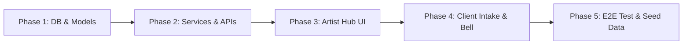

# รายงานการพัฒนาฟีเจอร์ VGen-style Commission Request & Intake Form System (ฉบับสมบูรณ์)

> **สถานะโครงการ:** ✅ ดำเนินการเสร็จสมบูรณ์ 100% ทุก Phase (Phase 1 ถึง Phase 5)  
> **การทดสอบ:** ผ่านการทดสอบ Unit & Integration Test ทั้งหมด 15/15 รายการ (OK) และ TypeScript Compilation ผ่าน 0 Errors  
> **ฐานข้อมูล:** Migrated เรียบร้อย พร้อม Seed ข้อมูลจำลองสำหรับศิลปิน (Akira, Hana, Zero) และตัวอย่างใบคำขอ

---

## 1. ภาพรวมการดำเนินงาน (Summary of Accomplishments)

ระบบเปิดรับคอมมิชชันและแบบฟอร์มบรีฟงาน (VGen-style Intake & Commission Management System) ถูกพัฒนาขึ้นเพื่อยกระดับแพลตฟอร์ม DICE ให้ศิลปินสามารถบริหารจัดการข้อเสนอและรับงานได้อย่างเป็นระบบ ปลอดภัย และป้องกันปัญหาข้อพิพาท โดยแบ่งการทำงานออกเป็น 5 Phase หลักดังนี้:



---

## 2. รายละเอียดผลการดำเนินงานในแต่ละ Phase

### Phase 1: Data Model, Lightweight Migration & Schemas ✅
- **หลีกเลี่ยง Table Duplication:** ตรวจพบตารางเดิม `ArtistService` ที่ใช้งานอยู่ใน Marketplace จึงทำการ Extend ตารางเดิมด้วยคอลัมน์การจัดการสล็อต (`max_slots`, `is_form_open`, `auto_close_on_full`, `sort_order`, `last_open_notified_at`) แทนการสร้างตารางซ้ำซ้อน
- **Idempotent Lightweight Migration:** สร้าง [backend/core/migrations.py](file:///C:/Users/fainl/DICE/backend/core/migrations.py) ใช้ SQLAlchemy Inspector ตรวจสอบและทำ `ALTER TABLE ADD COLUMN` อัตโนมัติเมื่อเซิร์ฟเวอร์เริ่มทำงาน
- **Timezone-naive Consistency:** สร้าง [backend/core/time.py](file:///C:/Users/fainl/DICE/backend/core/time.py) ฟังก์ชัน `utcnow()` คืนค่า naive UTC เพื่อตัดปัญหา Python 3.12+ Deprecation Warning และไม่ขัดแย้งกับ SQLite / PostgreSQL
- **Data Models:**
  - `ArtistCommissionPolicy`: บันทึก Terms of Service, นโยบายคืนเงิน, ข้อห้ามการนำงานไปเทรน AI (`ai_policy`), รายการ Will Draw / Won't Draw, และ Versioning อัตโนมัติ
  - `ServiceAddon`: ตัวเลือกเสริมราคาแบบคงที่ (Fixed) หรือคิดเป็นเปอร์เซ็นต์ (Percentage)
  - `CommissionSlotSubscription`: ระบบผู้ติดตามกดกระดิ่งรับแจ้งเตือนเมื่อสล็อตเปิด
  - `CommissionRequest`: ใบคำขอบรีฟงาน พร้อมแนบภาพเรฟเฟอเรนซ์, ตัวเลือก Addons, และ Snapshot ของ TOS ณ เวลาที่ส่ง
- **Pydantic Schemas:** สร้าง schemas ครบถ้วนใน [backend/schemas/commission.py](file:///C:/Users/fainl/DICE/backend/schemas/commission.py)

---

### Phase 2: Core Services, Security & API Routers ✅
- **Dynamic Slot Calculation (No Counter Drift):** ใน [backend/services/commission_service.py](file:///C:/Users/fainl/DICE/backend/services/commission_service.py) สล็อตที่ถูกใช้งานจะถูกคำนวณแบบ Dynamic จาก Order ที่ยังดำเนินอยู่ (`Order.service_id == service.id` และสถานะไม่อยู่ใน `COMPLETED` หรือ `CANCELLED`) ป้องกันปัญหาตัวเลขนับเกินหรือค้าง
- **Server-Side Price Authority:** ฝั่งเซิร์ฟเวอร์คำนวณราคาสุทธิใหม่เสมอจากฐานข้อมูล (`base_price + addons`) เพื่อป้องกันการดัดแปลงราคาจากหน้าบ้าน
- **Atomic Order Conversion:** เมื่อศิลปินกด **Accept** ระบบจะสร้าง `Order` และ `MilestoneInvoice` (Deposit Invoice ตามเปอร์เซ็นต์มัดจำที่ตั้งไว้) ภายใต้ Transaction เดียวกันอย่างปลอดภัย
- **Cooldowned Notification Dispatch:** เมื่อเปิดรับสล็อต ระบบจะค้นหา Client ที่ Subscribed ไว้และส่ง Notification แบบ In-app และ WebSocket แบบ Bulk พร้อม Cooldown 30 นาที ป้องกันสแปม
- **Magic-bytes Reference Upload:** ตรวจสอบไฟล์เรฟเฟอเรนซ์ด้วย Magic Bytes (`.png`, `.jpg`, `.webp`) ขนาดไม่เกิน 10MB ต่อรูป สูงสุด 5 รูป และเก็บใน `uploads/references/` พร้อม Endpoint ตรวจสอบสิทธิ์เฉพาะศิลปินและผู้ว่าจ้างเท่านั้น
- **API Endpoints:**
  - `POST /api/commissions/requests` (ส่งแบบฟอร์มคำขอ)
  - `GET /api/commissions/incoming` & `GET /api/commissions/mine`
  - `POST /api/commissions/requests/{id}/accept` & `POST /api/commissions/requests/{id}/decline`
  - `POST /api/commissions/requests/{id}/withdraw` (สำหรับ Client ยกเลิกคำขอที่ยัง PENDING)
  - `POST /api/commissions/subscriptions/toggle` & `GET /api/commissions/subscriptions/status`
  - `GET /api/artists/{handle}/commission-info` (สำหรับหน้าโปรไฟล์สาธารณะ)
  - `PUT /api/artists/me/commission-policy` (จัดการ TOS และ Do's/Don'ts)
  - `PATCH /api/artists/me/services/{id}/availability` (เปิด/ปิดสล็อตทันที)

---

### Phase 3 & 4: Frontend Implementation (Artist Hub & Client Flow) ✅
- **Types & API Client:**
  - [frontend/src/types/commission.ts](file:///C:/Users/fainl/DICE/frontend/src/types/commission.ts)
  - [frontend/src/lib/commissionApi.ts](file:///C:/Users/fainl/DICE/frontend/src/lib/commissionApi.ts)
- **Artist Hub (`/dashboard/artist/commissions`):**
  - แท็บ **Requests Inbox:** แสดงรายการคำขอ พร้อมสถานะ PENDING, ACCEPTED, DECLINED, WITHDRAWN สามารถเปิดดูบรีฟฉบับเต็ม ภาพเรฟเฟอเรนซ์ และกดยอมรับหรือปฏิเสธพร้อมระบุเหตุผล
  - แท็บ **Scales & Slots:** การจัดการสเกลงาน (Bust-up, Full-body ฯลฯ) สลับสวิตช์เปิด/ปิดสล็อต พร้อม Slot Badge แสดงจำนวนสล็อตคงเหลือแบบเรียลไทม์ และจัดการ Add-ons
  - แท็บ **Terms & Policies:** จัดการ TOS, Refund Policy, ข้อกำหนด No-AI, และแท็ก Do's & Don'ts
- **Public Profile & Client Experience (`/artists/[handle]`):**
  - แสดงนโยบาย No-AI License และ TOS ชัดเจน
  - แสดงป้ายกำกับ Do's & Don'ts ([DosDontsBadgeList.tsx](file:///C:/Users/fainl/DICE/frontend/src/components/commission/DosDontsBadgeList.tsx))
  - ปุ่มกระดิ่งแจ้งเตือนเมื่อสล็อตเปิด ([SlotAlertBell.tsx](file:///C:/Users/fainl/DICE/frontend/src/components/commission/SlotAlertBell.tsx))
  - แบบฟอร์มบรีฟงาน 3 ขั้นตอน ([CommissionIntakeModal.tsx](file:///C:/Users/fainl/DICE/frontend/src/components/commission/CommissionIntakeModal.tsx)):
    1. *Step 1: Scope & Add-ons* เลือกแพ็กเกจ วัตถุประสงค์ (Personal / Commercial) และ Add-ons พร้อมสรุปยอดคำนวณสด
    2. *Step 2: Brief & References* กรอกชื่อตัวละคร รายละเอียดท่าทาง แนบลิงก์ และอัปโหลดภาพเรฟเฟอเรนซ์ได้สูงสุด 5 ภาพ
    3. *Step 3: Review & Agreement* ตรวจสอบสรุปรายการและยอมรับ TOS ของศิลปินก่อนกดยืนยัน
- **Client Dashboard Integration (`/dashboard/client`):**
  - เพิ่มส่วน **Commission Briefs & Proposals** ให้ผู้ว่าจ้างติดตามสถานะใบคำขอของตนเอง
  - สามารถกดยกเลิก (Withdraw) คำขอที่ศิลปินยังไม่ได้ตอบรับได้
  - เมื่อศิลปินตอบรับแล้ว จะมีปุ่มคลิกไปยังหน้า Order เพื่อชำระเงินมัดจำได้ทันที

---

### Phase 5: Verification & Seed Data ✅
- **Mock Data Seeded:** ปรับปรุง [backend/seed_fake_data.py](file:///C:/Users/fainl/DICE/backend/seed_fake_data.py) และ [backend/clean_fake_data.py](file:///C:/Users/fainl/DICE/backend/clean_fake_data.py) ให้รองรับการ Seed และ Clean ข้อมูลอย่างปลอดภัย
- **Automated Tests:** รันชุดทดสอบครอบคลุมทั้งระบบคอมมิชชัน ระบบการประมูล และระบบความปลอดภัย:
  ```
  Ran 15 tests in 0.737s
  OK
  ```
- **TypeScript Check:** รัน `npx tsc --noEmit` ได้ผลลัพธ์ผ่าน 100% ไม่มีข้อผิดพลาดของ Type หรือ Broken Import ใดๆ
