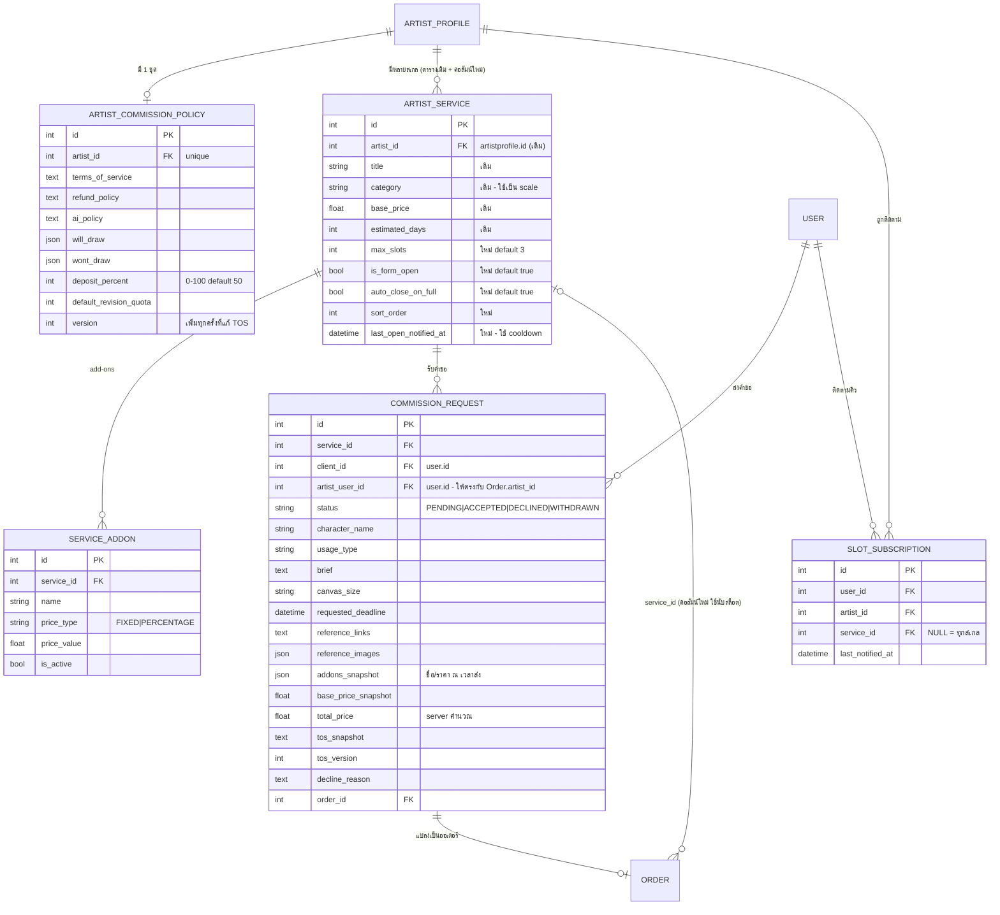
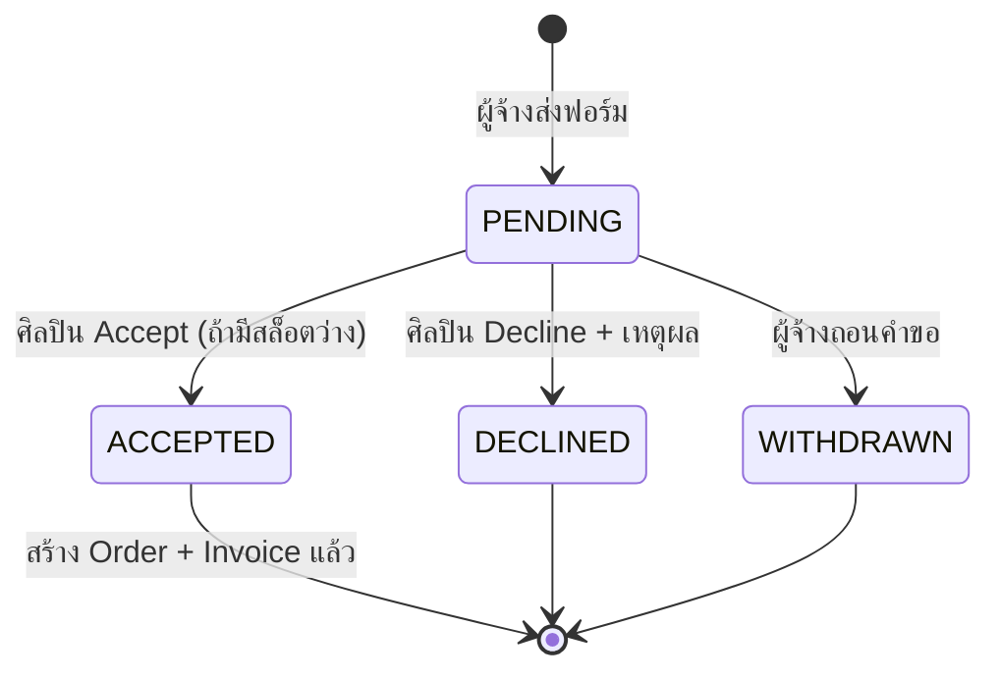

# 🔎 บทวิจารณ์แผนเทคนิค v1 และแผนฉบับแก้ไข v2 (Critical Review & Revised Technical Plan)

> **ฟีเจอร์:** ระบบเปิดรับ Commission Form หลายสเกล + TOS/ข้อจำกัด + เปิด-ปิดรับ + แจ้งเตือนผู้ติดตาม  
> **วันที่:** 16 ตุลาคม 2026  
> **เอกสารที่ถูกแทนที่:** [`technical_implementation_plan.md`](./technical_implementation_plan.md) (v1) — ให้ถือเอกสารนี้ (v2) เป็นหลัก  
> **สถานะ:** รออนุมัติก่อนลงมือทำ (ยังไม่มีการแก้โค้ดใด ๆ)

---

## ส่วนที่ 1 — บทวิจารณ์แผน v1 (อ้างอิงจากโค้ดจริงในโปรเจกต์)

คะแนน 9.7/10 ในแผน v1 **ให้สูงเกินจริง** เพราะเป็นการประเมินตัวเองโดยไม่ได้เทียบกับโค้ดที่มีอยู่ เมื่อตรวจกับโค้ดจริงแล้วพบปัญหาดังนี้

### 🔴 ระดับวิกฤต (ถ้าทำตาม v1 ระบบจะพังหรือข้อมูลผิด)

| # | ปัญหา | หลักฐานในโค้ด | ผลกระทบ |
|:-:|:--|:--|:--|
| C1 | **สร้างตาราง `CommissionService` ซ้ำกับของเดิม** | มี `ArtistService` อยู่แล้วใน [artist.py](file:///C:/Users/fainl/DICE/backend/models/artist.py#L28-L41) ใช้งานจริงใน [artists.py](file:///C:/Users/fainl/DICE/backend/api/routers/artists.py#L348-L387), `page.tsx`, `marketplaceApi.ts` | จะมีสองแหล่งข้อมูล (two sources of truth) ข้อมูลบริการเดิมไม่แสดงในระบบใหม่ และหน้าโปรไฟล์ต้องรวมข้อมูลสองตาราง |
| C2 | **ไม่มีระบบ Migration** | [db.py](file:///C:/Users/fainl/DICE/backend/core/db.py#L34-L35) ใช้แค่ `SQLModel.metadata.create_all()` | `create_all` **สร้างได้แค่ตารางใหม่ แต่จะไม่เพิ่มคอลัมน์ให้ตารางที่มีอยู่แล้ว** ถ้าเพิ่มคอลัมน์ใน `artistservice` แล้วใช้ `test.db` เดิม จะเกิด `no such column` ทันที |
| C3 | **`active_slots` มีแต่เพิ่ม ไม่เคยลด** | v1 เขียนแค่ `active_slots += 1` ตอน Accept | เมื่อออเดอร์ `COMPLETED`/`CANCELLED` สล็อตไม่ถูกคืน สุดท้ายสเกลจะเต็มถาวร ตัวนับจะคลาดเคลื่อนจากความจริง (counter drift) |
| C4 | **เชื่อราคาที่ client ส่งมา** | v1 รับ `estimated_total_price` จาก payload | ผู้ใช้แก้ราคาเองผ่าน DevTools ได้ (price tampering) |
| C5 | **ข้อตกลงโต้ตอบ (Counter-offer) ไม่ครบวงจร** | มีแค่ endpoint ฝั่งศิลปินเสนอราคา | ไม่มี endpoint ให้ผู้จ้าง "ยอมรับ/ปฏิเสธข้อเสนอ" ทำให้คำขอค้างที่สถานะ `COUNTER_OFFER` ตลอดไป และ v1 ยังให้ศิลปินกด Accept คำขอ `COUNTER_OFFER` ได้เองโดยไม่ต้องรอผู้จ้างยืนยัน |

### 🟠 ระดับสำคัญ (ทำงานได้ แต่มีช่องโหว่หรือออกแบบไม่รัดกุม)

| # | ปัญหา | ข้อเสนอแก้ไข |
|:-:|:--|:--|
| M1 | **Master switch ซ้ำของเดิม**: v1 สร้างใหม่ ทั้งที่ `ArtistProfile.commission_status` (OPEN/CLOSED/WAITLIST) มีอยู่แล้ว และมี API `PUT /api/artists/me` รองรับแล้ว | ใช้ฟิลด์เดิมเป็น Master switch และเพิ่ม hook ส่งแจ้งเตือนตอนเปลี่ยนเป็น OPEN |
| M2 | **ไม่บันทึกฉบับ TOS ที่ผู้จ้างกดยอมรับ**: ถ้าศิลปินแก้ TOS ภายหลัง จะพิสูจน์ไม่ได้ว่าผู้จ้างยอมรับข้อความฉบับไหน | เก็บ `tos_snapshot` (ข้อความ ณ เวลาส่ง) + `tos_version` ลงในคำขอ |
| M3 | **ภาพเรฟค้างในระบบ (orphan files)**: v1 ไม่ระบุว่าอัปโหลดภาพตอนไหน ถ้าอัปโหลดก่อนแล้วไม่ส่งฟอร์ม ไฟล์จะค้าง | ใช้ endpoint เดียวแบบ `multipart/form-data` (ส่งข้อมูล JSON + ไฟล์ในคำขอเดียว) ถ้า validate ไม่ผ่านให้ลบไฟล์ทั้งหมดที่บันทึกไปแล้ว |
| M4 | **Subscription ซ้ำได้**: ไม่มี unique constraint | เพิ่ม `UniqueConstraint(user_id, artist_id, service_id)` |
| M5 | **ส่งแจ้งเตือนแบบ commit ทีละคน**: [`create_notification`](file:///C:/Users/fainl/DICE/backend/services/notification_service.py#L9-L44) ทำ `commit()` ทุกครั้งที่เรียก ถ้ามีผู้ติดตาม 500 คนจะเกิด 500 commits บน SQLite | เขียน `bulk_notify()`: `add_all` แล้ว commit ครั้งเดียว จากนั้นค่อยวนส่ง WebSocket |
| M6 | **ตั้งเวลาเปิดรับ (Scheduled Opening) ไม่มีตัวรัน**: โปรเจกต์ไม่มี scheduler ที่ทำงานอยู่ (มี `celery` ใน dependencies แต่ไม่ได้ตั้งค่า worker) | ยกไปทำใน Phase 2 และใช้วิธี lazy evaluation + asyncio loop เบา ๆ ตอน startup แทนการตั้ง Celery |
| M7 | **ความหมายของ WAITLIST ไม่ชัด**: ส่งฟอร์มได้ไหม? นับสล็อตไหม? | กำหนดให้ WAITLIST = ส่งฟอร์มได้ แต่คำขอเข้าคิวรอและไม่กินสล็อตจนกว่าศิลปินจะ Accept |
| M8 | **บังคับงวดเงิน 50/50 ตายตัว**: ไม่ตรงกับโจทย์ "แล้วแต่ศิลปิน" | เพิ่ม `deposit_percent` ใน Policy (0–100) โดยใช้ 50 เป็นค่าเริ่มต้น |
| M9 | **ไม่มี endpoint ให้ผู้จ้างยกเลิกคำขอ** และไม่มีวันหมดอายุของคำขอ | เพิ่ม `POST /requests/{id}/withdraw` และ `expires_at` (ค่าเริ่มต้น 14 วัน) |
| M10 | **ขาด custom questions ต่อสเกล**: ฟีเจอร์หลักของ VGen คือศิลปินตั้งคำถามในฟอร์มเองได้ แต่ v1 fix ฟิลด์ไว้ตายตัว | เพิ่ม `form_questions` (JSON) ต่อสเกล แล้วเก็บคำตอบเป็น `answers` (JSON) ในคำขอ |

### 🟡 ระดับย่อย / ความถูกต้องของเอกสาร

- **Pipeline 5 ขั้นไม่ตรงกับโค้ด:** `OrderStatus` จริงมี `PENDING → ACCEPTED → SKETCHING → COLORING → COMPLETED` (ไม่มี `LINING`) ส่วน README เขียนว่ามี Lining เอกสารใหม่จึงต้องอ้างตามโค้ดจริง
- **`datetime.utcnow()` deprecated:** เทสต์ปัจจุบันขึ้น DeprecationWarning อยู่แล้ว โค้ดใหม่ควรใช้ `datetime.now(timezone.utc)` แต่ต้องระวังการเทียบค่ากับคอลัมน์เดิมที่เป็น naive datetime (ดูข้อ R3)
- **Gantt chart ใน v1 ไม่สมจริง:** วางไว้ ~30 วันทำงานแต่ไม่ได้แยก MVP ออกมา ขอบเขตงานกว้างเกินไปสำหรับรอบแรก
- **`page.tsx` ของศิลปินใหญ่ 612 บรรทัดแล้ว:** ถ้าใส่ฟอร์มลงไปตรง ๆ จะดูแลยาก ควรแยกเป็นคอมโพเนนต์
- **Lint เดิมมี 42 errors:** โค้ดใหม่ต้องไม่เพิ่ม error (ห้ามใช้ `any`) แต่ไม่ต้องไล่แก้ของเดิมในงานนี้
- **เทสต์บางไฟล์ไม่ใช่ unit test:** `test_api.py` และ `test_analytics.py` ยิง HTTP ไปที่เซิร์ฟเวอร์จริง ส่วน `test_security.py` เขียนลง `test.db` จริง และไม่มี `pytest` ใน venv เทสต์ใหม่จึงควรใช้ in-memory SQLite แบบเดียวกับ `test_auctions.py`

### คะแนน v1 หลังประเมินใหม่ตามจริง

| เกณฑ์ | v1 ให้ตัวเอง | ประเมินใหม่ | เหตุผล |
|:--|:-:|:-:|:--|
| Architecture & Modularity | 10 | **5** | ตารางซ้ำ (C1) และ master switch ซ้ำ (M1) |
| Security | 9.5 | **6** | price tampering (C4) และไม่เก็บหลักฐาน TOS (M2) |
| Data Consistency | 9.5 | **4** | ไม่มี migration (C2) และ slot drift (C3) |
| VGen Alignment | 10 | **7** | ขาด custom questions (M10) และ counter-offer ไม่ครบวงจร (C5) |
| Compatibility & Testability | 9.5 | **5** | `create_all` ใช้กับ DB เดิมไม่ได้ |
| **เฉลี่ย** | **9.7** | **5.4 / 10** | **ยังไม่พร้อมลงมือทำ** |

---

## ส่วนที่ 2 — แผนเทคนิคฉบับแก้ไข (v2)

### 2.1 หลักการออกแบบที่เปลี่ยนจาก v1

1. **ต่อยอดของเดิม ไม่สร้างซ้ำ:** ขยาย `ArtistService` ให้เป็น "สเกลงาน" และใช้ `ArtistProfile.commission_status` เป็น Master switch
2. **Server เป็นผู้คำนวณราคาเสมอ:** client ส่งมาแค่ `addon_ids` ฝั่ง server คำนวณราคาเองและเก็บ snapshot ไว้
3. **สล็อตคำนวณจากข้อมูลจริง ไม่ใช้ตัวนับ:** `used_slots = COUNT(Order ที่มาจากสเกลนี้และยังไม่ COMPLETED/CANCELLED)` จึงไม่มีปัญหาตัวเลขคลาดเคลื่อน
4. **มี migration แบบเบา:** เขียนฟังก์ชัน `ALTER TABLE ADD COLUMN` แบบ idempotent (รันซ้ำได้ไม่พัง) ตอน startup โดยไม่ต้องติดตั้ง Alembic ในรอบนี้
5. **แบ่งเป็น MVP กับ Phase 2:** รอบแรกทำเฉพาะสิ่งที่ผู้ใช้ขอ ส่วนฟีเจอร์เสริมยกไปทำทีหลัง

### 2.2 ขอบเขตงาน (Scope)

| ✅ MVP (รอบนี้) | ⏭️ Phase 2 (รอบถัดไป) |
|:--|:--|
| ขยาย `ArtistService` เป็นสเกลงาน: สล็อต, เปิด/ปิดฟอร์มรายสเกล, ปิดอัตโนมัติเมื่อเต็ม | ตั้งเวลาเปิดรับล่วงหน้า + นับถอยหลัง |
| Policy ของศิลปิน: TOS, นโยบายคืนเงิน, นโยบาย AI, Will/Won't draw, % มัดจำ, โควตาแก้งาน | ศิลปินเพิ่มคำถามเองในฟอร์ม (custom questions) |
| Add-ons ต่อสเกล (FIXED / PERCENTAGE) | Counter-offer (ศิลปินเสนอราคา/วันส่งใหม่ และผู้จ้างตอบรับ) |
| ฟอร์มขอจ้าง + แนบภาพเรฟ + ยืนยัน TOS (เก็บ snapshot) | คำขอหมดอายุอัตโนมัติ |
| Inbox ของศิลปิน: Accept / Decline; ผู้จ้างกดถอนคำขอได้ | อีเมลแจ้งเตือน |
| กระดิ่งติดตามคิว + แจ้งเตือนเมื่อเปิดรับ (in-app + WebSocket) และ cooldown | |
| Migration แบบเบา + unit tests | |

> Counter-offer ย้ายไป Phase 2 เพราะผู้ใช้ไม่ได้ขอโดยตรง และต้องมี state machine สองฝ่ายที่ซับซ้อน ระหว่างนี้ใช้แชทที่มีอยู่เพื่อต่อรองราคาแทนได้ ส่วน custom questions ถ้าต้องการให้อยู่ใน MVP ก็ย้ายมาได้ (เพิ่มงานประมาณ 1 วัน)

### 2.3 Data Model (v2)



**ข้อควรระวังเรื่อง ID:** ใน `Order.artist_id` เก็บ **user.id** ส่วน `ArtistService.artist_id` เก็บ **artistprofile.id** v2 จึงตั้งชื่อคอลัมน์ในคำขอว่า `artist_user_id` เพื่อไม่ให้สับสน (ปัญหาเดียวกันเคยทำให้เกิดบั๊ก Issue #15 ใน `ai_execution_plan.md`)

**คอลัมน์ที่เพิ่มในตารางเดิม (ต้องทำผ่าน migration):**
- `artistservice`: `max_slots`, `is_form_open`, `auto_close_on_full`, `sort_order`, `last_open_notified_at`
- `order`: `service_id` (nullable, ใช้นับสล็อต) และ `commission_request_id` (nullable)

### 2.4 Migration แบบเบา

```python
# backend/core/migrations.py  (เรียกใน init_db() หลัง create_all)
from sqlalchemy import inspect, text

ADDED_COLUMNS = {
    "artistservice": {
        "max_slots": "INTEGER NOT NULL DEFAULT 3",
        "is_form_open": "BOOLEAN NOT NULL DEFAULT 1",
        "auto_close_on_full": "BOOLEAN NOT NULL DEFAULT 1",
        "sort_order": "INTEGER NOT NULL DEFAULT 0",
        "last_open_notified_at": "DATETIME",
    },
    "order": {
        "service_id": "INTEGER REFERENCES artistservice(id) ON DELETE SET NULL",
        "commission_request_id": "INTEGER",
    },
}

def run_lightweight_migrations(engine):
    insp = inspect(engine)
    with engine.begin() as conn:
        for table, cols in ADDED_COLUMNS.items():
            if not insp.has_table(table):
                continue  # create_all จะสร้างให้พร้อมคอลัมน์ครบ
            existing = {c["name"] for c in insp.get_columns(table)}
            for name, ddl in cols.items():
                if name not in existing:
                    conn.execute(text(f'ALTER TABLE "{table}" ADD COLUMN {name} {ddl}'))
```

- รันซ้ำได้ไม่พัง (idempotent) และไม่แตะข้อมูลเดิม
- ⚠️ SQLite ไม่บังคับ FK ของคอลัมน์ที่เพิ่มด้วย `ALTER TABLE` ในทุกกรณี จึงต้องให้ฝั่งแอปตรวจสอบเองด้วย
- ก่อนรัน migration ครั้งแรก ให้สำรอง `test.db` (มีแนวทางเดิมอยู่ใน `seed_fake_data.py`)

### 2.5 กติกาทางธุรกิจ (Business Rules)

**สถานะที่ผู้จ้างเห็นของแต่ละสเกล** (คำนวณใน service ไม่ได้เก็บใน DB):

```python
def effective_status(profile, service, used_slots) -> str:
    if profile.commission_status == "CLOSED" or not service.is_form_open:
        return "CLOSED"
    if used_slots >= service.max_slots:
        return "FULL"          # แสดงปุ่มกระดิ่งแทน
    if profile.commission_status == "WAITLIST":
        return "WAITLIST"      # ส่งฟอร์มได้ แต่แสดงคำเตือนว่าจะได้คิวช้า
    return "OPEN"
```

**State machine ของคำขอ (MVP):**



**ตอนส่งฟอร์ม (`POST /api/commissions/requests`)** ต้องผ่านการตรวจทุกข้อ:
1. effective status ต้องเป็น `OPEN` หรือ `WAITLIST`
2. ผู้จ้างต้องไม่ใช่เจ้าของสเกลเอง
3. ผู้จ้างมีคำขอสถานะ PENDING กับศิลปินคนนี้ได้ไม่เกิน 3 รายการ
4. `agreed_to_tos == true` (ถ้าไม่ส่งมาให้ตอบ 422)
5. `addon_ids` ทุกตัวต้องเป็นของสเกลนี้และ `is_active`
6. server คำนวณราคาเอง: `total = base + Σ(FIXED) + base × Σ(PERCENTAGE)/100` ปัดทศนิยม 2 ตำแหน่ง
7. ภาพเรฟไม่เกิน 5 รูป ตรวจด้วย `validate_and_save_upload` เดิม (ใช้เพดาน 10MB ไม่ใช่ 25MB ที่เป็นค่าเริ่มต้น) และถ้าล้มเหลวกลางทางให้ลบไฟล์ที่บันทึกไปแล้วทั้งหมด
8. เก็บ `tos_snapshot`, `tos_version`, `addons_snapshot`, `base_price_snapshot`

**ตอน Accept (`POST /api/commissions/requests/{id}/accept`)** ทำทั้งหมดใน transaction เดียว:
1. ล็อกแถวก่อน: บน SQLite ใช้ `BEGIN IMMEDIATE` (ล็อกการเขียนทั้ง DB) บน PostgreSQL ใช้ `SELECT ... FOR UPDATE` บนแถว service
2. ตรวจว่าคำขอยังเป็น `PENDING` (กันกดซ้ำ) และนับ `used_slots` ใหม่ภายใน transaction ต้องน้อยกว่า `max_slots` ไม่อย่างนั้นตอบ **409**
3. สร้าง `Order` (status=`ACCEPTED`, `service_id`, `commission_request_id`, `agreed_price=total_price`, `revision_quota` จาก policy) ให้ `description` รวมบรีฟ ลิงก์เรฟ และรายการ add-on
4. สร้าง `MilestoneInvoice` ตาม `deposit_percent`: ถ้าเป็น 100 จะมีงวดเดียว ถ้าเป็น 0 จะมีงวดสุดท้ายงวดเดียว นอกจากนั้นแบ่งเป็นสองงวด
5. คัดลอกภาพเรฟไปผูกกับออเดอร์ (ใช้ตาราง `File` เดิม) เพื่อให้แสดงในหน้าออเดอร์ได้ทันที
6. ถ้า `used_slots + 1 >= max_slots` และเปิด `auto_close_on_full` ไว้ ให้ตั้ง `is_form_open = False`
7. commit แล้วส่งแจ้งเตือนผู้จ้างผ่าน `BackgroundTasks` (ส่งหลัง commit เท่านั้น)

**ตอนส่งแจ้งเตือนคิวเปิด:** จุดที่ทริกเกอร์มี 3 จุด
- ศิลปินเปิด `is_form_open` ของสเกลจาก false → true
- Master `commission_status` เปลี่ยนจาก CLOSED → OPEN/WAITLIST
- *(ไม่ทำใน MVP)* สล็อตว่างขึ้นเพราะออเดอร์จบ เพราะจะทำให้ผู้ติดตามได้แจ้งเตือนถี่เกินไป

ขั้นตอนส่ง:
1. ตรวจ cooldown ระดับสเกลก่อน ถ้า `last_open_notified_at` ห่างจากตอนนี้ไม่ถึง 30 นาทีให้ข้ามการส่ง และ response บอกศิลปินว่า "ระบบงดส่งแจ้งเตือนเนื่องจากเพิ่งส่งไปเมื่อไม่นานนี้"
2. ดึงผู้ติดตามที่ `service_id = :id OR service_id IS NULL` ของศิลปินคนนี้
3. `bulk_notify()`: insert `Notification` ทั้งหมดแล้ว commit ครั้งเดียว จากนั้นค่อยวน `manager.send_personal_message` ใช้ type `notification` เดิม เพื่อให้ `WebSocketContext.tsx` แสดงได้โดยไม่ต้องแก้ฝั่ง client มาก
4. ตั้ง `last_open_notified_at = now` และส่งจำนวนผู้ได้รับแจ้งเตือนกลับไปให้ศิลปิน
5. ตัวเลือกเสริม (ค่าเริ่มต้นเปิดไว้): ศิลปินกดเปิดสวิตช์แบบ "ไม่ส่งแจ้งเตือน" ได้ (`notify_followers=false`) เผื่อกรณีเปิดเพื่อทดสอบ

### 2.6 API (MVP)

| Method | Path | สิทธิ์ | หมายเหตุ |
|:--|:--|:-:|:--|
| GET | `/api/artists/{handle}/commission-info` | Public | ส่ง policy, สเกล (พร้อม `effective_status`, `used_slots`), add-ons ครบในคำขอเดียว |
| PUT | `/api/artists/me/commission-policy` | Artist | ถ้าแก้ TOS จะเพิ่ม `version` อัตโนมัติ |
| PATCH | `/api/artists/me/services/{id}` | Artist | แก้ `max_slots`, `auto_close_on_full`, ข้อมูลสเกล |
| PATCH | `/api/artists/me/services/{id}/availability` | Artist | `{is_form_open, notify_followers}` เป็นจุดเดียวที่ทริกเกอร์การส่งแจ้งเตือน |
| POST/PATCH/DELETE | `/api/artists/me/services/{id}/addons[/{addon_id}]` | Artist | DELETE เป็น soft delete (`is_active=false`) เพื่อไม่ให้ snapshot ในคำขอเก่าเสีย |
| PUT | `/api/artists/me` *(เดิม)* | Artist | เพิ่ม hook: ถ้า `commission_status` เปลี่ยนเป็น OPEN ให้ส่งแจ้งเตือน |
| POST | `/api/commissions/requests` | User | multipart: `payload` (JSON string) + `references[]` |
| GET | `/api/commissions/requests/incoming?status=` | Artist | แบ่งหน้า (pagination) |
| GET | `/api/commissions/requests/mine` | User | |
| GET | `/api/commissions/requests/{id}` | เจ้าของคำขอ / ศิลปิน / admin | |
| POST | `/api/commissions/requests/{id}/accept` | Artist | 409 ถ้าสล็อตเต็มหรือสถานะเปลี่ยนไปแล้ว |
| POST | `/api/commissions/requests/{id}/decline` | Artist | ต้องระบุ `reason` |
| POST | `/api/commissions/requests/{id}/withdraw` | Client | ทำได้เฉพาะคำขอที่ยัง PENDING |
| GET | `/api/commissions/requests/{id}/references/{filename}` | เจ้าของคำขอ / ศิลปิน | ใช้ `sanitize_filename` เดิม และห้ามเปิด `/uploads` เป็น public |
| POST / DELETE | `/api/commissions/subscriptions` | User | upsert ตาม unique key |
| GET | `/api/commissions/subscriptions/status?artist_id=` | User | ใช้แสดงสถานะปุ่มกระดิ่ง |

### 2.7 ไฟล์ที่จะสร้างหรือแก้

**Backend**
- `models/commission.py` *(ใหม่)*: `ArtistCommissionPolicy`, `ServiceAddon`, `CommissionRequest`, `SlotSubscription`
- `models/artist.py`: เพิ่มคอลัมน์ใน `ArtistService`
- `models/order.py`: เพิ่ม `service_id`, `commission_request_id`
- `models/notification.py`: เพิ่มค่า enum `COMMISSION`
- `models/__init__.py`: export โมเดลใหม่
- `core/migrations.py` *(ใหม่)* และเรียกใช้ใน `core/db.py` → `init_db()`
- `core/time.py` *(ใหม่)*: `utcnow()` helper กลาง (ดูข้อ R3)
- `schemas/commission.py` *(ใหม่)* + export ใน `schemas/__init__.py`
- `services/commission_service.py` *(ใหม่)*: `compute_price`, `count_used_slots`, `effective_status`, `accept_request`, `dispatch_open_alert`
- `services/notification_service.py`: เพิ่ม `bulk_notify`
- `api/routers/commissions.py` *(ใหม่)* + ลงทะเบียนใน `api/routers/__init__.py`
- `api/routers/artists.py`: endpoints ฝั่งศิลปิน + hook ใน `PUT /me`
- `main.py`: เพิ่ม `os.makedirs("uploads/references")`
- `tests/test_commissions.py` *(ใหม่, ใช้ in-memory SQLite)*

**Frontend**
- `src/types/commission.ts`, `src/lib/commissionApi.ts` *(ใหม่ แยกไฟล์ เพื่อไม่ให้ `api.ts` ใหญ่ขึ้นอีก)*
- `src/components/commission/`: `CommissionSection`, `ServiceScaleCard`, `CommissionRequestModal` (3 ขั้น), `PriceSummary`, `DosDontsBadges`, `TosPanel`, `SlotAlertBell`, `ReferenceUploader`
- `src/app/[locale]/artists/[handle]/page.tsx`: แทรก `<CommissionSection />` (แก้ไฟล์นี้ให้น้อยที่สุด)
- `src/app/[locale]/dashboard/artist/commissions/page.tsx` *(ใหม่)*: แท็บ สเกล & สล็อต / Policy & TOS / Inbox
- `src/app/[locale]/dashboard/artist/layout.tsx`: เพิ่มเมนู
- `src/app/[locale]/dashboard/client/...`: รายการ "คำขอของฉัน"
- `src/messages/th.json`, `en.json`

### 2.8 แผนการทดสอบ

| เทสต์ | สิ่งที่ตรวจ |
|:--|:--|
| `test_price_computed_server_side` | ส่งราคาปลอมไปแล้ว server ไม่ใช้ค่านั้น และ add-on ของสเกลอื่นถูกปฏิเสธ |
| `test_submit_blocked_when_closed_or_full` | สเกลที่ CLOSED/FULL ตอบ 409 ส่วน WAITLIST ยังส่งได้ |
| `test_tos_required_and_snapshotted` | ไม่ส่ง agreed ตอบ 422 และหลังแก้ TOS ค่า snapshot ในคำขอเดิมไม่เปลี่ยน |
| `test_accept_creates_order_and_invoices` | deposit 0/50/100 แบ่งงวดถูกต้อง และ `service_id` ผูกกับออเดอร์ |
| `test_accept_respects_slots_and_autoclose` | สล็อตสุดท้ายทำให้ฟอร์มปิด ถ้า accept เกินสล็อตตอบ 409 |
| `test_slot_freed_when_order_completed_or_cancelled` | ยืนยันว่าแก้ปัญหา C3 แล้ว |
| `test_double_accept_idempotent` | accept ครั้งที่สองตอบ 409 และไม่เกิดออเดอร์ซ้ำ |
| `test_open_alert_notifies_subscribers_with_cooldown` | ส่งแจ้งเตือนครบทุกคน และถ้าเปิดซ้ำภายใน 30 นาทีจะไม่ส่งซ้ำ |
| `test_subscription_unique` | กดติดตามสองครั้งได้แค่ 1 แถว |
| `test_migration_idempotent` | รัน migration กับ DB ที่มีแค่ schema เก่า 2 ครั้งแล้วไม่ error |
| `test_reference_access_control` | บุคคลที่สามเปิดดูภาพเรฟไม่ได้ (403) และใช้ path traversal ไม่ได้ |

นอกจากนี้ต้องรัน `tsc --noEmit` ให้ผ่าน, รัน `eslint` เฉพาะไฟล์ใหม่ให้ได้ 0 error และทดสอบ flow จริงด้วยมือ: ปิดรับ → กดกระดิ่ง → เปิดรับ → แจ้งเตือนเด้ง → ส่งฟอร์ม → Accept → ออเดอร์ปรากฏพร้อมใบแจ้งหนี้

### 2.9 ความเสี่ยงที่ยังเหลือ

| # | ความเสี่ยง | การจัดการ |
|:-:|:--|:--|
| R1 | `BEGIN IMMEDIATE` บน SQLite ล็อกทั้ง DB ระยะสั้น | transaction สั้นมาก และมี `busy_timeout=10000` อยู่แล้ว ถือว่ารับได้ |
| R2 | WebSocket ส่งถึงเฉพาะคนที่ออนไลน์อยู่ | คนที่ออฟไลน์ยังเห็นแจ้งเตือนในกระดิ่งเมื่อกลับมา เพราะบันทึกลง DB แล้ว |
| R3 | ผสม naive กับ aware datetime | โค้ดเดิมใช้ naive UTC ทั้งระบบ ดังนั้นรอบนี้ให้ `core/time.utcnow()` คืนค่า **naive UTC** (`datetime.now(timezone.utc).replace(tzinfo=None)`) เพื่อเลี่ยงคำเตือน deprecation โดยไม่ทำให้การเปรียบเทียบเวลากับข้อมูลเดิมพัง |
| R4 | ผู้ใช้ที่ใช้ DB อื่นนอกจาก `test.db` | migration ทำงานกับ engine ใดก็ได้ แต่ถ้าย้ายไป PostgreSQL ในอนาคตควรเปลี่ยนไปใช้ Alembic |
| R5 | ขอบเขต frontend ใหญ่ที่สุด | แยกเป็นคอมโพเนนต์ย่อย และทำ backend + tests ให้เสร็จก่อนเริ่ม UI |

### 2.10 ลำดับการทำงานและประมาณเวลา (MVP)

| ขั้น | งาน | ประมาณ |
|:-:|:--|:-:|
| 1 | Models + migration + `core/time.py` + ทดสอบ migration กับสำเนาของ `test.db` | 0.5 วัน |
| 2 | `commission_service.py` + `bulk_notify` + unit tests ของกติกาทั้งหมด | 1 วัน |
| 3 | Routers + schemas + เทสต์สิทธิ์การเข้าถึง | 1 วัน |
| 4 | Frontend: types/api + หน้าโปรไฟล์ (สเกล, TOS, กระดิ่ง, ฟอร์ม) | 1.5 วัน |
| 5 | Frontend: แดชบอร์ดศิลปิน (สเกล/สล็อต, Policy, Inbox) + หน้าคำขอของผู้จ้าง + i18n | 1.5 วัน |
| 6 | ตรวจ typecheck/lint, ทดสอบ E2E ด้วยมือ, อัปเดต README | 0.5 วัน |
| | **รวม** | **~6 วันทำงาน** |

---

## ส่วนที่ 3 — คะแนนแผน v2

> นี่ยังเป็นการประเมินตัวเองเหมือนเดิม จึงควรอ่านเป็นการประเมินคร่าว ๆ ไม่ใช่การรับรองคุณภาพ คะแนนจริงต้องวัดหลังเขียนโค้ดและผ่านเทสต์แล้ว

| เกณฑ์ | v1 (ประเมินใหม่) | v2 | ที่ยังหักคะแนน |
|:--|:-:|:-:|:--|
| Architecture & Modularity | 5 | **8.5** | `api.ts`/`page.tsx` เดิมยังใหญ่อยู่ |
| Security | 6 | **8.5** | ยังไม่มี rate limit ระดับ IP |
| Data Consistency | 4 | **8.5** | migration แบบเบายังไม่ใช่ Alembic |
| VGen Alignment | 7 | **8** | custom questions และ counter-offer อยู่ใน Phase 2 |
| Compatibility & Testability | 5 | **8.5** | ยังไม่มี E2E test แบบอัตโนมัติ |
| **เฉลี่ย** | **5.4** | **≈ 8.4 / 10** | **พร้อมเริ่ม MVP หลังได้รับคำตอบในส่วนที่ 4** |

---

## ส่วนที่ 4 — คำถามที่ต้องตัดสินใจก่อนเริ่มทำ

1. **Custom questions (ศิลปินตั้งคำถามในฟอร์มเอง):** จะใส่ใน MVP เลยไหม (เพิ่มงานประมาณ 1 วัน) หรือยกไป Phase 2
2. **Counter-offer:** ยอมให้ใช้แชทต่อรองราคาแทนในรอบแรกได้ไหม
3. **WAITLIST:** ตกลงตามที่เสนอไหม (ส่งฟอร์มได้แต่ไม่กินสล็อต) หรือจะให้ WAITLIST ส่งฟอร์มไม่ได้เลย
4. **ข้อมูลใน `test.db`:** เป็นข้อมูลทดสอบที่ seed ใหม่ได้ใช่ไหม ถ้าใช่ จะทดสอบ migration กับสำเนาก่อนแล้วค่อยรันกับไฟล์จริง
