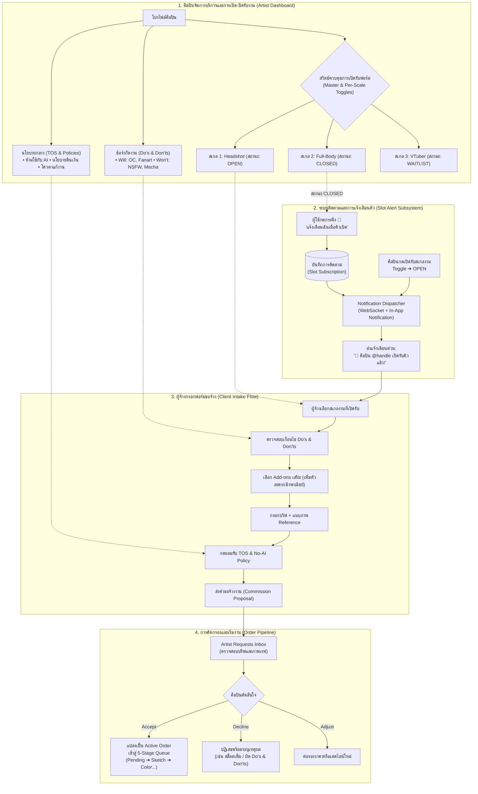
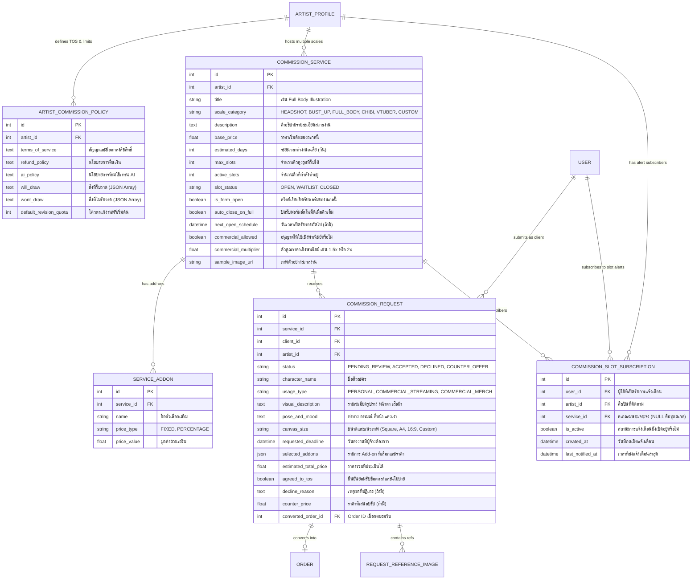
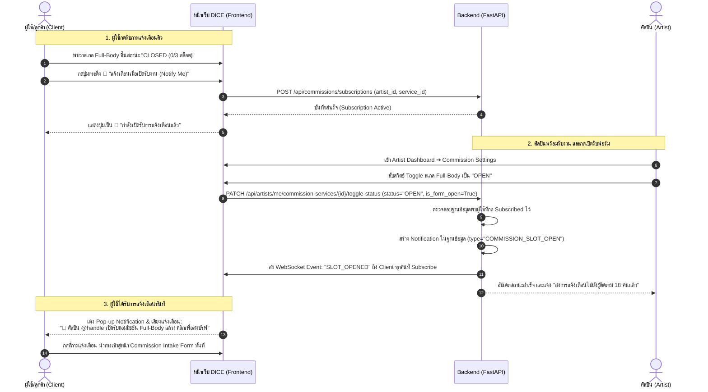
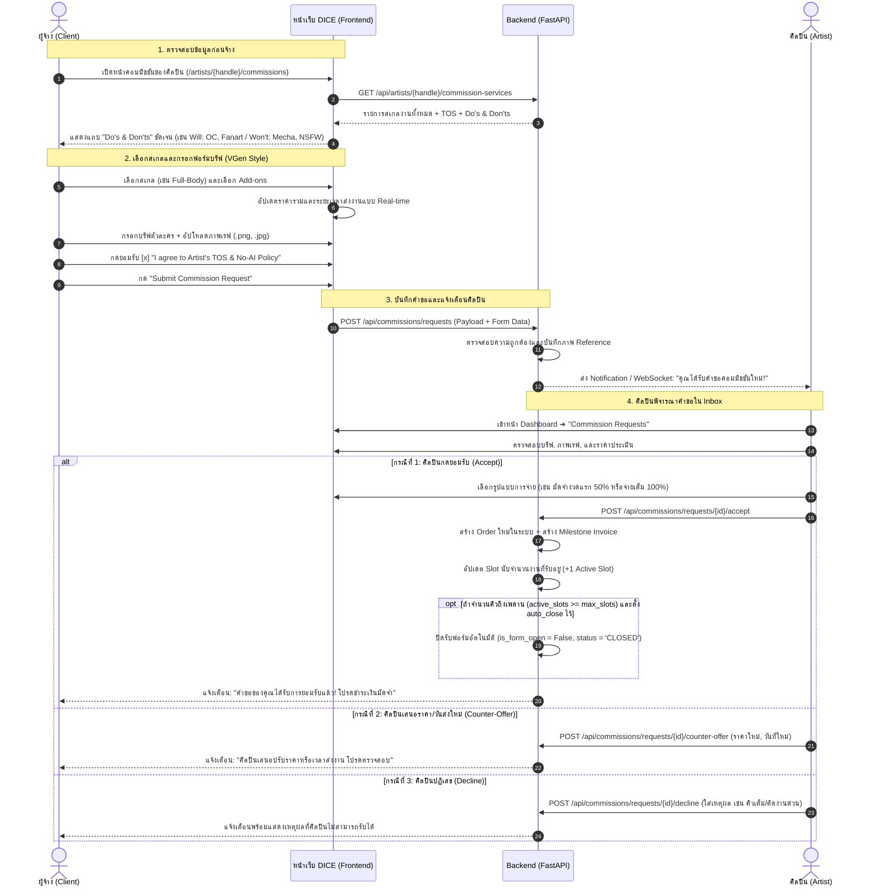
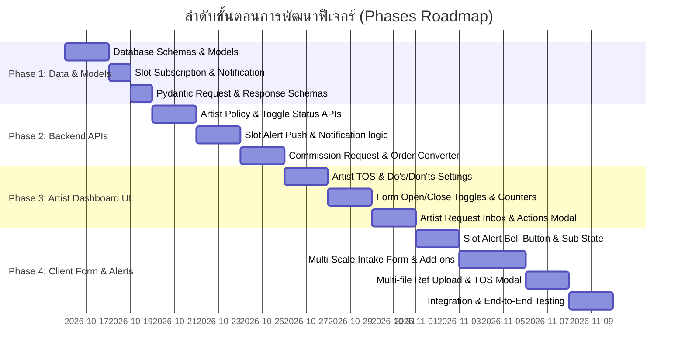

# 🎲 แผนการพัฒนาระบบรับงานคอมมิชชันหลายสเกล (VGen-Style Multi-Scale Commission Form & Intake System)

> **เอกสารข้อกำหนดและการออกแบบระบบ (System Design & Implementation Blueprint)**  
> แพลตฟอร์ม: **DICE (Freelance Art Commission & Live Auction Platform)**  
> วันที่ปรับปรุงล่าสุด: **16 ตุลาคม 2026**  
> สถานะ: **แบบร่างแผนการพัฒนา (Planning & Architecture Specification - v1.2)**

---

## 📋 1. บทนำและเป้าหมายของระบบ (System Goals & Motivation)

### 1.1 ที่มาและปัญหาเดิม
ในระบบเดิมของ DICE การสั่งคอมมิชชันระหว่างผู้จ้าง (Client) และศิลปิน (Artist) เป็นการเปิดฟอร์มเรียบง่ายที่มีเพียงช่องระบุชื่อหัวข้อ (`Title`) และรายละเอียดทั่วไป (`Description`) ซึ่งก่อให้เกิดปัญหา:
* ผู้จ้างไม่ทราบขอบเขตงานและราคาที่แน่นอนก่อนเริ่มคุย
* ศิลปินต้องเสียเวลาสอบถามรายละเอียดซ้ำซ้อน (เช่น ขอเรฟตัวละคร, ขนาดภาพ, ลิขสิทธิ์การนำไปใช้, เดดไลน์)
* ขาดการคัดกรองงานที่ศิลปินไม่ถนัดหรือไม่รับวาด (Do's & Don'ts) ทำให้เกิดการปฏิเสธงานหรือข้อพิพาทในภายหลัง
* ขาดการรับรองข้อตกลงและเงื่อนไขสัญญา (Terms of Service / TOS) อย่างเป็นทางการก่อนเริ่มงาน
* ศิลปินไม่สามารถควบคุมการเปิด-ปิดรับฟอร์มตามความสะดวก และผู้ที่สนใจต้องคอยส่องหน้าโปรไฟล์เองเพราะไม่มีระบบแจ้งเตือนคิวเปิด

### 1.2 วัตถุประสงค์ของการพัฒนาระบบสไตล์ VGen
1. **รองรับบริการหลายสเกล (Multi-Scale Services):** ศิลปินสามารถเปิดรับงานได้หลายประเภท (Headshot, Half-body, Full-body, Chibi, Character Sheet, VTuber Model) โดยมีราคาเริ่มต้น ระยะเวลาทำงาน และโควตาสล็อตแยกจากกัน
2. **ระบบเปิด-ปิดรับฟอร์มตามใจศิลปิน (Artist-Controlled Availability):**
   * ศิลปินสามารถกดสวิตช์ Toggle เปิด/ปิดรับฟอร์มของทั้งสตูดิโอ (Master Switch) หรือเลือกเปิด/ปิดเฉพาะบางสเกลงานได้อิสระ
   * รองรับการตั้งระบบปิดรับอัตโนมัติเมื่อคิวเต็ม (`Auto-close when slots reach max`) หรือตั้งเวลาระบุรอบเปิดรับล่วงหน้า (`Scheduled Opening Countdown`)
3. **ระบบกระดิ่งแจ้งเตือนเมื่อเปิดรับงาน (Slot Opening Notifications):**
   * ผู้ใช้ที่สนใจสามารถกดปุ่มกระดิ่ง 🔔 *"แจ้งเตือนเมื่อเปิดรับงาน (Notify Me When Slots Open)"* บนหน้าโปรไฟล์หรือสเกลงานที่ปิดอยู่
   * เมื่อศิลปินกดเปิดรับฟอร์ม ระบบจะส่งข้อความแจ้งเตือน (In-App Push & WebSocket) ไปยังผู้ติดตามทุกคนทันทีแบบ Real-time พร้อมลิงก์เข้าสู่ฟอร์มสั่งจ้าง
4. **ระบบกำหนดข้อจำกัดงาน (Do's & Don'ts):** ระบุสิ่งที่รับวาด (Will Draw) และไม่รับวาด (Won't Draw) แสดงเป็นป้ายกำกับชัดเจนก่อนเริ่มกรอกฟอร์ม
5. **ระบบเงื่อนไขสัญญาและนโยบาย (Artist Terms of Service):** สัญญาลิขสิทธิ์, นโยบายคืนเงิน, โควตาการแก้งาน และข้อกำหนดห้ามนำไปเทรน AI (No-AI Training Guarantee)
6. **ฟอร์มบรีฟงานมาตรฐาน (Structured Intake Brief):** แนบไฟล์ภาพตัวละครเรฟเฟอเรนซ์, รายละเอียดท่าทาง, อารมณ์, สีหน้า, ขนาดภาพ, และวันส่งงานที่ต้องการ
7. **คำนวณราคาประเมินสด (Real-time Dynamic Pricing):** สรุปราคารวมตามตัวเลือกเสริม (Add-ons) เช่น สิทธิ์เชิงพาณิชย์, เพิ่มตัวละคร, ฉากหลังละเอียด, งานด่วน
8. **กลไกการพิจารณาคำขอ (Request Inbox & Workflow):** ศิลปินมีสิทธิ์ตัดสินใจ ยอมรับ (Accept), ปฏิเสธพร้อมเหตุผล (Decline), หรือยื่นข้อเสนอใหม่ (Counter-Offer) ก่อนที่ระบบจะแปลงข้อมูลเป็นคิวงาน Order จริง

---

## 📐 2. แผนผังการทำงานภาพรวม (Architecture & Workflow Diagram)



---

## 🗄️ 3. การออกแบบฐานข้อมูล (Database Schema Specifications)



### 3.1 รายละเอียดโมเดล SQLModel ใหม่ (Python Definition)

```python
from enum import Enum
from typing import Optional, List
from datetime import datetime
from sqlmodel import SQLModel, Field, Relationship

class ScaleCategory(str, Enum):
    HEADSHOT = "HEADSHOT"
    BUST_UP = "BUST_UP"
    WAIST_UP = "WAIST_UP"
    FULL_BODY = "FULL_BODY"
    CHIBI = "CHIBI"
    CHARACTER_SHEET = "CHARACTER_SHEET"
    VTUBER_MODEL = "VTUBER_MODEL"
    CUSTOM = "CUSTOM"

class SlotStatus(str, Enum):
    OPEN = "OPEN"
    WAITLIST = "WAITLIST"
    CLOSED = "CLOSED"

# เพิ่มประเภท NotificationType
# NotificationType.COMMISSION_SLOT_OPEN = "COMMISSION_SLOT_OPEN"

class CommissionSlotSubscription(SQLModel, table=True):
    id: Optional[int] = Field(default=None, primary_key=True)
    user_id: int = Field(foreign_key="user.id", ondelete="CASCADE", index=True)
    artist_id: int = Field(foreign_key="artistprofile.id", ondelete="CASCADE", index=True)
    service_id: Optional[int] = Field(default=None, foreign_key="commissionservice.id", ondelete="CASCADE", index=True)
    is_active: bool = Field(default=True)
    created_at: datetime = Field(default_factory=datetime.utcnow)
    last_notified_at: Optional[datetime] = None
```

---

## 🔄 4. ขั้นตอนการทำงานแบบโต้ตอบ (Sequence Diagrams)

### 4.1 กระบวนการกดติดตามคิว และการส่งแจ้งเตือนเมื่อศิลปินเปิดรับฟอร์ม (Slot Alerts)



---

### 4.2 กระบวนการกรอกบรีฟและพิจารณาคำขอ (Intake & Order Workflow)



---

## 🎨 5. การออกแบบหน้าจอและประสบการณ์ผู้ใช้ (UI/UX Design)

### 5.1 ฝั่งศิลปิน: การควบคุมเปิด-ปิดรับฟอร์ม (Form Availability Controls)
* **Master Commission Switch:** สวิตช์หลักที่หัว Dashboard เพื่อเปิด/ปิดรับงานทุกประเภทในคลิกเดียว (Open / On Hiatus / Closed)
* **Per-Scale Card Controls:** บนการ์ดสเกลงานแต่ละชิ้น มีแผงควบคุมย่อย:
  * สวิตช์ Toggle `เปิดรับฟอร์ม (Form Open)` vs `ปิดรับชั่วคราว (Form Closed)`
  * ตัวนับ Slot: กำหนด Maximum Slots (เช่น 3 คิว)
  * Checkbox: `[x] ปิดรับฟอร์มอัตโนมัติทันทีที่คิวเต็ม (Auto-close when full)`
  * ช่องระบุวันเวลารอบเปิดรับครั้งต่อไป (Next Opening Countdown Timer) เพื่อให้หน้าเว็บขึ้นเวลานับถอยหลังดึงดูดผู้จ้าง

### 5.2 ฝั่งผู้จ้าง: การกดรับแจ้งเตือน (Slot Alert Subscription)
* **ปุ่มกระดิ่งแจ้งเตือน (Notify Button):**
  * เมื่อสเกลงานขึ้นป้าย `CLOSED` หรือ `WAITLIST` ปุ่ม "Request Commission" จะเปลี่ยนเป็นปุ่ม `🔔 แจ้งเตือนเมื่อคิวเปิด (Notify Me When Open)`
  * เมื่อกดแล้วจะเปลี่ยนสถานะเป็น `✓ เปิดแจ้งเตือนแล้ว (Subscribed)` พร้อมแสดงจำนวนผู้รอคิว (เช่น *"มีผู้รอคิว 15 คน"*)
* **Real-time Alert Banner & In-App Notification:**
  * เมื่อศิลปินเปิดรับ จะมี Pop-up Toast สวยงามโผล่ขึ้นมาทันที พร้อมปุ่มลัด `"ส่งคำขอทันที (Request Now)"`

### 5.3 หน้าฟอร์มบรีฟงานสไตล์ VGen (Commission Intake Modal)
* **Step 1: Scope & Add-ons**
  * สลับเลือกสเกลงานได้ง่าย พร้อมแสดงราคาฐาน
  * Checkbox Add-ons คำนวณราคาแบบ Real-time:
    * `[ ]` เพิ่มตัวละคร (+80%)
    * `[ ]` ฉากหลังระดับละเอียดพิเศษ (+฿1,200)
    * `[ ]` ขอไฟล์ต้นฉบับ .PSD แยกเลเยอร์ (+฿800)
    * `[ ]` สิทธิ์ใช้งานเชิงพาณิชย์ / Commercial License (+100%)
    * `[ ]` ลัดคิวงานด่วนภายใน 5 วัน (+฿1,500)
* **Step 2: Creative Brief & Visual References**
  * กล่อง Drag & Drop อัปโหลดภาพเรฟฟอร์แมนซ์ (Thumbnail Preview พร้อมปุ่มลบ)
  * ฟิลด์บรีฟที่มีตัวอย่างข้อความแนะนำ (Placeholder Guide)
  * ตัวเลือก Canvas Orientation (Square 1:1, Portrait 9:16, Landscape 16:9, Custom)
  * Deadline Picker พร้อมระบบแจ้งเตือนสีเหลืองหากเลือกวันส่งงานสั้นกว่าเกณฑ์มาตรฐานของศิลปิน
* **Step 3: TOS & Summary**
  * Sticky Summary Card ด้านข้าง: แสดงรายการที่เลือก ราคารวม ยอดมัดจำโดยประมาณ
  * กล่องแสดงนโยบาย TOS ของศิลปิน + Do's & Don'ts Card
  * Checkbox บังคับ: `"ข้าพเจ้ายอมรับเงื่อนไขสัญญาของศิลปินและรับทราบว่าผลงานนี้จะไม่ถูกนำไปใช้เทรน AI"`

---

## 🔌 6. รายการ API Endpoints (Backend REST API)

| Method | Endpoint | สิทธิ์เข้าถึง | คำอธิบาย |
| :--- | :--- | :---: | :--- |
| `GET` | `/api/artists/{handle}/commission-services` | Public | ดึงรายการสเกลงานทั้งหมด, สถานะเปิด/ปิดรับฟอร์ม, Do's & Don'ts, และ TOS |
| `POST` | `/api/artists/me/commission-services` | Artist | สร้างสเกลงานใหม่ |
| `PUT` | `/api/artists/me/commission-services/{id}` | Artist | แก้ไขข้อมูลสเกลงานและจำนวนสล็อต |
| `PATCH` | `/api/artists/me/commission-services/{id}/toggle-status` | Artist | สลับสถานะเปิด/ปิดรับฟอร์ม (ถ้าเปิด จะทริกเกอร์ยิงแจ้งเตือนไปยังผู้ติดตาม) |
| `PATCH` | `/api/artists/me/commission-status` | Artist | สลับสถานะภาพรวมของสตูดิโอ (OPEN / WAITLIST / CLOSED) |
| `PUT` | `/api/artists/me/commission-policy` | Artist | บันทึก/แก้ไข TOS, Do's & Don'ts, และนโยบายคืนเงิน |
| `POST` | `/api/commissions/subscriptions` | Client | กดเปิดรับการแจ้งเตือนเมื่อศิลปิน/สเกลเปิดรับคิว |
| `DELETE` | `/api/commissions/subscriptions/{id}` | Client | ยกเลิกการรับแจ้งเตือน |
| `GET` | `/api/commissions/subscriptions/check` | Client | เช็คว่าผู้ใช้ปัจจุบันเปิดรับแจ้งเตือนศิลปินคนนี้ไว้หรือไม่ |
| `POST` | `/api/commissions/requests` | Client | ส่งฟอร์มขอจ้างงานพร้อมอัปโหลดภาพเรฟ |
| `GET` | `/api/commissions/requests/incoming` | Artist | ดูรายการคำขอทั้งหมดที่ส่งมาหาศิลปิน |
| `GET` | `/api/commissions/requests/my-requests` | Client | ดูประวัติคำขอที่ตนเองเคยส่ง |
| `POST` | `/api/commissions/requests/{id}/accept` | Artist | ยอมรับคำขอและสร้างเป็น `Order` พร้อมวาง `MilestoneInvoice` |
| `POST` | `/api/commissions/requests/{id}/decline` | Artist | ปฏิเสธคำขอพร้อมระบุเหตุผล |
| `POST` | `/api/commissions/requests/{id}/counter-offer` | Artist | ส่งข้อเสนอราคา/วันส่งงานใหม่กลับไปให้ผู้จ้าง |

---

## 📅 7. แผนการดำเนินงานพัฒนา (Implementation Roadmap)



---

## 🔒 8. แผนความปลอดภัยและการป้องกันข้อมูล (Security & Integrity)

1. **File Upload Security:**
   * ตรวจสอบ MIME type และ Magic Bytes ของภาพ Reference อนุญาตเฉพาะ `.png`, `.jpg`, `.jpeg`, `.webp`
   * จำกัดขนาดไฟล์ไม่เกิน 10MB ต่อภาพ และไม่เกิน 50MB ต่อหนึ่งคำขอ
   * จัดเก็บในโฟลเดอร์แยก `uploads/references/{request_id}/` และสุ่มชื่อไฟล์แบบ UUID ป้องกัน Path Traversal
2. **Notification Spam Throttling:**
   * ศิลปินที่สลับ Toggle เปิด-ปิดถี่เกินไป จะมีระบบ Cooldown ป้องกันการส่งสแปมแจ้งเตือนซ้ำ (ห้ามส่งแจ้งเตือนสเกลเดิมซ้ำภายใน 30 นาที)
3. **Atomic Slot Integrity:**
   * ตรวจสอบเงื่อนไขคิวเต็มแบบ Atomic Transactions ใน SQLite/PostgreSQL เพื่อป้องกันการแย่งสล็อตเกินจำนวนที่ศิลปินกำหนด (Concurrency-Safe)
